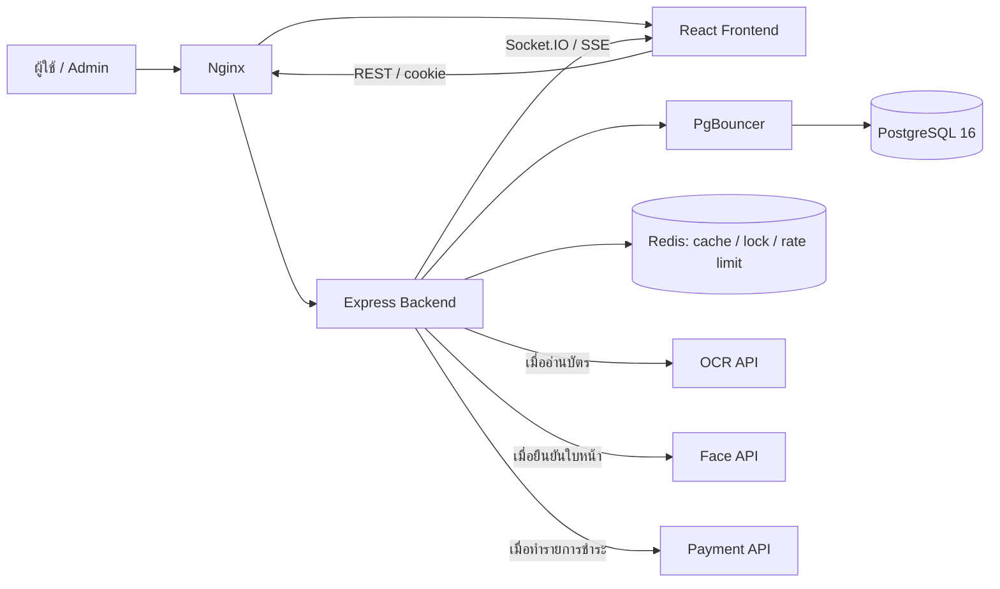

# 02. System Architecture

ปรับตามโค้ดและ Docker Compose วันที่ 8 ต.ค. 2569 เป็น Modular Monolith: Backend หนึ่งแอปแบ่งโมดูลตามงาน โดยมีบริการ OCR, Face Verification และ Payment ภายนอกแยกกัน

PostgreSQL เป็นข้อมูลหลักของผู้พัก บิล งานแจ้งซ่อม และผู้มาติดต่อ Redis ไม่ใช่ฐานข้อมูลหลักของรายการเหล่านี้ การใช้หลายช่องทาง REST/Socket.IO/SSE ไม่ได้แปลว่ามีฐานข้อมูลหลักหลายชุด และแต่ละช่องทางต้องมีการตรวจสิทธิ์ของตนเอง

ภาพและเอกสารอยู่ในพื้นที่อัปโหลดของบริการ ส่วนฐานข้อมูลเก็บการอ้างอิงและข้อมูลกำกับ จึงต้องสำรองทั้งฐานข้อมูลและไฟล์ร่วมกัน การลบใช้คิวถาวรและตรวจผลภายหลัง ไม่ถือว่าลบไฟล์เสร็จเพียงเพราะลบโปรไฟล์สำเร็จ

อ้างอิง: `docker-compose.yml`, `src/app.ts`, `src/realtime/`, `src/modules/face-verification/face-cleanup.service.ts` เอกสารนี้อธิบายโครงสร้าง ไม่รับรองความพร้อมใช้งานของบริการภายนอก
