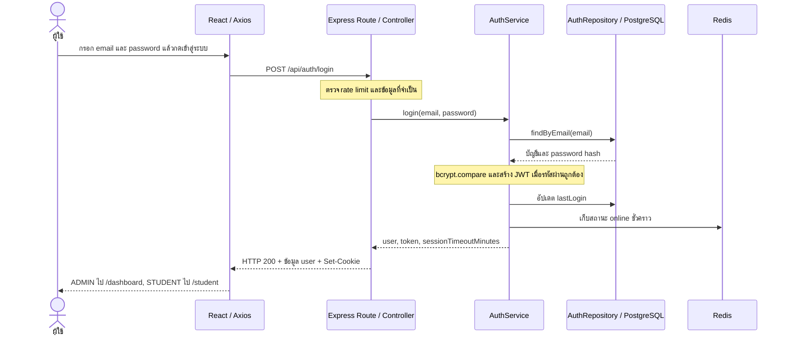

# ตัวอย่างอ่านระบบ: Flow เข้าสู่ระบบ

ตรวจจากโค้ด Backend และ repo `smart-dormitory-frontend` อัปเดต 13 ตุลาคม 2569
เอกสารเพื่อศึกษา ไม่ใช่ API contract ใหม่ ขอบเขตคือ login ด้วยอีเมลและรหัสผ่าน จนเข้าหน้าตามสิทธิ์และเรียก API ต่อได้

## 1. คำอธิบายสำหรับพรีเซนประมาณ 30 วินาที

“ผู้ใช้กรอกอีเมลและรหัสผ่านในหน้าเว็บ React แล้วส่งคำขอผ่าน Axios ไปยัง Express API ระบบจำกัดการลองเข้าสู่ระบบ ตรวจข้อมูลบัญชีใน PostgreSQL ผ่าน Prisma และใช้ bcrypt เปรียบเทียบรหัสผ่านกับ hash ที่เก็บไว้ เมื่อถูกต้องจะสร้าง JWT และส่งให้เบราว์เซอร์เก็บใน HttpOnly cookie จากนั้นหน้าบ้านเก็บข้อมูลผู้ใช้สำหรับแสดงผล และพาไปหน้าผู้ดูแลหรือนักศึกษาตาม role การเรียก API ที่ต้องมีสิทธิ์จะตรวจ JWT และ role ที่ Backend อีกครั้ง”

## 2. ภาพรวม Flow



ภาพนี้แสดงเส้นทางสำเร็จ ส่วน rate limit ใช้ Redis เมื่อกำหนดให้ใช้ Redis; โค้ดยังรองรับ MemoryStore ในบางโหมดด้วย

## 3. เปิดอ่านโค้ดตามลำดับนี้

ลิงก์ Frontend อ้างถึง repo ข้างเคียงในโครงสร้างเครื่องนี้

| ขั้น | เกิดอะไรขึ้น | โค้ดที่ควรเปิด |
|---|---|---|
| 1 | ฟอร์มบังคับกรอก email/password; `handleLogin` ตั้ง loading และส่งข้อมูล ปุ่มถูก disable ระหว่างรอ | [LoginPage.tsx](../../../smart-dormitory-frontend/src/modules/auth/pages/LoginPage.tsx), ค้น `handleLogin` |
| 2 | Axios ใช้ URL กลางและ `withCredentials: true` เพื่อให้ browser จัดการ cookie ในคำขอที่เงื่อนไข cookie/CORS อนุญาต | [api.ts](../../../smart-dormitory-frontend/src/services/api.ts), [api-url.js](../../../smart-dormitory-frontend/src/services/api-url.js) |
| 3 | Express ผูก prefix `/api/auth`; `/login` ผ่าน `loginLimiter` ก่อนเข้า Controller | [app.ts](../../src/app.ts), [auth.routes.ts](../../src/modules/auth/auth.routes.ts) |
| 4 | Controller แปลง DTO และตรวจชนิด/รูปแบบ email/password ก่อนเรียก Service | [auth.controller.ts](../../src/modules/auth/auth.controller.ts), ค้น `static async login` |
| 5 | Repository ใช้ `prisma.user.findUnique` ค้นบัญชีด้วย email และอ่าน password hash | [auth.repository.ts](../../src/modules/auth/auth.repository.ts), ค้น `findByEmail` |
| 6 | Service ใช้ `bcrypt.compare`; ถ้าบัญชีไม่พบหรือรหัสผ่านผิดจะส่ง error 401 | [auth.service.ts](../../src/modules/auth/auth.service.ts), ค้น `static async login` |
| 7 | สร้าง JWT ที่มี `id`, `role` และ `sessionVersion`; อายุอ่านจาก setting `sessionTimeoutMinutes` หากแปลงเป็นตัวเลขแล้วไม่มีค่าที่ใช้ได้จะใช้ 30 นาที | [auth.service.ts](../../src/modules/auth/auth.service.ts), ค้น `jwt.sign` |
| 8 | อัปเดต `lastLogin` ในฐานข้อมูล และเรียก `markUserOnline` เพื่อบันทึกสถานะชั่วคราวใน Redis | [auth.service.ts](../../src/modules/auth/auth.service.ts), [presence.ts](../../src/shared/presence.ts) |
| 9 | Controller ตั้ง cookie `access_token`, ส่งข้อมูลผู้ใช้ และแจ้งสถานะ online ผ่าน gateway | [auth.controller.ts](../../src/modules/auth/auth.controller.ts) |
| 10 | `login(user)` เก็บ user ใน React state และ localStorage; หน้า login เปลี่ยนหน้าไปตาม role | [AuthContext.tsx](../../../smart-dormitory-frontend/src/contexts/AuthContext.tsx), [LoginPage.tsx](../../../smart-dormitory-frontend/src/modules/auth/pages/LoginPage.tsx) |
| 11 | การเรียก protected API ครั้งต่อไปผ่าน `verifyToken`; route ที่จำกัด role ใช้ `requireRole` เพิ่ม | [auth-jwt.ts](../../src/middlewares/auth-jwt.ts) |

URL กลางอ่าน `VITE_API_URL` ก่อน หากไม่ได้ตั้งจะใช้ `http://localhost:3000/api` จึงไม่ควรจำว่า URL ทุกเครื่องเหมือนกัน

## 4. ข้อมูลที่ส่งและได้รับ

ตัวอย่างสมมติของ request เพื่อแสดงรูปแบบ ไม่ใช่บัญชีจริง:

```http
POST /api/auth/login
Content-Type: application/json
```

```json
{ "email": "student@example.com", "password": "example-password" }
```

เมื่อสำเร็จ HTTP status คือ 200 และ body มี `statusCode`, `success`, `message`, `data.user` โดย user มี `id`, `email`, `username`, `role`, `lastLogin`, `isOnline`

**JWT ไม่ถูกส่งใน JSON ของ login ปัจจุบัน**: Service คืน token ให้ Controller ภายใน Backend แล้ว Controller ส่งผ่าน `Set-Cookie` ชื่อ `access_token` โดยตั้ง `httpOnly: true`, `sameSite: 'lax'`, `path: '/'`, อายุเท่ากับ session และ `secure: true` เมื่อ `NODE_ENV === 'production'`

ข้อมูล user ใน localStorage ใช้ประกอบ UI ส่วนตัวแปร `token` ใน AuthContext มีค่า marker `'cookie'` ไม่ใช่ JWT จริง การอนุญาตให้เข้าถึง API อยู่ที่ Backend ผู้ใช้แก้ localStorage เองไม่ได้ทำให้ JWT มีสิทธิ์เพิ่ม

## 5. แต่ละเทคโนโลยีทำหน้าที่อะไรใน Flow นี้

| เทคโนโลยี | หน้าที่ |
|---|---|
| React | ฟอร์ม, loading, error และสถานะผู้ใช้ |
| React Router | เปลี่ยนหน้าเป็น `/dashboard` หรือ `/student` |
| Axios | ส่ง HTTP request และจัดการ response/error ผ่าน config กลาง |
| Express + TypeScript | รับคำขอ แยก route/controller/service และตรวจสิทธิ์ |
| Prisma + PostgreSQL | อ่านบัญชีและบันทึกเวลา login |
| bcrypt | ตรวจรหัสผ่านกับ hash โดยไม่ต้องถอด hash กลับเป็นรหัสผ่าน |
| JWT + HttpOnly cookie | JWT เป็นหลักฐานยืนยันตัวตนที่มีลายเซ็น; cookie เป็นช่องทางให้ browser เก็บและส่งกลับ |
| Redis | เก็บสถานะ online ชั่วคราวและตัวนับ rate limit เมื่อเลือก Redis store |
| Socket.IO gateway | ส่งการเปลี่ยนสถานะ online ไปยัง client ที่เชื่อมต่อ |

## 6. ถ้าไม่สำเร็จจะเป็นอย่างไร

| กรณี | พฤติกรรมที่พบในโค้ด |
|---|---|
| body ไม่ใช่ object, email ผิดชนิด/รูปแบบ หรือ password ผิดชนิด/ว่าง | Controller ตอบ 400 ก่อนเรียก Service |
| ไม่พบบัญชีหรือรหัสผ่านผิด | Service ส่ง 401 ด้วยข้อความเดียวกัน: “อีเมลหรือรหัสผ่านไม่ถูกต้อง” |
| ลอง login เกิน rate limit | ตอบ 429; ค่าเริ่มต้น 5 ครั้งที่ไม่สำเร็จต่อบัญชีในช่วง 5 นาที ปรับด้วย `LOGIN_RATE_LIMIT_MAX`; login สำเร็จไม่ถูกนับ |
| ไม่มี JWT หรือ JWT ไม่ถูกต้อง/หมดอายุใน protected API | ตอบ 401; Axios ล้าง user ที่เก็บไว้และส่ง event `auth:expired` ให้ AuthContext เคลียร์ state |
| JWT ถูกต้อง แต่ role ไม่ผ่าน route ที่จำกัดสิทธิ์ | ตอบ 403 |
| เชื่อมต่อไม่ได้ | หน้า login แสดงข้อความ fallback จาก `getErrorMessage` |
| การเก็บ presence ใน Redis ล้มเหลว | `markUserOnline` จับ error และเขียน warning จึงไม่ล้ม login จากขั้นตอนนี้เพียงอย่างเดียว |

rate limit ใช้ hash ของ email ที่ trim และแปลงเป็นตัวพิมพ์เล็กเป็น key; ถ้าไม่มี email ใช้ IP ส่วนการค้นบัญชีใน Repository ใช้ email ที่รับมาจริง ไม่ได้ normalize ในฟังก์ชันนั้น

## 7. จุดที่ต้องรู้ก่อนตอบกรรมการ

- **ทำไมต้องแยก Controller / Service / Repository?** Controller จัดการ HTTP, Service ตรวจรหัสผ่านและสร้าง session, Repository ติดต่อฐานข้อมูล จึงตามหาและแก้แต่ละหน้าที่ได้ชัดเจน
- **JWT กับ bcrypt ต่างกันอย่างไร?** bcrypt ใช้ตรวจรหัสผ่านในขั้น login ส่วน JWT ใช้ยืนยันตัวตนในคำขอต่อ ๆ ไป
- **ทำไมต้องตรวจ role ที่ Backend อีกครั้ง?** การเปลี่ยนหน้าหรือซ่อนปุ่มใน Frontend ไม่ได้ป้องกันคนเรียก API โดยตรง
- **Redis เก็บบัญชีหรือไม่?** ใน flow นี้บัญชีและ `lastLogin` อยู่ใน PostgreSQL; Redis เก็บสถานะชั่วคราวและ rate limit
- **รีเฟรชหน้าแล้วยังเห็นผู้ใช้ แปลว่า session ยังใช้ได้แน่นอนหรือไม่?** ไม่แน่นอน AuthContext โหลด user จาก localStorage โดยยังไม่ได้ยืนยัน session ในขั้นเริ่มต้น ต้องให้ protected API ตรวจ cookie/JWT; ถ้าได้ 401 จะเคลียร์สถานะ

## 8. มาตรฐานเอกสารและโค้ดหลังปรับให้ตรงกัน

1. Login คืน `data.user` ใน JSON และส่ง JWT ผ่าน HttpOnly `access_token` cookie เท่านั้น; ไม่คืน token ใน body โดยปรับ API contract ให้ตรงกับการทำงานนี้
2. `createResponse` คืน `{ statusCode, success, message, data }` เสมอ: `success` เป็น true สำหรับ 2xx และข้อมูลที่ไม่มีใช้ `data: null` เพื่อไม่หายตอนแปลงเป็น JSON Auth limiters ใช้ wrapper เดียวกันสำหรับ 429
3. Controller ตรวจว่า body เป็น object ก่อนแปลงเป็น `LoginRequestDto` ด้วย `plainToInstance` จาก class-transformer แล้วตรวจ string/email และ string/password ที่ไม่ว่างด้วย class-validator ก่อนส่งให้ Service ไม่แปลงตัวเลขเป็น string และไม่ trim รหัสผ่าน การตรวจนี้ใช้ฟังก์ชันของ library ไม่ได้ใช้ decorator หรือ middleware `validateDto` ของโมดูลอื่น

ขอบเขตงานนี้คือ login และ wrapper/limiters ที่เกี่ยวข้อง ไม่ได้ยืนยันว่า validation ของทุกโมดูลครบแล้ว

## 9. วิธีใช้ไฟล์นี้ทบทวน

1. อ่านคำอธิบาย 30 วินาที แล้วลองเล่าโดยไม่มองข้อความ
2. เปิด `handleLogin`, `AuthController.login`, `AuthService.login`, `findByEmail` ตามลำดับ และชี้หน้าที่ของแต่ละฟังก์ชัน
3. ลองตอบ: รหัสผ่านผิดถูกตรวจตรงไหน? JWT เก็บที่ไหน? เปลี่ยน role ใน localStorage จะเข้าถึง API ของ ADMIN ได้หรือไม่ เพราะอะไร?
4. ในสภาพแวดล้อมทดสอบ ลอง login และดู Network: request payload, status, response และ cookie โดยไม่เผยแพร่รหัสผ่านหรือ token ในภาพพรีเซน

## 10. ขอบเขตการยืนยันเดิม (6 ต.ค. 2569)

ตรวจ source code, API contract และ config ที่เกี่ยวข้อง โดยไม่บันทึกรหัสผ่านหรือ token ในเอกสาร ทดสอบ local ผ่าน Chrome ที่ `http://127.0.0.1:5174` หลัง rebuild Backend ที่ปรับ wrapper/validation แล้ว: login ตอบ 200, browser รับ HttpOnly cookie โดยไม่มีเหตุผลบล็อก, body ไม่มี token และมี `success: true`, `/api/auth/me` ตอบ 200 ด้วย cookie และหลัง logout ตอบ 401 การส่ง email เป็นตัวเลขตอบ 400 พร้อม `success: false, data: null`; health ตอบ 200 และเชื่อมฐานข้อมูลได้ ผลนี้ไม่รับรองการตั้งค่า cookie/CORS ของ deployment ภายนอก

Regression tests สำหรับการปรับครั้งนี้อยู่ใน `tests/unit/auth-contract.test.ts`; tests เดิมใน `tests/unit/auth-jwt.test.ts` ตรวจ JWT และ role โดยไม่จำเป็นต้องเปลี่ยนฐานข้อมูลหรือ password จริง

ผลตรวจโค้ดชุดนี้: `npm run build` และ ESLint สำหรับไฟล์ที่แก้ผ่าน ชุด Auth/response รวม error-response integration ผ่านทั้งหมด; `npm run test` ผ่าน 109 จาก 113 รายการ ข้อผิดพลาดที่เหลืออยู่ใน housing OCR flow เนื่องจาก credentials ของฐานข้อมูลทดสอบไม่ถูกต้อง ส่วน `npm run test:typecheck` ยังพบ `contactNumber` ใน `tests/integration/housing-payment.test.ts:276` ซึ่งไม่อยู่ใน type ของ personal information ปัจจุบัน จึงยังไม่รับรองชุดทดสอบทั้งระบบว่าเขียวทั้งหมด และไม่ได้แก้ข้อมูล/credentials ฐานข้อมูลเพื่อให้ผลทดสอบผ่าน


## 11. Flow ปัจจุบัน (13 ต.ค. 2569)

หลังตรวจ JWT Middleware เรียก AuthService.authenticateToken อ่านบัญชี/role/authSessionVersion จาก PostgreSQL ทั้ง REST และ Socket handshake; ไม่รับ token ผ่าน URL. logout เพิ่ม authSessionVersion จึงทำให้ copied cookie เดิมตอบ 401 ด้วย ไม่ใช่แค่ clearCookie. การเปลี่ยนรหัสผ่านและ role ยกเลิกทุก session; User.version สำหรับแก้ข้อมูลไม่ทำให้ cookie หมดสิทธิ์. ต้อง migrate field authSessionVersion ก่อน deploy; token รุ่นเก่าต้องเข้าสู่ระบบใหม่

Register มี DTO type/email/mobile/password/username validation ก่อน hashing และจำกัด 10 attempts/IP/hour โดย default. 2FA ยังไม่รองรับ จึงเปิดใช้งานไม่ได้; SMS/provider จริง Out of scope. lastLogin ยังนับเฉพาะ login สำเร็จสำหรับ retention ไม่ใช่ heartbeat/Socket

ผล Chrome และตัวเลข tests ในข้อ 10 เป็นหลักฐานของวันที่เดิมเท่านั้น ผลปัจจุบันให้ยึด `.docs/qa/system-flow-report.md` ส่วนแก้ flow 13 ต.ค.; HTTP/DB integration ตรวจ cookie replay หลัง logout และ data OCC แยกจาก session แล้ว ส่วนการกด browser ด้วยบัญชี ACTIVE ยังต้องยืนยันแยก
