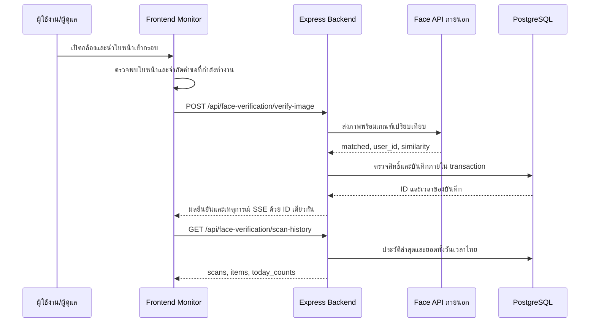

# ระบบสแกนใบหน้าเข้า–ออก: เอกสารประกอบเล่ม 5 บท

วันที่จัดทำ: 2026-10-03 | สถานะ: คำอธิบายจากโค้ดและผล regression tests; ยังไม่ใช่ผลทดลองความแม่นยำกับผู้เข้าร่วมจริง

เอกสารนี้รวบรวมเฉพาะส่วนสแกนใบหน้าเพื่อใช้เขียนเล่มของระบบหอพัก ผู้จัดทำต้องปรับรูปแบบตามข้อกำหนดสถาบัน และเติมข้อมูลผู้เข้าร่วม อุปกรณ์ เวอร์ชันที่ใช้งาน และผลทดลองจริงก่อนส่งเล่ม
นโยบาย Frontend ปัจจุบันคือเก็บฟีเจอร์ไว้และแก้บั๊กเท่านั้น การเพิ่มความสามารถใหม่ต้องได้รับอนุมัติ

## บทที่ 1 บทนำ

### ปัญหาและความเป็นมา

ระบบมีหน้าจอ Monitor แสดงกล้อง ผลเปรียบเทียบใบหน้า ประวัติการสแกน และยอดเข้า–ออกประจำวัน การแสดงข้อมูลซ้ำหรือข้อความแจ้งเตือนผิดทำให้ผู้ดูแลตีความสถานะผิดได้
อาการที่ตรวจพบจากโค้ดคือเหตุการณ์สดและประวัติจากฐานข้อมูลใช้ ID ต่างกันสำหรับการสแกนเดียวกัน และการนับจากรายการล่าสุดไม่ครอบคลุมทั้งวัน
ตัวสร้างแจ้งเตือนเดิมยังค้นหาคำว่า `close` ขณะที่คำสั่งปิดประตูส่ง `lock` จึงแจ้งว่าเปิดผิด

### วัตถุประสงค์

1. แสดงผลยืนยันใบหน้าผ่านบริการที่ระบบมีอยู่ พร้อมตรวจสิทธิ์เข้าถึงจาก Backend
2. บันทึกการสแกนที่ยอมรับลง PostgreSQL และแสดงกิจกรรมหนึ่งครั้งเป็นหนึ่งบันทึก
3. แสดงยอดเข้า–ออกทั้งวันตามเวลาไทยโดยแยกกิจกรรมประตูจำลอง
4. อธิบายคะแนนความคล้ายและประเมินผลจากชุดทดลองที่ตรวจสอบย้อนกลับได้

### ขอบเขต

- Frontend รับภาพกล้องและแสดงผล; Express เป็นตัวกลางไปยังบริการ Face Recognition ภายนอก
- งานสแกนเข้า–ออก (`IN`/`OUT`) เป็นคนละกิจกรรมกับเปิด–ปิดประตูจำลอง
- หน้ากล้อง Monitor ปัจจุบันไม่ส่ง `direction` จึงใช้ `IN` ตามค่าเริ่มต้นของ Backend; ช่องทางที่ส่ง `OUT` ต้องมีการยืนยันใบหน้าจริงก่อนบันทึก
- การกดปิดประตูหรือปิดกล้องไม่ใช่การสแกนออก และไม่เพิ่ม Check-out
- ประตู Monitor เป็นการจำลองในแอป ไม่มีหลักฐานว่าคำสั่งนี้ควบคุมฮาร์ดแวร์ประตูจริง
- ยังไม่รับรองการตรวจความมีชีวิต (liveness), ป้องกันภาพถ่าย/วิดีโอปลอม, ความแม่นยำภาคสนาม หรือการทำงานกล้องออฟไลน์

## บทที่ 2 แนวคิดและงานที่เกี่ยวข้อง

### การตรวจจับและการระบุตัวบุคคล

การตรวจจับใบหน้าเป็นการหาตำแหน่งใบหน้าในภาพ; การเปรียบเทียบใบหน้าเป็นการเปรียบเทียบคุณลักษณะกับข้อมูลที่ลงทะเบียนแล้ว
Monitor ใช้ BlazeFace ฝั่งเบราว์เซอร์สำหรับกรอบใบหน้าและช่วยเลือกจังหวะส่งภาพ ไม่ได้ใช้กรอบนั้นตัดสินสิทธิ์เข้าหอพัก
งานวิจัย [BlazeFace](https://arxiv.org/abs/1907.05047) อธิบายโมเดลตรวจจับใบหน้าสำหรับอุปกรณ์เคลื่อนที่

บริการ Python มีเส้นทาง InsightFace สำหรับตรวจจับและสร้าง embedding และมีเส้นทางจำลองเมื่อโมเดลไม่พร้อม
Embedding คือเวกเตอร์ตัวเลขแทนคุณลักษณะของภาพ ใช้เปรียบเทียบกับเวกเตอร์ที่ลงทะเบียนไว้
[ArcFace](https://arxiv.org/abs/1801.07698) เป็นงานวิจัยเกี่ยวกับการเรียนรู้คุณลักษณะสำหรับการจดจำใบหน้า; การมีเส้นทางนี้ในโค้ดไม่ได้ยืนยันว่าโมเดลจริงโหลดสำเร็จใน runtime ต้องเก็บหลักฐานเพิ่มเติม

### คะแนนความคล้ายและเปอร์เซ็นต์

`Face_Recognition/app/services/search_service.py` มี cosine similarity ระหว่างเวกเตอร์ a และ b:

```text
s = (a · b) / (||a|| × ||b||)
ค่าที่แสดงบน Monitor = similarity จาก API × 100
```

Cosine similarity โดยคณิตศาสตร์อยู่ในช่วง -1 ถึง 1; API และ Backend ใช้คะแนนที่เข้าเงื่อนไข 0–1 สำหรับการยอมรับ
หน้า Monitor ใช้ `toFixed(0)` จึงปัดเปอร์เซ็นต์เป็นจำนวนเต็ม เช่น similarity 0.7342 แสดง 73% ทั้งที่การตัดสินใช้ค่าดิบ
คะแนนนี้ไม่ใช่ความน่าจะเป็นที่บุคคลถูกต้อง และไม่ใช่ accuracy ของระบบ ตัวอย่างดังกล่าวเป็นตัวอย่างวิธีคำนวณ ไม่ใช่ผลทดลอง

### เกณฑ์การยอมรับและการตรวจสิทธิ์

- ค่าเริ่มต้นที่ Controller ใช้คือ `DEFAULT_SIMILARITY_THRESHOLD = 0.68`
- ต้องผ่าน `matched` ของบริการภายนอก มี similarity ที่เป็นตัวเลขจำกัดและผ่านเกณฑ์ และมี owner ID ที่ถูกต้อง
- ต้องตรวจสิทธิ์ใน PostgreSQL อีกชั้น ผู้พักต้องมีสัญญา/สถานะและช่วงวันที่เข้าใช้งานที่อนุญาต และไม่ถูกถอนสิทธิ์ใบหน้า; ADMIN ใช้นโยบายสิทธิ์ของ ADMIN
- ผู้มาติดต่อมี biometric flow เดิมแยกจาก reception flow; reception ไม่เปลี่ยนเป็น CHECKED_IN เมื่อ Admin เปิดประตูจำลอง
- มีการรับ threshold ผ่านบางช่องทางและค่าตั้งของบริการภายนอก จึงต้องบันทึก threshold ที่ใช้จริงในแต่ละการทดลอง อย่าสรุปว่าทุก client ใช้ 0.68 เสมอ
- เกณฑ์นี้เป็นค่าตั้งในโค้ด ยังไม่ได้พิสูจน์ว่าเหมาะสมที่สุดจากผลทดลองของโปรเจกต์

### ค่าประเมินที่ต้องแยกจากคะแนนบนจอ

ระบบค้นหาในชุดบุคคลที่ลงทะเบียนเป็นลักษณะ 1:N แม้ endpoint จะใช้ชื่อ verify จึงควรประเมินว่าค้นหาได้ตัวตนถูกต้องหรือไม่ และแยกการปฏิเสธจากสิทธิ์ออกจากความผิดพลาดของโมเดล
สำหรับการทดลองเปรียบเทียบคู่ภาพ 1:1 ใช้ FMR/FNMR; สำหรับการค้นหา 1:N ใช้ FPIR/FNIR และจำนวนตัวตนในชุดค้นหา อย่าใช้สองประเภทแทนกันโดยไม่ระบุวิธีทดลอง
[NIST 1:1 Verification](https://pages.nist.gov/frvt/html/frvt11.html) และ [NIST 1:N Identification](https://pages.nist.gov/frvt/html/frvt1N.html) เป็นแหล่งอ้างอิงการแยกประเภทการประเมิน

## บทที่ 3 วิธีดำเนินงานและออกแบบระบบ

### ลำดับการทำงาน



### ค่าควบคุมการสแกนที่พบในโค้ด

| ค่า | ค่าปัจจุบัน | ความหมาย |
| --- | --- | --- |
| DETECT_INTERVAL_MS | 120 ms | ช่วงเวลาระหว่างการตรวจใบหน้าฝั่งเบราว์เซอร์ |
| VERIFY_INTERVAL_MS | 800 ms | ระยะขั้นต่ำระหว่างความพยายามส่งภาพ ไม่ใช่เวลาตอบสนองจริง |
| COOLDOWN_MS | 3500 ms | ช่วงพักฝั่งหน้าจอหลังได้รับผล |
| MATCH_HOLD_MS | 2500 ms | ระยะค้างแถบผลบนหน้าจอ |
| Backend cooldown | 5000 ms | ลดการบันทึกซ้ำจากการสแกนถี่; ใช้ Redis และมี fallback ในหน่วยความจำ |
| Face API timeout | 4000 ms | ขีดจำกัดคำขอไปบริการเปรียบเทียบ |
| MAX_HISTORY_ITEMS | 30 | จำนวนกิจกรรมล่าสุดที่แสดง ไม่ใช่จำนวนกิจกรรมสูงสุดต่อวัน |
| ประตูจำลอง | 5 วินาที | ระยะก่อนปิดอัตโนมัติเมื่อสั่งเปิด |

### การแก้ความสอดคล้องของข้อมูล

- ID ของผู้พัก/ADMIN ใช้ `db-<AccessLog.id>` ทั้งเหตุการณ์สดและประวัติ
- biometric visitor flow เดิมใช้ `visitor-db-<VisitorLog.id>` เพื่อไม่ชนกับ AccessLog
- เวลาที่แสดงใช้เวลาบันทึกของเซิร์ฟเวอร์ ไม่ใช้เวลาที่ client ส่งมาเป็นแหล่งข้อมูลหลัก
- ประวัติอ่านจากฐานข้อมูล จึงไม่รวม telemetry ที่ไม่เคยบันทึกเป็นการสแกนจริง
- จำนวน IN/OUT นับทั้งวันจากฐานข้อมูล แยกจาก take 30 และไม่รวม `MONITOR_DOOR`
- ช่วงวันเป็น `[00:00 ของวันไทย, 00:00 ของวันถัดไป)` เช่น วันที่ 3 ตุลาคม 2026 เท่ากับ `[2026-10-02T17:00:00Z, 2026-10-03T17:00:00Z)`
- ประวัติและยอดอ่านใน transaction ระดับ RepeatableRead เพื่อใช้ snapshot เดียวกัน
- หน้า Monitor รับเหตุการณ์สดเพื่ออัปเดตรายการ และขอประวัติ/ยอดจาก Backend หลังเหตุการณ์ โดยรวมคำขอที่เกิดใกล้กันในช่วง 150 ms
- การแจ้งเตือนรับ `faceGateActivity` ผ่าน Socket หลังบันทึกกิจกรรมสำเร็จ โดยใช้ `activity_type`, `direction` และ `door_trigger` แยกสแกนเข้า/ออก เปิด/ปิดด้วยมือ และปิดอัตโนมัติ ไม่สร้าง toast สำเร็จซ้ำจาก response ของคำสั่งประตู
- สีแจ้งเตือนและป้ายประวัติ: สแกนเข้า/เปิดประตูเป็นสีเขียว สแกนออก/ปิดประตูเป็นสีแดง การออกตามปกติใช้ tone `exit` แยกจาก error
- SSE ใช้ `withCredentials: true` สำหรับ cookie authentication และไม่ส่งค่า token ตัวแทน `cookie` ใน query string

### ข้อมูล API ที่หน้าจอใช้

| Endpoint/เหตุการณ์ | หน้าที่ | ข้อจำกัด |
| --- | --- | --- |
| POST /api/face-verification/verify-image | เปรียบเทียบภาพ ตรวจสิทธิ์ บันทึกเมื่อผ่าน | ผล matched ต้องผ่านการตรวจสิทธิ์ก่อนถือว่าเข้าใช้งานได้ |
| POST /api/face-verification/scan | รับ IN/OUT จากอุปกรณ์และบันทึก | ต้องผ่านสิทธิ์/การตรวจ token ของ route; ไม่ใช่ API สาธารณะ |
| GET /api/face-verification/events | ส่งเหตุการณ์ SSE | Monitor ใช้สิทธิ์ ADMIN; มี cleanup เมื่อออกจากหน้า |
| GET /api/face-verification/scan-history | scans/items ล่าสุด และ today_counts | ยอดวันไทย; response เพิ่ม timezone, day_start, day_end |
| POST /api/face-verification/door-command | unlock/lock ประตูจำลอง | ADMIN; ไม่สร้าง Check-in/Check-out |

`today_counts` มี `{ in, out, total }` ซึ่ง total เท่ากับ in + out; จำนวนแถวประวัติอาจต่างจาก total เพราะมีรายการประตูและจำกัด 30 แถว

### การออกแบบการทดลองจริง

1. ระบุเวอร์ชันทั้งสาม repo, image, โมเดล, threshold, ขนาด gallery, กล้อง, CPU/GPU, แสง และเครือข่าย
2. ยืนยันว่าบริการ Python โหลดโมเดลจริง ไม่ใช่ SimulatedDetector/SimulatedEmbedder
3. ใช้ผู้เข้าร่วมที่ยินยอม แยกภาพลงทะเบียนจากภาพทดสอบ ใช้รหัสผู้เข้าร่วมแทนชื่อหรือเลขบัตรประชาชน
4. กำหนดจำนวนคน จำนวนครั้ง และเงื่อนไขก่อนเริ่มเก็บข้อมูล; หากปรับ threshold ให้ใช้ชุดพัฒนาแยกจากชุดทดสอบสุดท้าย
5. ทดสอบคนที่ลงทะเบียน คนที่ไม่อยู่ใน gallery มุมหน้า แสง อุปกรณ์ และกรณีบริการขัดข้อง โดยคงจำนวนครั้งให้เปรียบเทียบได้
6. เก็บตัวตนจริง ตัวตนที่ระบบคืน คะแนน เกณฑ์ matched ผลตรวจสิทธิ์ ทิศทาง ID บันทึก และเวลาตอบสนอง แยกเหตุการณ์ประตูออก
7. เก็บหลายช่วงเวลา/หลาย session ต่อบุคคล เพื่อไม่ให้ผลดีจากภาพซ้ำหรือการทดสอบคนเดียว
8. ตรวจข้อมูลคำขอซ้ำและ cooldown ก่อนคำนวณจำนวนความพยายาม; กำหนดหนึ่ง trial ให้ชัดและไม่ถือเฟรมกล้องต่อเนื่องทุกเฟรมเป็น trial อิสระ

## บทที่ 4 ผลการดำเนินงานและการประเมิน

### หลักฐานที่มีในรอบแก้ไขนี้

| ตรวจสอบ | ผล/สถานะ |
| --- | --- |
| Backend unit/integration ที่ใช้ mock | 76/76 ผ่าน รวมการบันทึกและส่งเหตุการณ์ปิดอัตโนมัติ และการยกเลิก timer เมื่อปิดด้วยมือ |
| Frontend tests | 17/17 ผ่าน รวมชื่อและ tone ของ Socket สำหรับสแกนเข้า/ออก เปิด ปิดด้วยมือ ปิดอัตโนมัติ และไม่สร้าง toast ซ้ำจาก response ประตู |
| ID ของบันทึกสแกน | ทดสอบการคืน db-1 และ visitor-db-1 และไม่คืน ID ใหม่เมื่อ cooldown |
| ยอดเกินหน้าประวัติ | fixture 58 กิจกรรม แสดง 30 รายการ ยอดเข้า 45 ออก 13 |
| ขอบเขตวัน | fixture ที่เที่ยงคืนไทยตรวจ gte/lt ของวันถูกต้อง |
| ประตูจำลอง | fixture ประตูปิดหนึ่งรายการไม่เพิ่มยอดเข้า/ออก |
| ความแม่นยำกับใบหน้าจริง | ยังไม่ได้เก็บผลทดลอง |
| Build และ lint | Backend/Frontend ผ่าน; Backend test:typecheck ผ่าน |
| Runtime อ่าน PostgreSQL | service ใน container อ่านได้: 20 กิจกรรม, ID ไม่ซ้ำ, เรียงเวลาถูกต้อง; ยอด IN 14 / OUT 0 / total 14 ณ เวลาตรวจ |
| Health API | HTTP 200 หลังเปลี่ยน container Backend เป็น image ล่าสุด |
| Authenticated HTTP/เบราว์เซอร์ | ยังไม่ยืนยัน: cookie เดิมไม่มี access_token ของ localhost ที่ใช้ได้ ต้องล็อกอินใหม่และทดลองหน้าจอ |

จำนวน fixture และเปอร์เซ็นต์ตัวอย่างไม่ใช่ผลความแม่นยำภาคสนาม ผลทดสอบข้างต้นยืนยันพฤติกรรมโค้ดตามเงื่อนไขจำลอง

### นิยามและสูตรผลประเมิน

สำหรับชุดทดลองเปรียบเทียบคู่ภาพที่กำหนดตัวตนเป้าหมายไว้ (1:1):

| ค่า | นิยาม |
| --- | --- |
| TP | คู่ภาพคนเดียวกันที่ยอมรับถูก |
| FN | คู่ภาพคนเดียวกันที่ปฏิเสธผิด |
| TN | คู่ภาพต่างคนที่ปฏิเสธถูก |
| FP | คู่ภาพต่างคนที่ยอมรับผิด |
| Accuracy | `(TP + TN) / (TP + TN + FP + FN) × 100` |
| Precision | `TP / (TP + FP) × 100` |
| Recall | `TP / (TP + FN) × 100` |
| FMR | `FP / (FP + TN) × 100` สำหรับการเปรียบเทียบต่างคน |
| FNMR | `FN / (FN + TP) × 100` สำหรับการเปรียบเทียบคนเดียวกัน |

สำหรับการค้นหาทั้ง gallery (1:N) ซึ่งตรงกับระบบปัจจุบัน ให้รายงานเพิ่ม:

- อัตราระบุตัวตนถูกต้อง = จำนวน trial ของคนที่ลงทะเบียนและคืนตัวตนถูก / trial ของคนที่ลงทะเบียนทั้งหมด
- FPIR = จำนวน trial ของคนที่ไม่อยู่ใน gallery แต่คืนบุคคลใน gallery / trial ของคนที่ไม่อยู่ใน gallery
- FNIR ที่ rank 1 = จำนวน trial ของคนที่อยู่ใน gallery แต่ไม่คืนตัวตนที่ถูกเป็นอันดับแรกเหนือเกณฑ์ / trial ของคนที่อยู่ใน gallery
- รายงานกรณีระบุผิดเป็นอีกคนใน gallery แยกด้วย ไม่ถือว่า matched=true เป็นความสำเร็จทุกครั้ง

หากตัวหารเป็นศูนย์ ให้แสดง “คำนวณไม่ได้” พร้อมจำนวนตัวอย่าง ไม่ใส่ 0% แทน ผลระดับโมเดลต้องแยกจากการถูกปฏิเสธเพราะหมดสิทธิ์หรือการเชื่อมต่อขัดข้อง

### เวลาและความครบถ้วนของระบบ

- `processing_time_ms` ของ Python คือช่วงประมวลผลในบริการ ไม่ครอบคลุมเวลา capture, upload, ตรวจสิทธิ์, DB และการแสดงผล
- เวลา end-to-end วัดตั้งแต่เริ่มส่งภาพจน UI แสดงผล และรายงานค่าเฉลี่ย median และ p95 โดยระบุจำนวนตัวอย่างและวิธีหาค่า percentile
- อัตราสำเร็จของงาน = จำนวน trial ที่ได้ผลและบันทึกตามที่คาด / trial ที่เข้าเงื่อนไขทั้งหมด; แยก timeout/no-face/access-denied/cooldown
- จำนวนบันทึกซ้ำ = จำนวน row เพิ่มเกินหนึ่ง row ต่อ trial ที่ได้รับอนุญาตให้บันทึก; การที่ SSE แสดงรายการซ้ำยังเป็นบั๊ก UI ได้แม้ DB มีเพียงหนึ่ง row
- ตารางผลจริงควรมีจำนวนตัวอย่าง ตัวเศษ ตัวหาร และช่วงความไม่แน่นอนของค่าประเมินก่อนสรุปว่า “แม่นยำสูง”

### ตารางสำหรับกรอกผลจริง

| เงื่อนไข | ผู้เข้าร่วม/ขนาด gallery | จำนวน trial | ระบุตัวตนถูก | ระบุผิด/ปฏิเสธผิด | timeout/no-face | เวลา median/p95 | หมายเหตุ |
| --- | --- | --- | --- | --- | --- | --- | --- |
| แสงปกติ หน้าตรง | รอเก็บ | รอเก็บ | รอเก็บ | รอเก็บ | รอเก็บ | รอเก็บ | |
| แสงน้อย | รอเก็บ | รอเก็บ | รอเก็บ | รอเก็บ | รอเก็บ | รอเก็บ | |
| มุมหน้าเปลี่ยน | รอเก็บ | รอเก็บ | รอเก็บ | รอเก็บ | รอเก็บ | รอเก็บ | |
| บุคคลนอก gallery | รอเก็บ | รอเก็บ | ไม่ใช้ | รอเก็บ FPIR | รอเก็บ | รอเก็บ | |
| เครือข่าย/บริการขัดข้อง | รอเก็บ | รอเก็บ | ไม่ใช้ | ไม่ใช้ | รอเก็บ | รอเก็บ | แยกจากผลโมเดล |

## บทที่ 5 สรุปและข้อเสนอแนะ

การแก้รอบนี้ทำให้ข้อความคำสั่งประตูอ้างอิงสถานะที่ยืนยันแล้ว ใช้ ID จากฐานข้อมูลสำหรับการสแกน และนับยอดวันไทยแยกจากประวัติล่าสุด
การปิดประตูจำลองไม่ใช่หลักฐานว่าบุคคลออกจากหอพัก การใช้งาน Check-out ต้องมาจากการสแกนที่ส่ง OUT และผ่านสิทธิ์
ผล regression tests ใช้ยืนยันความสอดคล้องของโค้ด ยังไม่ใช้สรุปความแม่นยำของ biometric model

ข้อจำกัดที่ต้องระบุในเล่ม:

- Python มีเส้นทางจำลองเมื่อโมเดลโหลดไม่สำเร็จ ต้องพิสูจน์ runtime ก่อนนำผลไปอ้างเป็น biometric จริง
- Backend ใช้ safe-deny fallback เมื่อ Face API ผิดพลาด โดยคืน similarity 0.1 และเวลา 50 ms ที่กำหนดไว้ในโค้ด ค่าสองรายการนี้ไม่ใช่ค่าที่วัดจริง และต้องคัดออกจากการประเมินคะแนน/เวลาโมเดล
- ไม่มีผลทดสอบ liveness หรือฮาร์ดแวร์ประตูจริงในงานนี้
- ประตูจำลองและ cooldown fallback เก็บบางสถานะในหน่วยความจำ การ restart/หลาย replica อาจมีข้อจำกัด ต้องทดสอบก่อนขยาย deployment
- เวลาไทยของยอดรายวันอยู่ฝั่ง Backend แต่เวลาในรายการใช้ locale ของเบราว์เซอร์ ต้องตั้ง timezone ของเครื่องทดลองให้ตรงกัน
- การตัดวันบน UI จะเปลี่ยนเมื่อโหลดประวัติ/รีเฟรชหรือมีเหตุการณ์ใหม่ ไม่ได้มีตัวจับเวลาข้ามวันอัตโนมัติ
- ในประวัติผู้พัก คะแนนใช้ `AccessLog.duration` ซึ่งเก็บคะแนนปัดเป็นจำนวนเต็ม ไม่ใช่ระยะเวลา; การประเมินควรเก็บคะแนนดิบแยกจาก row นี้
- ความพร้อมของกล้อง การหลุดของ SSE การ reconnect และการปิดอัตโนมัติต้องตรวจในเบราว์เซอร์จริงเพิ่มเติม

## ตำแหน่งหลักฐานในโครงการ

- [Controller และ API](../../src/modules/face-verification/face-verification.controller.ts)
- [Service ตรวจสิทธิ์ บันทึก และยอดรายวัน](../../src/modules/face-verification/face-verification.service.ts)
- [เหตุการณ์ SSE](../../src/modules/face-verification/face-verification-monitoring.ts)
- [Regression tests](../../tests/unit/face-verification.test.ts)
- [QA checklist เดิม](face-verification-qa-checklist.md)
- [Monitor ฝั่ง Frontend](../../../smart-dormitory-frontend/src/componants/addminpage/pages/Monitor/MonitorPage.tsx)
- [แจ้งเตือนคำสั่งผ่าน API](../../../smart-dormitory-frontend/src/services/api.ts)
- [บริการ Python](../../../Face_Recognition/app/services/face_service.py)
- [การค้นหา cosine similarity](../../../Face_Recognition/app/services/search_service.py)
- [สถานะโมเดลจริง/จำลอง](../../../Face_Recognition/app/ai/insightface_loader.py)

ลิงก์ข้าม repo ต้อง checkout repositories ไว้ข้างกัน; หากส่งเล่มให้ใช้ชื่อไฟล์/เวอร์ชันและรายการอ้างอิงแทนพาธเครื่องส่วนตัว ไม่แนบ cookie, API key หรือภาพใบหน้าผู้เข้าร่วมลงเอกสารสาธารณะ
