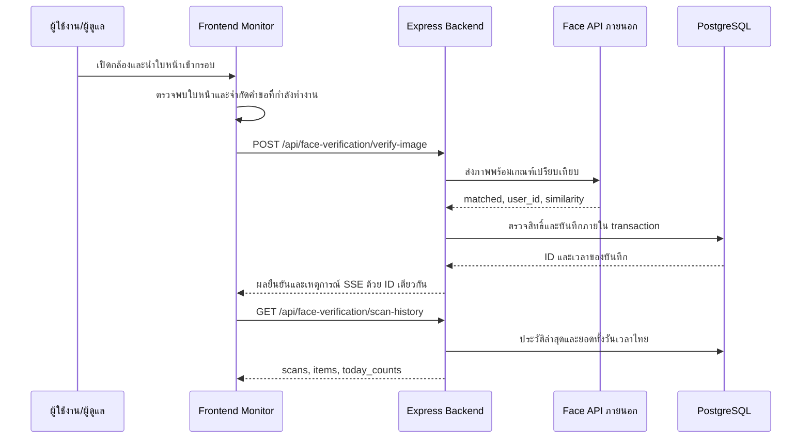

# ระบบสแกนใบหน้าเข้า–ออก: เอกสารประกอบเล่ม 5 บท

วันที่จัดทำ: 2026-10-03 | สถานะ: คำอธิบายจากโค้ดและผล regression tests; ยังไม่ใช่ผลทดลองความแม่นยำกับผู้เข้าร่วมจริง

เอกสารนี้รวบรวมเฉพาะส่วนสแกนใบหน้าเพื่อใช้เขียนเล่มของระบบหอพัก ผู้จัดทำต้องปรับรูปแบบตามข้อกำหนดสถาบัน และเติมข้อมูลผู้เข้าร่วม อุปกรณ์ เวอร์ชันที่ใช้งาน และผลทดลองจริงก่อนส่งเล่ม
นโยบาย Frontend ปัจจุบันคือเก็บฟีเจอร์ไว้และแก้บั๊กเท่านั้น การเพิ่มความสามารถใหม่ต้องได้รับอนุมัติ

## บทที่ 1 บทนำ

### ปัญหาและความเป็นมา

ระบบมีหน้าจอ Monitor แสดงกล้อง ผลเปรียบเทียบใบหน้า ประวัติการสแกน และยอดเข้า–ออกประจำวัน การแสดงข้อมูลซ้ำหรือข้อความแจ้งเตือนผิดทำให้ผู้ดูแลตีความสถานะผิดได้
อาการที่ตรวจพบจากโค้ดคือเหตุการณ์สดและประวัติจากฐานข้อมูลใช้ ID ต่างกันสำหรับการสแกนเดียวกัน และการนับจากรายการล่าสุดไม่ครอบคลุมทั้งวัน
ตัวสร้างแจ้งเตือนเดิมยังค้นหาคำว่า `close` ขณะที่คำสั่งปิดประตูส่ง `lock` จึงแจ้งว่าเปิดผิด

### วัตถุประสงค์

1. แสดงผลยืนยันใบหน้าผ่านบริการที่ระบบมีอยู่ พร้อมตรวจสิทธิ์เข้าถึงจาก Backend
2. บันทึกการสแกนที่ยอมรับลง PostgreSQL และแสดงกิจกรรมหนึ่งครั้งเป็นหนึ่งบันทึก
3. แสดงยอดเข้า–ออกทั้งวันตามเวลาไทยโดยแยกกิจกรรมประตูจำลอง
4. อธิบายคะแนนความคล้ายและประเมินผลจากชุดทดลองที่ตรวจสอบย้อนกลับได้

### ขอบเขต

- Frontend รับภาพกล้องและแสดงผล; Express เป็นตัวกลางไปยังบริการ Face Recognition ภายนอก
- งานสแกนเข้า–ออก (`IN`/`OUT`) เป็นคนละกิจกรรมกับเปิด–ปิดประตูจำลอง
- หน้ากล้อง Monitor ปัจจุบันไม่ส่ง `direction` จึงใช้ `IN` ตามค่าเริ่มต้นของ Backend; ช่องทางที่ส่ง `OUT` ต้องมีการยืนยันใบหน้าจริงก่อนบันทึก
- การกดปิดประตูหรือปิดกล้องไม่ใช่การสแกนออก และไม่เพิ่ม Check-out
- ประตู Monitor เป็นการจำลองในแอป ไม่มีหลักฐานว่าคำสั่งนี้ควบคุมฮาร์ดแวร์ประตูจริง
- ยังไม่รับรองการตรวจความมีชีวิต (liveness), ป้องกันภาพถ่าย/วิดีโอปลอม, ความแม่นยำภาคสนาม หรือการทำงานกล้องออฟไลน์

## บทที่ 2 แนวคิดและงานที่เกี่ยวข้อง

### การตรวจจับและการระบุตัวบุคคล

การตรวจจับใบหน้าเป็นการหาตำแหน่งใบหน้าในภาพ; การเปรียบเทียบใบหน้าเป็นการเปรียบเทียบคุณลักษณะกับข้อมูลที่ลงทะเบียนแล้ว
Monitor ใช้ BlazeFace ฝั่งเบราว์เซอร์สำหรับกรอบใบหน้าและช่วยเลือกจังหวะส่งภาพ ไม่ได้ใช้กรอบนั้นตัดสินสิทธิ์เข้าหอพัก
งานวิจัย [BlazeFace](https://arxiv.org/abs/1907.05047) อธิบายโมเดลตรวจจับใบหน้าสำหรับอุปกรณ์เคลื่อนที่

บริการ Python มีเส้นทาง InsightFace สำหรับตรวจจับและสร้าง embedding และมีเส้นทางจำลองเมื่อโมเดลไม่พร้อม
Embedding คือเวกเตอร์ตัวเลขแทนคุณลักษณะของภาพ ใช้เปรียบเทียบกับเวกเตอร์ที่ลงทะเบียนไว้
[ArcFace](https://arxiv.org/abs/1801.07698) เป็นงานวิจัยเกี่ยวกับการเรียนรู้คุณลักษณะสำหรับการจดจำใบหน้า; การมีเส้นทางนี้ในโค้ดไม่ได้ยืนยันว่าโมเดลจริงโหลดสำเร็จใน runtime ต้องเก็บหลักฐานเพิ่มเติม

### คะแนนความคล้ายและเปอร์เซ็นต์

`Face_Recognition/app/services/search_service.py` มี cosine similarity ระหว่างเวกเตอร์ a และ b:

```text
s = (a · b) / (||a|| × ||b||)
ค่าที่แสดงบน Monitor = similarity จาก API × 100
```

Cosine similarity โดยคณิตศาสตร์อยู่ในช่วง -1 ถึง 1; API และ Backend ใช้คะแนนที่เข้าเงื่อนไข 0–1 สำหรับการยอมรับ
หน้า Monitor ใช้ `toFixed(0)` จึงปัดเปอร์เซ็นต์เป็นจำนวนเต็ม เช่น similarity 0.7342 แสดง 73% ทั้งที่การตัดสินใช้ค่าดิบ
คะแนนนี้ไม่ใช่ความน่าจะเป็นที่บุคคลถูกต้อง และไม่ใช่ accuracy ของระบบ ตัวอย่างดังกล่าวเป็นตัวอย่างวิธีคำนวณ ไม่ใช่ผลทดลอง

### เกณฑ์การยอมรับและการตรวจสิทธิ์

- ค่าเริ่มต้นที่ Controller ใช้คือ `DEFAULT_SIMILARITY_THRESHOLD = 0.68`
- ต้องผ่าน `matched` ของบริการภายนอก มี similarity ที่เป็นตัวเลขจำกัดและผ่านเกณฑ์ และมี owner ID ที่ถูกต้อง
- ต้องตรวจสิทธิ์ใน PostgreSQL อีกชั้น ผู้พักต้องมีสัญญา/สถานะและช่วงวันที่เข้าใช้งานที่อนุญาต และไม่ถูกถอนสิทธิ์ใบหน้า; ADMIN ใช้นโยบายสิทธิ์ของ ADMIN
- ผู้มาติดต่อมี biometric flow เดิมแยกจาก reception flow; reception ไม่เปลี่ยนเป็น CHECKED_IN เมื่อ Admin เปิดประตูจำลอง
- มีการรับ threshold ผ่านบางช่องทางและค่าตั้งของบริการภายนอก จึงต้องบันทึก threshold ที่ใช้จริงในแต่ละการทดลอง อย่าสรุปว่าทุก client ใช้ 0.68 เสมอ
- เกณฑ์นี้เป็นค่าตั้งในโค้ด ยังไม่ได้พิสูจน์ว่าเหมาะสมที่สุดจากผลทดลองของโปรเจกต์

### ค่าประเมินที่ต้องแยกจากคะแนนบนจอ

ระบบค้นหาในชุดบุคคลที่ลงทะเบียนเป็นลักษณะ 1:N แม้ endpoint จะใช้ชื่อ verify จึงควรประเมินว่าค้นหาได้ตัวตนถูกต้องหรือไม่ และแยกการปฏิเสธจากสิทธิ์ออกจากความผิดพลาดของโมเดล
สำหรับการทดลองเปรียบเทียบคู่ภาพ 1:1 ใช้ FMR/FNMR; สำหรับการค้นหา 1:N ใช้ FPIR/FNIR และจำนวนตัวตนในชุดค้นหา อย่าใช้สองประเภทแทนกันโดยไม่ระบุวิธีทดลอง
[NIST 1:1 Verification](https://pages.nist.gov/frvt/html/frvt11.html) และ [NIST 1:N Identification](https://pages.nist.gov/frvt/html/frvt1N.html) เป็นแหล่งอ้างอิงการแยกประเภทการประเมิน

## บทที่ 3 วิธีดำเนินงานและออกแบบระบบ

### ลำดับการทำงาน



### ค่าควบคุมการสแกนที่พบในโค้ด

| ค่า | ค่าปัจจุบัน | ความหมาย |
| --- | --- | --- |
| DETECT_INTERVAL_MS | 120 ms | ช่วงเวลาระหว่างการตรวจใบหน้าฝั่งเบราว์เซอร์ |
| VERIFY_INTERVAL_MS | 800 ms | ระยะขั้นต่ำระหว่างความพยายามส่งภาพ ไม่ใช่เวลาตอบสนองจริง |
| COOLDOWN_MS | 3500 ms | ช่วงพักฝั่งหน้าจอหลังได้รับผล |
| MATCH_HOLD_MS | 2500 ms | ระยะค้างแถบผลบนหน้าจอ |
| Backend cooldown | 5000 ms | ลดการบันทึกซ้ำจากการสแกนถี่; ใช้ Redis และมี fallback ในหน่วยความจำ |
| Face API timeout | 4000 ms | ขีดจำกัดคำขอไปบริการเปรียบเทียบ |
| MAX_HISTORY_ITEMS | 30 | จำนวนกิจกรรมล่าสุดที่แสดง ไม่ใช่จำนวนกิจกรรมสูงสุดต่อวัน |
| ประตูจำลอง | 5 วินาที | ระยะก่อนปิดอัตโนมัติเมื่อสั่งเปิด |

### การแก้ความสอดคล้องของข้อมูล

- ID ของผู้พัก/ADMIN ใช้ `db-<AccessLog.id>` ทั้งเหตุการณ์สดและประวัติ
- biometric visitor flow เดิมใช้ `visitor-db-<VisitorLog.id>` เพื่อไม่ชนกับ AccessLog
- เวลาที่แสดงใช้เวลาบันทึกของเซิร์ฟเวอร์ ไม่ใช้เวลาที่ client ส่งมาเป็นแหล่งข้อมูลหลัก
- ประวัติอ่านจากฐานข้อมูล จึงไม่รวม telemetry ที่ไม่เคยบันทึกเป็นการสแกนจริง
- จำนวน IN/OUT นับทั้งวันจากฐานข้อมูล แยกจาก take 30 และไม่รวม `MONITOR_DOOR`
- ช่วงวันเป็น `[00:00 ของวันไทย, 00:00 ของวันถัดไป)` เช่น วันที่ 3 ตุลาคม 2026 เท่ากับ `[2026-10-02T17:00:00Z, 2026-10-03T17:00:00Z)`
- ประวัติและยอดอ่านใน transaction ระดับ RepeatableRead เพื่อใช้ snapshot เดียวกัน
- หน้า Monitor รับเหตุการณ์สดเพื่ออัปเดตรายการ และขอประวัติ/ยอดจาก Backend หลังเหตุการณ์ โดยรวมคำขอที่เกิดใกล้กันในช่วง 150 ms
- การแจ้งเตือนรับ `faceGateActivity` ผ่าน Socket หลังบันทึกกิจกรรมสำเร็จ โดยใช้ `activity_type`, `direction` และ `door_trigger` แยกสแกนเข้า/ออก เปิด/ปิดด้วยมือ และปิดอัตโนมัติ ไม่สร้าง toast สำเร็จซ้ำจาก response ของคำสั่งประตู
- สีแจ้งเตือนและป้ายประวัติ: สแกนเข้า/เปิดประตูเป็นสีเขียว สแกนออก/ปิดประตูเป็นสีแดง การออกตามปกติใช้ tone `exit` แยกจาก error
- SSE ใช้ `withCredentials: true` สำหรับ cookie authentication และไม่ส่งค่า token ตัวแทน `cookie` ใน query string

### ข้อมูล API ที่หน้าจอใช้

| Endpoint/เหตุการณ์ | หน้าที่ | ข้อจำกัด |
| --- | --- | --- |
| POST /api/face-verification/verify-image | เปรียบเทียบภาพ ตรวจสิทธิ์ บันทึกเมื่อผ่าน | ผล matched ต้องผ่านการตรวจสิทธิ์ก่อนถือว่าเข้าใช้งานได้ |
| POST /api/face-verification/scan | รับ IN/OUT จากอุปกรณ์และบันทึก | ต้องผ่านสิทธิ์/การตรวจ token ของ route; ไม่ใช่ API สาธารณะ |
| GET /api/face-verification/events | ส่งเหตุการณ์ SSE | Monitor ใช้สิทธิ์ ADMIN; มี cleanup เมื่อออกจากหน้า |
| GET /api/face-verification/scan-history | scans/items ล่าสุด และ today_counts | ยอดวันไทย; response เพิ่ม timezone, day_start, day_end |
| POST /api/face-verification/door-command | unlock/lock ประตูจำลอง | ADMIN; ไม่สร้าง Check-in/Check-out |

`today_counts` มี `{ in, out, total }` ซึ่ง total เท่ากับ in + out; จำนวนแถวประวัติอาจต่างจาก total เพราะมีรายการประตูและจำกัด 30 แถว

### การออกแบบการทดลองจริง

1. ระบุเวอร์ชันทั้งสาม repo, image, โมเดล, threshold, ขนาด gallery, กล้อง, CPU/GPU, แสง และเครือข่าย
2. ยืนยันว่าบริการ Python โหลดโมเดลจริง ไม่ใช่ SimulatedDetector/SimulatedEmbedder
3. ใช้ผู้เข้าร่วมที่ยินยอม แยกภาพลงทะเบียนจากภาพทดสอบ ใช้รหัสผู้เข้าร่วมแทนชื่อหรือเลขบัตรประชาชน
4. กำหนดจำนวนคน จำนวนครั้ง และเงื่อนไขก่อนเริ่มเก็บข้อมูล; หากปรับ threshold ให้ใช้ชุดพัฒนาแยกจากชุดทดสอบสุดท้าย
5. ทดสอบคนที่ลงทะเบียน คนที่ไม่อยู่ใน gallery มุมหน้า แสง อุปกรณ์ และกรณีบริการขัดข้อง โดยคงจำนวนครั้งให้เปรียบเทียบได้
6. เก็บตัวตนจริง ตัวตนที่ระบบคืน คะแนน เกณฑ์ matched ผลตรวจสิทธิ์ ทิศทาง ID บันทึก และเวลาตอบสนอง แยกเหตุการณ์ประตูออก
7. เก็บหลายช่วงเวลา/หลาย session ต่อบุคคล เพื่อไม่ให้ผลดีจากภาพซ้ำหรือการทดสอบคนเดียว
8. ตรวจข้อมูลคำขอซ้ำและ cooldown ก่อนคำนวณจำนวนความพยายาม; กำหนดหนึ่ง trial ให้ชัดและไม่ถือเฟรมกล้องต่อเนื่องทุกเฟรมเป็น trial อิสระ

## บทที่ 4 ผลการดำเนินงานและการประเมิน

### หลักฐานที่มีในรอบแก้ไขนี้

| ตรวจสอบ | ผล/สถานะ |
| --- | --- |
| Backend unit/integration ที่ใช้ mock | 76/76 ผ่าน รวมการบันทึกและส่งเหตุการณ์ปิดอัตโนมัติ และการยกเลิก timer เมื่อปิดด้วยมือ |
| Frontend tests | 17/17 ผ่าน รวมชื่อและ tone ของ Socket สำหรับสแกนเข้า/ออก เปิด ปิดด้วยมือ ปิดอัตโนมัติ และไม่สร้าง toast ซ้ำจาก response ประตู |
| ID ของบันทึกสแกน | ทดสอบการคืน db-1 และ visitor-db-1 และไม่คืน ID ใหม่เมื่อ cooldown |
| ยอดเกินหน้าประวัติ | fixture 58 กิจกรรม แสดง 30 รายการ ยอดเข้า 45 ออก 13 |
| ขอบเขตวัน | fixture ที่เที่ยงคืนไทยตรวจ gte/lt ของวันถูกต้อง |
| ประตูจำลอง | fixture ประตูปิดหนึ่งรายการไม่เพิ่มยอดเข้า/ออก |
| ความแม่นยำกับใบหน้าจริง | ยังไม่ได้เก็บผลทดลอง |
| Build และ lint | Backend/Frontend ผ่าน; Backend test:typecheck ผ่าน |
| Runtime อ่าน PostgreSQL | service ใน container อ่านได้: 20 กิจกรรม, ID ไม่ซ้ำ, เรียงเวลาถูกต้อง; ยอด IN 14 / OUT 0 / total 14 ณ เวลาตรวจ |
| Health API | HTTP 200 หลังเปลี่ยน container Backend เป็น image ล่าสุด |
| Authenticated HTTP/เบราว์เซอร์ | ยังไม่ยืนยัน: cookie เดิมไม่มี access_token ของ localhost ที่ใช้ได้ ต้องล็อกอินใหม่และทดลองหน้าจอ |

จำนวน fixture และเปอร์เซ็นต์ตัวอย่างไม่ใช่ผลความแม่นยำภาคสนาม ผลทดสอบข้างต้นยืนยันพฤติกรรมโค้ดตามเงื่อนไขจำลอง

### นิยามและสูตรผลประเมิน

สำหรับชุดทดลองเปรียบเทียบคู่ภาพที่กำหนดตัวตนเป้าหมายไว้ (1:1):

| ค่า | นิยาม |
| --- | --- |
| TP | คู่ภาพคนเดียวกันที่ยอมรับถูก |
| FN | คู่ภาพคนเดียวกันที่ปฏิเสธผิด |
| TN | คู่ภาพต่างคนที่ปฏิเสธถูก |
| FP | คู่ภาพต่างคนที่ยอมรับผิด |
| Accuracy | `(TP + TN) / (TP + TN + FP + FN) × 100` |
| Precision | `TP / (TP + FP) × 100` |
| Recall | `TP / (TP + FN) × 100` |
| FMR | `FP / (FP + TN) × 100` สำหรับการเปรียบเทียบต่างคน |
| FNMR | `FN / (FN + TP) × 100` สำหรับการเปรียบเทียบคนเดียวกัน |

สำหรับการค้นหาทั้ง gallery (1:N) ซึ่งตรงกับระบบปัจจุบัน ให้รายงานเพิ่ม:

- อัตราระบุตัวตนถูกต้อง = จำนวน trial ของคนที่ลงทะเบียนและคืนตัวตนถูก / trial ของคนที่ลงทะเบียนทั้งหมด
- FPIR = จำนวน trial ของคนที่ไม่อยู่ใน gallery แต่คืนบุคคลใน gallery / trial ของคนที่ไม่อยู่ใน gallery
- FNIR ที่ rank 1 = จำนวน trial ของคนที่อยู่ใน gallery แต่ไม่คืนตัวตนที่ถูกเป็นอันดับแรกเหนือเกณฑ์ / trial ของคนที่อยู่ใน gallery
- รายงานกรณีระบุผิดเป็นอีกคนใน gallery แยกด้วย ไม่ถือว่า matched=true เป็นความสำเร็จทุกครั้ง

หากตัวหารเป็นศูนย์ ให้แสดง “คำนวณไม่ได้” พร้อมจำนวนตัวอย่าง ไม่ใส่ 0% แทน ผลระดับโมเดลต้องแยกจากการถูกปฏิเสธเพราะหมดสิทธิ์หรือการเชื่อมต่อขัดข้อง

### เวลาและความครบถ้วนของระบบ

- `processing_time_ms` ของ Python คือช่วงประมวลผลในบริการ ไม่ครอบคลุมเวลา capture, upload, ตรวจสิทธิ์, DB และการแสดงผล
- เวลา end-to-end วัดตั้งแต่เริ่มส่งภาพจน UI แสดงผล และรายงานค่าเฉลี่ย median และ p95 โดยระบุจำนวนตัวอย่างและวิธีหาค่า percentile
- อัตราสำเร็จของงาน = จำนวน trial ที่ได้ผลและบันทึกตามที่คาด / trial ที่เข้าเงื่อนไขทั้งหมด; แยก timeout/no-face/access-denied/cooldown
- จำนวนบันทึกซ้ำ = จำนวน row เพิ่มเกินหนึ่ง row ต่อ trial ที่ได้รับอนุญาตให้บันทึก; การที่ SSE แสดงรายการซ้ำยังเป็นบั๊ก UI ได้แม้ DB มีเพียงหนึ่ง row
- ตารางผลจริงควรมีจำนวนตัวอย่าง ตัวเศษ ตัวหาร และช่วงความไม่แน่นอนของค่าประเมินก่อนสรุปว่า “แม่นยำสูง”

### ตารางสำหรับกรอกผลจริง

| เงื่อนไข | ผู้เข้าร่วม/ขนาด gallery | จำนวน trial | ระบุตัวตนถูก | ระบุผิด/ปฏิเสธผิด | timeout/no-face | เวลา median/p95 | หมายเหตุ |
| --- | --- | --- | --- | --- | --- | --- | --- |
| แสงปกติ หน้าตรง | รอเก็บ | รอเก็บ | รอเก็บ | รอเก็บ | รอเก็บ | รอเก็บ | |
| แสงน้อย | รอเก็บ | รอเก็บ | รอเก็บ | รอเก็บ | รอเก็บ | รอเก็บ | |
| มุมหน้าเปลี่ยน | รอเก็บ | รอเก็บ | รอเก็บ | รอเก็บ | รอเก็บ | รอเก็บ | |
| บุคคลนอก gallery | รอเก็บ | รอเก็บ | ไม่ใช้ | รอเก็บ FPIR | รอเก็บ | รอเก็บ | |
| เครือข่าย/บริการขัดข้อง | รอเก็บ | รอเก็บ | ไม่ใช้ | ไม่ใช้ | รอเก็บ | รอเก็บ | แยกจากผลโมเดล |

## บทที่ 5 สรุปและข้อเสนอแนะ

การแก้รอบนี้ทำให้ข้อความคำสั่งประตูอ้างอิงสถานะที่ยืนยันแล้ว ใช้ ID จากฐานข้อมูลสำหรับการสแกน และนับยอดวันไทยแยกจากประวัติล่าสุด
การปิดประตูจำลองไม่ใช่หลักฐานว่าบุคคลออกจากหอพัก การใช้งาน Check-out ต้องมาจากการสแกนที่ส่ง OUT และผ่านสิทธิ์
ผล regression tests ใช้ยืนยันความสอดคล้องของโค้ด ยังไม่ใช้สรุปความแม่นยำของ biometric model

ข้อจำกัดที่ต้องระบุในเล่ม:

- Python มีเส้นทางจำลองเมื่อโมเดลโหลดไม่สำเร็จ ต้องพิสูจน์ runtime ก่อนนำผลไปอ้างเป็น biometric จริง
- Backend ใช้ safe-deny fallback เมื่อ Face API ผิดพลาด โดยคืน similarity 0.1 และเวลา 50 ms ที่กำหนดไว้ในโค้ด ค่าสองรายการนี้ไม่ใช่ค่าที่วัดจริง และต้องคัดออกจากการประเมินคะแนน/เวลาโมเดล
- ไม่มีผลทดสอบ liveness หรือฮาร์ดแวร์ประตูจริงในงานนี้
- ประตูจำลองและ cooldown fallback เก็บบางสถานะในหน่วยความจำ การ restart/หลาย replica อาจมีข้อจำกัด ต้องทดสอบก่อนขยาย deployment
- เวลาไทยของยอดรายวันอยู่ฝั่ง Backend แต่เวลาในรายการใช้ locale ของเบราว์เซอร์ ต้องตั้ง timezone ของเครื่องทดลองให้ตรงกัน
- การตัดวันบน UI จะเปลี่ยนเมื่อโหลดประวัติ/รีเฟรชหรือมีเหตุการณ์ใหม่ ไม่ได้มีตัวจับเวลาข้ามวันอัตโนมัติ
- ในประวัติผู้พัก คะแนนใช้ `AccessLog.duration` ซึ่งเก็บคะแนนปัดเป็นจำนวนเต็ม ไม่ใช่ระยะเวลา; การประเมินควรเก็บคะแนนดิบแยกจาก row นี้
- ความพร้อมของกล้อง การหลุดของ SSE การ reconnect และการปิดอัตโนมัติต้องตรวจในเบราว์เซอร์จริงเพิ่มเติม

## ตำแหน่งหลักฐานในโครงการ

- [Controller และ API](../../src/modules/face-verification/face-verification.controller.ts)
- [Service ตรวจสิทธิ์ บันทึก และยอดรายวัน](../../src/modules/face-verification/face-verification.service.ts)
- [เหตุการณ์ SSE](../../src/modules/face-verification/face-verification-monitoring.ts)
- [Regression tests](../../tests/unit/face-verification.test.ts)
- [QA checklist เดิม](face-verification-qa-checklist.md)
- [Monitor ฝั่ง Frontend](../../../smart-dormitory-frontend/src/componants/addminpage/pages/Monitor/MonitorPage.tsx)
- [แจ้งเตือนคำสั่งผ่าน API](../../../smart-dormitory-frontend/src/services/api.ts)
- [บริการ Python](../../../Face_Recognition/app/services/face_service.py)
- [การค้นหา cosine similarity](../../../Face_Recognition/app/services/search_service.py)
- [สถานะโมเดลจริง/จำลอง](../../../Face_Recognition/app/ai/insightface_loader.py)

ลิงก์ข้าม repo ต้อง checkout repositories ไว้ข้างกัน; หากส่งเล่มให้ใช้ชื่อไฟล์/เวอร์ชันและรายการอ้างอิงแทนพาธเครื่องส่วนตัว ไม่แนบ cookie, API key หรือภาพใบหน้าผู้เข้าร่วมลงเอกสารสาธารณะ


### สถานะบันทึกใบหน้าครบและการซ่อนเมนู User — 13 ต.ค. 2569

หลังหน้า UserIdentityFlow ส่งภาพครบ 5 รายการสำเร็จ เรียก POST /api/tenants/me/face-enrollment/complete โดยใช้ User จาก session เท่านั้น ไม่มี userId ใน body บันทึก marker FACE_ENROLLMENT_COMPLETE ใน AccessLog เดิมภายใต้ owner lock เฉพาะผู้พัก active/APPROVED หรือ ACTIVE ที่มีห้อง มีภาพอย่างน้อย 5 และไม่ faceRevokedAt เรียกซ้ำไม่เพิ่ม marker ซ้ำ GET /api/tenants/me คืน faceEnrollmentComplete โดยตรวจ marker ตรง Tenant ปัจจุบันและยังมีภาพครบ ไม่ส่ง accessLogs/_count ภายในออกไปกับ user profile เมนูบันทึกใบหน้าซ่อนเมื่อ true และเปิด URL เดิมจะกลับหน้าหลัก หากส่งภาพหรือบันทึก marker ไม่สำเร็จยังคง retry ได้ สถานะนี้เป็นสถานะ UI ของการบันทึก ไม่ใช้อนุญาตประตูหรือรับรองการทำงานของ provider

การ DELETE ผู้พักผ่าน guarded purge ลบ FaceEmbedding/FaceEnrollmentPhoto และ access logs พร้อม revoke ใบหน้า เก็บ User; งาน cleanup ล้างไฟล์และ provider ภายนอกแบบ retry จึงอาจตอบ PENDING จนล้างสำเร็จ การครบวัน endDate อย่างเดียวปัจจุบันไม่มี scheduler ลบใบหน้าอัตโนมัติ ต้องดำเนินย้ายออกและลบผู้พักตาม flow เดิม บัญชีที่เคย revoke ต้องผ่านการคืนสิทธิ์โดยผู้ดูแลก่อนลงทะเบียนใบหน้าใหม่ ไม่ปลด revoke อัตโนมัติจากการซ่อนเมนู

ตรวจ build/lint Backend และ Frontend ผ่าน Backend unit/mock 180/180 (เพิ่ม 4 กรณี completion/persistence/idempotency/privacy/incomplete/revoked/inactive/old tenant) Frontend 112/112 รอบนี้ไม่ได้ทดสอบกล้อง/ประตู/provider จริง และยังไม่มี browser acceptance ของ flow ใหม่


เพิ่มเติม flow สมัครใหม่ (13 ต.ค. 2569): แก้คืนสิทธิ์ใบหน้าเมื่อ Admin อนุมัติ Tenant ใหม่จาก PENDING เท่านั้น โดย cleanup ของ User ต้อง phase DONE และไม่มี photo/embedding เก่า หากยังล้างค้างให้ 409 และ rollback ไม่เปลี่ยนสถานะผู้พักเดิม ACTIVE เพื่อปลด revoke ผ่าน transaction นี้ Integration ใช้ HTTP/PostgreSQL จริงในฐานแยกและ mock เฉพาะการลบ owner ภายนอก ผ่านพร้อม suite 36/36 ไฟล์ fixture ทั้ง 5 ถูกลบจากดิสก์และ marker เก่าถูกลบ เมนูสมัครใหม่จึงต้องบันทึกใบหน้าใหม่ ไม่รับรองผลกล้อง/ประตู/provider จริง

## ความยินยอมก่อนเก็บภาพ — 14 ต.ค. 2569

เพิ่ม FACE_ENROLLMENT แยกจาก HOUSING และสัญญา ก่อนเปิดกล้อง/อัปโหลดภาพ ไม่ยินยอมสามารถกลับหน้าหลักได้โดยบัญชี/สัญญายังคงอยู่ Service ตรวจหลักฐานบัญชีปัจจุบันก่อนเก็บภาพหรือเรียก provider และไม่ให้ Admin สร้าง consent แทนผู้ใช้ ไม่มีการยินยอมย้อนหลังโดยอัตโนมัติ การถอนใช้ติดต่อผู้ดูแล

ผล unit/mock ล่าสุด 185/185 และเว็บ 119/119 รวม guard ต่าง purpose/บัญชี รุ่นข้อความ กดซ้ำ รีเฟรช และ abort หลังออกหน้า Build/lint ผ่าน อัปเดต Docker และตรวจ health 200/คำชี้แจงไม่มี session 401 แล้ว ยังไม่ใช่ผลเปิดกล้องจริงหรือ browser acceptance รายละเอียดอยู่ใน [โมดูลใบหน้า](../system/face-verification.md)

## แผนทดลองความถูกต้องใบหน้า 1:N — 18 ต.ค. 2569

**สถานะตอนเตรียมแผน: ยังไม่มีผลใบหน้าจริง** ขณะเริ่มเตรียมผู้ใช้ยังไม่มีชุดภาพอาสาสมัครและ Docker daemon ไม่พร้อม จึงไม่ได้เริ่ม provider หรือลงทะเบียนใคร ต่อมาผู้ใช้รันเองและให้สรุปผลเพิ่มเติม 4 ภาพตามหัวข้อท้ายเอกสาร แผนด้านล่างเป็นแนวทางขยายการทดลอง ไม่ใช่ผลรับรองกล้อง ประตู liveness หรือ provider จริง การทดสอบตัวสคริปต์ใช้ mock และข้อมูลสังเคราะห์เท่านั้น

### สิ่งที่ตรวจพบจากโค้ด

- `../Face_Recognition/app/api/faces.py`: POST `/api/v1/faces/verify` รับ `file` และ `threshold` ไม่รับ claimed user ID
- `app/services/search_service.py`: ค้นหาคะแนนสูงสุดจาก template ทั้งหมด จึงเป็น **1:N identification** ต้องมีทั้งคนที่อยู่ในทะเบียน (known/mated) และคนที่ไม่อยู่ (unknown/non-mated) ไม่ใช้สูตรการเปรียบเทียบคู่ 1:1 แทน
- `app/ai/insightface_loader.py`: ใช้โหมดจำลองได้เมื่อ InsightFace/โมเดลไม่พร้อม ต้องยืนยันโมเดลจริงก่อนวัด
- `/health` ของ provider บอกฐานข้อมูล/cache/จำนวนคน แต่ไม่ได้ยืนยันว่าโมเดลจริง active จึงใช้ HTTP 200 อย่างเดียวรับรองไม่ได้
- endpoint verify ของเว็บหอพักมีผลข้างเคียงบันทึก scan และติดตามการเข้าออก การทดลองนี้จึงส่งไป **Face API แยกสำหรับทดลองโดยตรง** ไม่ยิง endpoint หอพักหรือฐานข้อมูลใช้งานจริง ไม่เพิ่ม engine หรือแก้ fallback/security

### การเก็บภาพและทะเบียนทดสอบ

1. ขอความยินยอมเฉพาะการทดลองและกำหนดผู้เข้าถึง/วันลบก่อนเก็บภาพ ใช้รหัส P01/P02 แทนชื่อ บันทึกหลักฐานแยกจากภาพ ความยินยอม FACE_ENROLLMENT สำหรับใช้งานหอพักไม่ถือว่าครอบคลุมการวิจัยนี้อัตโนมัติ
2. เริ่มชุดนำร่อง เช่น คนในทะเบียน 10 คน และคนนอกทะเบียนอีก 5 คน ภาพทดสอบใหม่คนละ 5 ภาพ เป็นตัวอย่างแผน ไม่ใช่ขนาดตัวอย่างรับรองผลทั่วไป ไม่ใช้ภาพจากอินเทอร์เน็ตหรือคนที่ไม่ได้ยินยอม
3. ลงทะเบียนเฉพาะกลุ่ม known ใน provider แยกผ่าน POST `/api/v1/faces/register` (multipart `user_id`, `file`, header `X-API-Key`) ใช้ API key ของบริการทดลอง เก็บ reference images ทุกภาพที่ใช้ พร้อมรหัสเจ้าของ กลุ่ม unknown ต้องไม่ลงทะเบียนแม้แต่ภาพเดียว สคริปต์ประเมินไม่ลงทะเบียน/ลบ/แก้ template ให้เอง
4. ภาพทดสอบถ่ายต่างรอบจากภาพลงทะเบียน เช่น แสงปกติ 2 ภาพ แสงน้อย 1 ภาพ เอียงซ้าย 1 ภาพ เอียงขวา 1 ภาพ ระบุอุปกรณ์ ระยะ มุม และสภาพแสงที่ทำได้จริง คงจำนวนเงื่อนไขแต่ละกลุ่มเทียบเคียงกัน ภาพหนึ่งมีหนึ่งคน ไม่ใช้ภาพเดิมหรือ crop/resize ของภาพลงทะเบียน สคริปต์กันไฟล์ซ้ำด้วย SHA-256 ได้ แต่พิสูจน์ว่าเป็นการถ่ายคนละรอบไม่ได้ ผู้เก็บข้อมูลต้องตรวจเอง
5. ล็อก threshold ก่อนชุดประเมิน เช่น 0.60 เมื่อยืนยันค่าที่ใช้จริงแล้ว หากปรับให้ใช้ชุด calibration แยก ไม่เลือกค่าจากภาพประเมินแล้วรายงานผลบนภาพเดิม รักษารุ่นโมเดลและสมาชิกทะเบียนเดิมตลอดรอบ
6. เก็บภาพ/แผน/หลักฐานไว้ใน `.face-evaluation/` ที่ gitignore แล้ว หรือพื้นที่ส่วนตัวนอก repository ห้าม commit รูป key consent จริง หรือ provider IDs ที่โยงตัวบุคคล ผลใช้เพียงรหัสอาสาสมัคร ยังถือเป็นข้อมูลที่ต้องจำกัดการเข้าถึง ไม่ใช่ข้อมูลนิรนามสมบูรณ์

### เตรียมหลักฐานโมเดลก่อนรัน

ใช้ Face service **แยกจากตัวใช้งานจริง** ที่ `127.0.0.1:<พอร์ตทดลอง>` พร้อม DB/volume ใหม่ของการทดลอง ห้ามชี้พอร์ตไป provider จริงเพียงเพราะอยู่ localhost ตรวจ startup log ของ instance นั้นว่ามีข้อความ `InsightFace model '...' loaded successfully` ไม่มีการตกไปโหมดจำลอง เก็บช่วง log ของการเริ่มรอบนั้นเป็น `runtime-model.log` พร้อมรหัส container/image หรือ commit ของบริการและข้อมูลโมเดลที่ใช้ ไม่เอา log จาก instance หรือรอบอื่นมาแทน

ตรวจทะเบียนว่าไม่มีบุคคลนอกชุด known และ reference images ครบ `cached_users` ช่วยตรวจจำนวนคน แต่จำนวนเท่ากันไม่ได้ยืนยันว่าเป็นคนถูกต้อง จึงต้องตรวจรายการลงทะเบียนเองด้วย ห้ามเปลี่ยนทะเบียนระหว่างรัน

สคริปต์ตรวจ hash ของหลักฐาน ข้อความโหลดโมเดล และ health/gallery count ก่อนส่งภาพ แต่หลักฐานโมเดลยังเป็น **การตรวจโดยผู้ดำเนินการ** ไม่ใช่ attestation จาก response ทุกคำขอ หากยืนยัน instance/โมเดลจริงไม่ได้ให้หยุดและไม่รายงานเป็น biometric accuracy

### ตัวอย่างแผนส่วนตัวและคำสั่ง

สร้าง `.face-evaluation/plan.json` ด้วยโครงต่อไปนี้ แก้พาธและค่าทั้งหมดให้ตรงรอบจริง ตัวอย่างสองคนเพียงแสดงรูปแบบ ไม่ใช่ชุดทดลองที่เพียงพอสำหรับสรุปผล:

```json
{
  "mode": "identification-1:N",
  "runId": "pilot-01",
  "isolatedService": true,
  "baseUrl": "http://127.0.0.1:18001",
  "modelName": "buffalo_l",
  "serviceRevision": "REPLACE_WITH_TEST_SERVICE_COMMIT_OR_IMAGE_DIGEST",
  "threshold": 0.60,
  "thresholdSource": "Fixed before evaluation; record calibration or deployment source",
  "intervalMs": 1000,
  "timeoutMs": 15000,
  "runtimeEvidence": {
    "realModelActive": true,
    "isolatedGalleryVerified": true,
    "file": "runtime-model.log",
    "sha256": "REPLACE_WITH_SHA256_OF_REVIEWED_LOG"
  },
  "subjects": [
    { "code": "P01", "consentRef": "PRIVATE-CONSENT-01", "enrolled": true, "providerUserId": 101, "referenceImages": ["reference/P01-front.jpg"] },
    { "code": "P02", "consentRef": "PRIVATE-CONSENT-02", "enrolled": false }
  ],
  "probes": [
    { "id": "T001", "subject": "P01", "condition": "normal", "image": "probes/P01-normal-01.jpg" },
    { "id": "T002", "subject": "P02", "condition": "normal", "image": "probes/P02-normal-01.jpg" }
  ],
  "outputDirectory": "results"
}
```

```powershell
# ตรวจไฟล์/ความครบ/ภาพซ้ำก่อน โดยไม่ส่ง request ใด ๆ
node tests/face-identification.cjs .face-evaluation/plan.json

# ดู hash หลักฐาน log แล้วนำค่าไปใส่ runtimeEvidence.sha256
(Get-FileHash -Algorithm SHA256 .face-evaluation/runtime-model.log).Hash.ToLower()

# รันเมื่อเตรียม key ไว้ใน FACE_EVAL_API_KEY ส่วนตัวแล้ว ไม่ใส่ key ในแชตหรือไฟล์แผน
node tests/face-identification.cjs .face-evaluation/plan.json --execute
```

ค่าเริ่มต้นเป็น dry-run ต้องใส่ `--execute` จึงส่งภาพไป provider โดยส่งเฉพาะ `/health` และ POST `/api/v1/faces/verify` ไม่มี enrollment หรือคำสั่งประตู ไม่มีการลองใหม่อัตโนมัติเมื่อ error และหยุดรอบหาก 401/403/429 ไม่ลด rate limit เพื่อให้ผลผ่าน ผลออกที่ `outputDirectory/runId/` ประกอบด้วย `attempts.jsonl`, `summary.json`, `final_report.md` ไม่เขียนทับรอบเดิม ไม่สำเนาภาพ ชื่อจริง key หรือ response body ลงผล

### ตัวชี้วัดและการนำเสนอ

| ตัวชี้วัด | ตัวเศษ / ตัวส่วน |
|---|---|
| Correct rank-1 identification | known ที่คืนคนถูก / known ที่ประมวลผลจำแนกได้ |
| FNIR ที่ rank 1 | known ที่ปฏิเสธหรือคืนคนผิด / known ที่ประมวลผลจำแนกได้ |
| FPIR | unknown ที่คืนคนใดคนหนึ่งในทะเบียน / unknown ที่ประมวลผลจำแนกได้ |
| Known end-to-end success | known ที่คืนคนถูก / known ทั้งหมด รวมตรวจไม่สำเร็จและ error |
| Acquisition failure | ไม่พบใบหน้าหรือพบหลายหน้า / จำนวนภาพทดสอบทั้งหมด |
| Service error | HTTP/timeout/response ผิดรูปแบบ / จำนวนคำขอทั้งหมด |
| Mean/p95 latency | เวลา HTTP ฝั่ง client ของคำขอที่ไม่ใช่ service error รวม detection/search/logging ไม่ใช่เวลาโมเดลล้วน |

FNIR/FPIR ในเครื่องมือนี้เป็นอัตราแบบมีเงื่อนไขเมื่อได้ผลจำแนก ไม่รวม acquisition/service errors ในตัวส่วน จึงต้องแสดงจำนวนที่ตัดออกและ end-to-end success คู่กัน ไม่เปลี่ยน no-face หรือ outage เป็น true rejection ของคนนอกทะเบียน แยก wrong identity ของคนในทะเบียนออกจาก false identification ของคนนอกทะเบียน ค่า N/A คือไม่มีตัวส่วน ไม่ใช่ 0% สรุปรายเงื่อนไขอยู่ใน `summary.json`

รายงานจำนวนคน ภาพ และขนาดทะเบียนร่วมกับผลทุกครั้ง ภาพหลายภาพของคนเดียวกันไม่ใช่ตัวอย่างอิสระทั้งหมด หากไม่มีข้อผิดพลาดในชุดเล็ก ให้พูดว่า “ไม่พบในจำนวน ... ครั้ง” ไม่ใช่ “ปลอดภัย/แม่นยำ 100%” เครื่องมือนี้ยังไม่ให้ช่วงความเชื่อมั่นหรือผลประชากร และไม่ใช่ benchmark รับรองของ NIST

นิยามการค้นหา 1:N และ FNIR/FPIR อ้างอิง [NIST FRTE 1:N Identification](https://pages.nist.gov/frvt/html/frvt1N.html) (อ่าน 18 ต.ค. 2569) ปรับการแสดงผลเป็น rank-1 และแยก failure ตาม API โครงการ ไม่คัดเกณฑ์เป้าหมายของ NIST มาอ้างว่าระบบผ่านมาตรฐาน

หลักฐานโค้ด: [สคริปต์ทดลอง](../../tests/face-identification.cjs), [ทดสอบเครื่องมือด้วย mock](../../tests/unit/face-identification.test.cjs) คำสั่ง `node --test tests/unit/face-identification.test.cjs` พิสูจน์การคำนวณ/ตรวจแผน/ส่งคำขอของเครื่องมือ ไม่ใช่ความแม่นยำใบหน้า และไม่บวกเข้าผล suite เก่า 185/119 โดยอัตโนมัติ

### ตรวจความพร้อม runtime เพิ่มเติม — 18 ต.ค. 2569

หลังผู้ใช้ให้ดำเนินการ ตรวจ Docker แบบ read-only พบ container `smart-dormitory-face-recognition` ทำงานแล้ว ต่างจากช่วงเตรียมแผนก่อนหน้า Image ID `sha256:c16bcfaf5f80a4dd47e39bde37c9dea64ecc0cf31e22a3b2165b7394a6f815d8` และ StartedAt `2026-10-17T17:42:14.97021658Z` เป็นข้อมูลอ้างอิงรอบนี้ ไม่ใช่ผลของ provider สำหรับทดลองแยก

พบ log รอบเริ่มบริการ `2026-10-17 17:42:33.538` ว่า `InsightFace model 'buffalo_l' loaded successfully from 'models'` และ log หลังเริ่มมี `InsightFace detected 1 face(s)` ตรวจโค้ด detection ใน container แล้วพบว่าสร้าง `_fallback_detector` ตั้งแต่ constructor แต่เลือก InsightFace ก่อนเมื่อ loader active ดังนั้นข้อความ `Falling back to SimulatedDetector` จากการสร้างตัวสำรองเพียงอย่างเดียวไม่พอจะสรุปว่าคำขอตรวจใบหน้านั้นเป็น simulated ต้องดู loader/เส้นทาง inference ประกอบ ไม่ได้ import โมเดลใน process ใหม่เพื่อใช้แทนหลักฐานของ process ที่ให้บริการ

GET `/health` ภายใน container ตอบ `healthy`, database `connected`, cache_loaded `true`, cached_users `1` ตัวเลขนี้นับเจ้าของ template ใน cache ไม่ใช่จำนวนภาพ ไม่ระบุว่าเป็นบัญชีใด และไม่ใช่ผลประเมินความถูกต้อง

ยังไม่พบ `.face-evaluation/` หรือพาธชุดภาพใหม่ที่ผู้ใช้ยืนยัน จึงไม่ได้อ่านหรือคัดภาพผู้พักเดิมมาเป็น probe ไม่ส่ง verify/register และไม่สร้างประวัติสแกนเพิ่ม ภาพลงทะเบียนจริงที่มีอยู่ไม่ใช้แทนชุดทดสอบอิสระ ขั้นถัดไปต้องมีพาธภาพใหม่ รหัสเจ้าของ/สถานะ known–unknown และการยินยอมสำหรับทดลอง ก่อนจัดแผนและบริการแยก ผลตรวจ runtime นี้ยืนยันความพร้อมบางส่วน ไม่ใช่ accuracy, FPIR/FNIR หรือการรับรองประตูจริง

### ชุดภาพที่ผู้ใช้ส่งเพิ่มเติม — 18 ต.ค. 2569

ผู้ใช้ยืนยันความยินยอมและสถานะลงทะเบียนของผู้ร่วมทดลอง พร้อมยืนยันว่าภาพทดสอบแยกจากภาพลงทะเบียน ข้อมูลเจ้าของและ expected account ใช้ ground truth ที่ผู้ใช้แจ้ง ไม่ใช่การระบุตัวบุคคลจากภาพโดยเอเจนต์

ตามคำสั่งผู้ใช้ ปิดชุดนำร่องที่ **การทดสอบเพิ่มเติม 4 ภาพ** ได้แก่ T002/P01 และ T003/P03 เป็นคนนอกทะเบียน ส่วน T005/P05 และ T007/P05 เป็นภาพของผู้ลงทะเบียน 1 คน รวมผู้ร่วมทดลอง 3 คน เก็บรหัสภาพเดิมเพื่ออ้างอิง response ได้ ไม่เปลี่ยนเลขให้ต่อกัน

นำรายการที่ไม่ได้ทดสอบ T001, T004, T006, T008 และ T009 ออกจาก `.face-evaluation/probe-list.csv` และ `.face-evaluation/manual-results.csv` แล้ว ไม่มีสถานะรอทดสอบในชุดสรุปนี้ ไม่ลบหรือแก้ภาพต้นฉบับใน Downloads ไฟล์ส่วนตัวทั้งสองถูก gitignore และไม่ได้ส่งภาพไป verify/register จากเอเจนต์

นี่เป็นชุดภาพที่มีผลพร้อมใช้งานตามที่ผู้ใช้เลือก ไม่ใช่การสุ่มตัวอย่างหรือชุดประเมินที่ออกแบบล่วงหน้าครบทุกเงื่อนไข จึงใช้รายงานผลเบื้องต้นเฉพาะภาพเหล่านี้ ไม่ใช้ประมาณความแม่นยำของประชากร

### สรุปผลการทดสอบเพิ่มเติม 4 ภาพ — 18 ต.ค. 2569

ผู้ใช้ส่ง JSON จากการรันเอง 4 รายการและยืนยันว่าใช้ threshold 0.60 เหมือนกัน จากนั้นยืนยันลำดับผล 1 = T005, 2 = T007, 3 = T003 และ 4 = T002 พร้อมยืนยัน expected account ของ P05 ตรงกับรหัสที่สอง response แรกคืน จึงบันทึกผลตามข้อมูลข้อความที่ผู้ใช้ให้ ไม่ใช่การเปรียบเทียบใบหน้าโดยเอเจนต์

| รายการ JSON | รหัสภาพที่ยืนยัน | ผลที่รายงาน | Similarity | เวลา provider |
|---|---|---|---|---|
| 1 | T005 | ตรง expected account ตามคำยืนยันผู้ใช้ | 0.8139 | 470.77 ms |
| 2 | T007 | ตรง expected account ตามคำยืนยันผู้ใช้ | 0.8745 | 459.32 ms |
| 3 | T003 | ตรวจไม่พบใบหน้า ไม่ใช่ true rejection | ไม่ใช้ประเมินคะแนน | ไม่ได้ส่งกลับ |
| 4 | T002 | ปฏิเสธคนนอกทะเบียนตาม ground truth ผู้ใช้ | 0.2624 | 383.06 ms |

หลักฐานเป็น USER_REPORTED จากข้อความ API ที่ผู้ใช้คัดลอก ยังไม่ได้ตรวจ response ต้นฉบับ/เวลาเก็บ/ความครบทุกภาพ ไม่มี HTTP status หรือเวลา HTTP จึงเว้นช่องดังกล่าว ไม่ใช้ processing_time_ms แทน latencyMs และไม่สมมติ reason ที่ response ไม่ได้คืน สำหรับ T003 ใช้ข้อความ `No face detected in the image` จัดประเภท failure โดยไม่อ้างว่า API ส่ง reason enum มา

**สรุป:** มีการทดสอบเพิ่มเติม 4 ภาพ ที่ threshold 0.60 จากผลที่ผู้ดำเนินการรายงาน ระบบระบุคนในทะเบียนตรงตาม expected account 2 ภาพ ปฏิเสธคนนอกทะเบียนได้ 1 ภาพ และตรวจไม่พบใบหน้า 1 ภาพ กรณี T003 เป็น acquisition failure ไม่เพิ่มจำนวนการปฏิเสธถูก ส่วนเวลา provider ของ 3 รายการที่มีค่ารายงานอยู่ระหว่าง 383.06–470.77 ms ไม่ใช้แทนเวลา HTTP หรือเวลาเปิดประตู

ภาพ known ที่มีผลทั้งสองเป็นคนเดียวกัน ส่วน unknown ที่ได้ผลจำแนกมีเพียง 1 ภาพ ยังไม่พบ false acceptance ในกรณีนั้น ไม่สรุปเป็น accuracy หรือความปลอดภัย 100% ไม่ใช้คะแนน similarity 81.39%/87.45% แทน accuracy และไม่มีผลรับรองประตูจริง liveness หรือความสามารถรองรับผู้ใช้จำนวนมาก ข้อจำกัดนี้ยังคงอยู่แม้ปิดชุดทดลองทั้ง 4 ภาพแล้ว

### แก้การแสดงคะแนนและเหตุผลบน Monitor — 18 ต.ค. 2569

- หน้าจอเดิมแทนคะแนนที่หายด้วย 0 และ wrapper ไม่อ่าน provider รุ่นที่คืน `message: No face detected in the image` โดยไม่มี reason จึงอาจแสดง “ไม่ผ่าน คะแนน 0.00%” แทนกรณีตรวจไม่สำเร็จ
- Wrapper รองรับ reason, face_count และข้อความ no-face/multiple-faces ของ provider เดิม เพิ่ม `score_available` เพื่อแยกคะแนนที่วัดได้จากค่าตัวเลขที่คงไว้สำหรับ client เก่า เมื่อ no-face/multiple-faces/คะแนนหายหรือไม่ถูกต้องต้องไม่ผ่านการยืนยัน
- Monitor แสดงเปอร์เซ็นต์จากคะแนนจริง เช่น `ไม่ผ่านเกณฑ์ · คะแนนความคล้าย 26.24% · เกณฑ์ 68.00%` และนำวงเล็บออกทั้งกรณีผ่านและไม่ผ่าน หากประเมินไม่ได้ให้แสดงเหตุผลแทนเปอร์เซ็นต์ ไม่สร้างคะแนนขึ้นเอง หาก provider วัดคะแนนเป็นศูนย์จริง ยังแสดง 0.00% ตามจริง
- API ปัจจุบันไม่ได้ส่งผลตรวจสิ่งปิดบังใบหน้าโดยเฉพาะ จึงไม่อ้างว่ารู้ว่าเป็นหน้ากาก/แว่น/ผมจากการไม่ผ่านหรือ no-face การแสดงคำแนะนำให้จัดหน้าในกรอบไม่ใช่ผลตรวจ occlusion ไม่มีการเพิ่ม engine ตรวจสิ่งปิดบัง
- เว็บ Monitor ใช้ DEFAULT_SIMILARITY_THRESHOLD = 0.68 จาก service/controller และตรวจซ้ำตอนบันทึก scan เป็นค่าเกณฑ์การตัดสินที่กำหนดไว้ ไม่ใช่ accuracy 68% และยังไม่มีชุด calibration ยืนยันว่าเป็นค่าที่เหมาะที่สุด คะแนน 0.67 ต่ำกว่าเกณฑ์ ส่วน 0.70 ผ่านเงื่อนไขคะแนนแต่ยังต้องผ่าน matched และสิทธิ์ตาม flow
- ผลผู้ใช้ที่เก็บผ่าน Swagger ก่อนหน้านี้ใช้ threshold 0.60 จึงต้องคงระบุ 0.60 ในผลทดลอง ไม่เปลี่ยนเป็น 0.68 ย้อนหลัง รอบนี้ไม่ปรับเกณฑ์เพื่อให้ผ่านง่ายขึ้น

การตรวจแก้นี้ใช้ unit/mock สำหรับผล provider และการแสดงข้อความ ไม่ใช่การรันจับคู่ภาพจริงหรือการรับรองกล้อง/ประตู/occlusion

ผลตรวจรอบแก้ข้อความ 18 ต.ค. 2569: Backend regression 186/186, frontend tests 122/122; build ทั้งสอง, backend test:typecheck, lint ไฟล์ backend ที่แก้และ frontend lint ผ่าน เพิ่มกรณี legacy no-face, คะแนนหาย/null/ศูนย์จริง, คะแนนต่ำกว่าเกณฑ์ และตรวจรูปแบบเปอร์เซ็นต์/ไม่มีวงเล็บ/ไม่มีการกล่าวอ้าง occlusion อัปเดต backend image ด้วย `docker compose up -d --build --no-deps backend` แล้ว ตรวจผ่าน Nginx GET `/api/health` = 200 และพบ score_available ในไฟล์ build ของ container เว็บใช้ dist ที่ Nginx mount อยู่หลัง build ใหม่ ยังไม่ได้ตรวจกล้องจริงหรือจับคู่ภาพในรอบนี้ ผลเก่า 185/119 บนสไลด์ยังเป็นหลักฐานวันที่เดิม ไม่แก้ย้อนหลังเป็นตัวเลขรอบนี้

เพิ่ม `.face-evaluation` ใน `.dockerignore` เพื่อไม่ส่งไฟล์ชุดทดลองส่วนตัวเข้า build context ไม่มีการเปลี่ยน schema, threshold, fallback หรือ dependency เพื่อแก้ข้อความครั้งนี้
