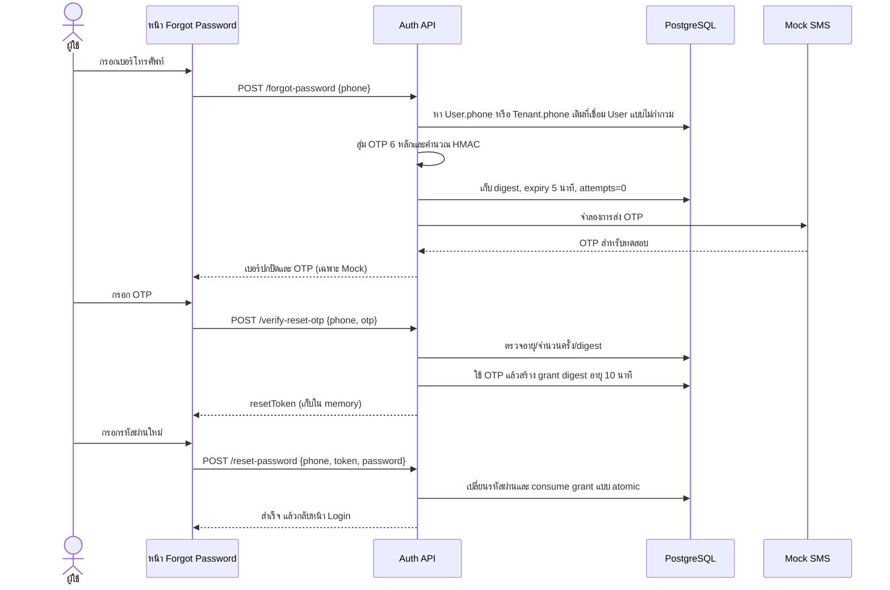

# รายงานระบบกู้คืนรหัสผ่านด้วย OTP ทางโทรศัพท์

เอกสารฉบับนี้อธิบายการออกแบบและการทำงานของฟังก์ชันกู้คืนรหัสผ่านในระบบ Smart Dormitory เพื่อใช้ประกอบเล่มรายงาน 5 บท โดยระบบที่ติดตั้งในปัจจุบันใช้ Mock SMS สำหรับสาธิตเท่านั้น ไม่ได้ส่ง SMS ผ่านเครือข่ายโทรศัพท์จริง

## บทที่ 1 บทนำ

### 1.1 ที่มาและความสำคัญ

ผู้ใช้ที่ลืมรหัสผ่านจำเป็นต้องยืนยันว่าตนสามารถเข้าถึงช่องทางติดต่อที่ผูกกับบัญชีได้ การนำ OTP มาใช้ทำให้การยืนยันทำได้เป็นขั้นตอน โดยไม่ต้องนำรหัสผ่านเดิมกลับมาแสดงหรือจัดเก็บเป็นข้อความธรรมดา บัญชีใหม่เก็บเบอร์กู้คืนไว้ที่ `User.phone`; บัญชีเดิมที่ยังไม่มีค่านี้ใช้หมายเลขจาก Tenant ที่เชื่อมกับบัญชีได้

### 1.2 ปัญหา

ช่องทางกู้คืนเดิมใช้ลิงก์ผ่านอีเมล แต่ยังไม่มีผู้ให้บริการ SMS จริงและการสาธิตบนระบบพัฒนาต้องเห็น OTP ได้ การออกแบบจึงต้องแยกโหมดจำลองออกจากระบบจริง ป้องกันการเปิด Mock provider ใน production และทำให้รหัสมีอายุสั้น ใช้ได้ครั้งเดียว และจำกัดการเดารหัส

### 1.3 วัตถุประสงค์และขอบเขต

1. ให้สมัครบัญชีด้วยเบอร์โทรศัพท์กู้คืนที่ไม่ซ้ำ และค้นหาบัญชีเป้าหมายอย่างไม่กำกวม
2. สร้าง OTP 6 หลักที่สุ่มด้วย secure random และยืนยันที่ backend
3. สร้างสิทธิ์ตั้งรหัสผ่านใหม่แบบใช้ครั้งเดียวเมื่อ OTP ถูกต้อง
4. ให้หน้าเว็บแสดง OTP เฉพาะการสาธิตด้วย Mock SMS
5. บันทึกขั้นตอน ข้อจำกัด และแนวทางเปลี่ยนไปใช้ SMS gateway จริง

ขอบเขตไม่รวมการเชื่อมต่อผู้ให้บริการ SMS จริง การยืนยันตัวตนด้วย SMS เป็นการครอบครองเบอร์โทรศัพท์ ไม่ใช่หลักฐานยืนยันบุคคลทางกฎหมาย

## บทที่ 2 ทฤษฎีและเทคโนโลยีที่เกี่ยวข้อง

### 2.1 OTP แบบตัวเลข 6 หลัก

OTP มีค่าที่เป็นไปได้ตั้งแต่ `000000` ถึง `999999` รวมหนึ่งล้านค่า เอนโทรปีเชิงทฤษฎีเท่ากับ `log2(1,000,000) ≈ 19.93 บิต` จึงไม่ควรพึ่งความลับของ OTP เพียงอย่างเดียว ระบบกำหนดอายุ 5 นาที จำกัดการตรวจผิด 5 ครั้ง และมี rate limit แยกตามเบอร์

### 2.2 การสุ่มด้วย CSPRNG

สร้างรหัสด้วย `crypto.randomInt(0, 1_000_000)` จาก Node.js ซึ่งใช้แหล่งสุ่มเชิงเข้ารหัสและหลีกเลี่ยง modulo bias ของการนำเลขสุ่มทั่วไปมาหารเอาเศษ จากนั้นเติมเลขศูนย์ด้านหน้าให้ได้ความยาว 6 หลักเสมอ เช่น `004281`

### 2.3 การเก็บ OTP และการเปรียบเทียบ

ฐานข้อมูลไม่เก็บ OTP ตรง ๆ แต่เก็บ HMAC-SHA256 ซึ่งใช้ `JWT_SECRET` เป็น server-side pepper และผูกข้อความกับ user ID, เบอร์มาตรฐาน และ OTP เนื่องจาก OTP มีเพียงหนึ่งล้านค่า การเก็บ hash แบบไม่มี secret อาจถูกไล่ครบทุกค่าได้ การเปรียบเทียบ digest ใช้ `timingSafeEqual` เพื่อลดการเปิดเผยความแตกต่างของเวลาตรวจ

### 2.4 Token สำหรับตั้งรหัสผ่าน

เมื่อ OTP ถูกต้อง backend สร้าง token สุ่ม 32 ไบต์ (256 บิต) และส่ง token นี้ให้ client เก็บใน memory เท่านั้น ฐานข้อมูลเก็บ SHA-256 digest ของ token อายุ 10 นาที และการอัปเดตรหัสผ่านกับการใช้ token เกิดในคำสั่งฐานข้อมูลแบบมีเงื่อนไขเดียวกัน เพื่อกัน replay และคำขอพร้อมกัน

### 2.5 Mock SMS กับระบบจริง

Mock provider คืน OTP ใน API response เพื่อทดสอบหน้าจอ แต่ไม่ส่งข้อความและไม่บันทึก OTP ลง notification history หรือ log การเปิดใช้งานต้องตั้ง `PASSWORD_RESET_SMS_MODE=mock` ด้วยตนเอง และโค้ดปฏิเสธเมื่อ runtime เป็น `staging` หรือ `production` ค่าเริ่มต้นคือ `disabled` สำหรับระบบจริงต้องพัฒนา adapter เชื่อม SMS gateway ที่ผ่านการอนุมัติ และไม่คืน OTP ใน response

## บทที่ 3 การวิเคราะห์และออกแบบระบบ

### 3.1 ลำดับการทำงาน

### 3.2 ข้อมูลที่ใช้

- `User.phone`: เบอร์กู้คืนหลักของบัญชีและมี unique index เพื่อป้องกันการผูกซ้ำ
- `Tenant.phone`: fallback สำหรับบัญชีเดิมที่ยังไม่มี `User.phone`
- `User.passwordResetOtpHash`: HMAC ของ OTP
- `User.passwordResetOtpExpiresAt`: เวลาหมดอายุของ OTP
- `User.passwordResetOtpAttempts`: จำนวนครั้งตรวจ OTP ผิด
- `User.passwordResetGrantHash` และ `passwordResetGrantExpiresAt`: digest และอายุของสิทธิ์ตั้งรหัสผ่าน

เบอร์ไทยถูก normalize เป็นรูปแบบตัวเลขท้องถิ่นก่อนบันทึกและนำไปสร้าง HMAC การสมัครใหม่ปฏิเสธเบอร์ที่ผูกบัญชีแล้ว ส่วนการค้นหาข้อมูลเดิมรองรับรูปแบบเบอร์บน Tenant หากพบหลายบัญชีจะไม่อนุญาตให้รีเซ็ตรหัสผ่าน การสมัครไม่สร้าง Tenant เปล่า เพราะ Tenant ใช้แทนข้อมูลผู้เช่าหรือผู้สมัครเข้าพัก

### 3.3 API

1. `POST /api/auth/register` รับ `{ "email", "phone", "password", "username?" }`; เบอร์ไทยถูก normalize และบันทึกใน `User.phone` ซึ่งไม่ซ้ำกัน.
2. `POST /api/auth/forgot-password` รับ `{ "phone": "0812345678" }`; ใน Mock mode ส่ง `{ provider, maskedPhone, otp }` กลับและกำหนด `Cache-Control: no-store`.
3. `POST /api/auth/verify-reset-otp` รับ `{ "phone": "0812345678", "otp": "004281" }`; เมื่อถูกต้องคืน `{ resetToken }`.
4. `POST /api/auth/reset-password` รับ `{ "phone": "0812345678", "token": "...", "password": "..." }`; ใช้ token ได้ครั้งเดียว.

### 3.4 เงื่อนไขผิดพลาดและการป้องกัน

- เบอร์ไม่ถูกต้องหรือ lookup ไม่เป็นบัญชีเดียว: ปฏิเสธคำขอ
- OTP ผิด: เพิ่ม attempt แบบ atomic; เมื่อครบห้าครั้งจะตรวจเพิ่มไม่ได้
- OTP หมดอายุ: ปฏิเสธและต้องขอรหัสใหม่
- OTP ถูกต้อง: ล้าง OTP ก่อนออก grant จึงนำ OTP เดิมกลับมาใช้ไม่ได้
- grant ผิด/หมดอายุ/ถูกใช้แล้ว: ไม่เปลี่ยนรหัสผ่าน
- จำกัดการขอ OTP 3 ครั้งต่อชั่วโมงต่อเบอร์ และการ verify/reset ตาม rate limit ของ route
- Mock mode ปิดเป็นค่าเริ่มต้น และถูกปฏิเสธใน staging/production

## บทที่ 4 การพัฒนาและผลการดำเนินงาน

### 4.1 ขั้นตอนพัฒนา

1. ตรวจสอบโครงสร้างข้อมูลจริง พบว่า `Tenant.phone` เป็นข้อมูลผู้เช่าและรายการนั้นแสดงแก่ผู้ดูแล จึงไม่สร้าง Tenant เปล่าสำหรับบัญชีสมัครใหม่
2. ปรับ schema ให้มีเบอร์บัญชีที่ไม่ซ้ำ, OTP digest, expiry, attempt counter และ grant digest
3. เพิ่ม migration โดย rename token columns เดิมเพื่อรักษารูปแบบการเปลี่ยนแปลงเดิม แล้วเพิ่มฟิลด์ OTP และ `User.phone` แบบ nullable/unique เพื่อรองรับบัญชีเก่า
4. สร้าง OTP service รับผิดชอบ CSPRNG, HMAC, constant-time compare, อายุและ attempt
5. เพิ่ม route สำหรับขอ OTP และตรวจ OTP; เปลี่ยน reset ให้รับ phone และ grant
6. เปลี่ยนหน้าเว็บเป็น 3 หน้าต่อเนื่อง: กรอกโทรศัพท์, ยืนยัน OTP, ตั้งรหัสผ่านใหม่
7. เพิ่มเอกสาร API contract และรายงานฉบับนี้

### 4.2 เหตุผลที่แยก OTP service

OTP เป็นข้อมูลรับรองชั่วคราวและมีข้อกำหนดความปลอดภัยเฉพาะ การแยก service ขนาดเล็กจาก login/register ช่วยไม่ให้ OTP เข้า notification persistence หรือ log ทั่วไป และทำให้ตรวจ policy ของ provider ได้ ณ จุดเดียว โดยยังใช้ AuthRepository เดิม ไม่เพิ่ม layer สำหรับงาน CRUD ทั่วไป

### 4.3 ผลที่ระบบออกแบบให้ได้

- OTP มีความยาวคงที่ 6 หลักและสุ่มจาก CSPRNG
- OTP ในฐานข้อมูลเป็น HMAC digest ไม่ใช่ข้อความเดิม
- การตรวจ OTP ใช้ constant-time comparison และมีขีดจำกัด 5 ครั้ง
- reset grant สุ่ม 256 บิต เก็บเฉพาะ SHA-256 และใช้ได้ครั้งเดียว
- หน้าเว็บไม่ใส่ OTP/grant ใน URL หรือ localStorage; grant อยู่ใน memory และหมดไปเมื่อโหลดหน้าใหม่
- Mock provider เปิดไม่ได้ใน staging/production และค่า config เริ่มต้นปิดอยู่

ผลการตรวจยืนยันรอบนี้: `prisma validate`, Prisma Client generation, backend TypeScript build และ frontend production build ผ่าน; migration ถูก apply กับฐานข้อมูล `projectdb` แล้วและไม่มี migration ค้าง; backend Docker image ถูก rebuild และ `GET /api/health` ผ่าน HTTP 200 ผ่าน Nginx การทดสอบ end-to-end โดยเปลี่ยนรหัสผ่านบัญชีจริงไม่ได้ทำในรอบนี้ เพื่อไม่เปลี่ยนข้อมูลรับรองของผู้ใช้โดยไม่ได้ตั้งใจ

## บทที่ 5 สรุปและข้อเสนอแนะ

ระบบ OTP แบบ Mock ทำให้สาธิตกระบวนการ reset password ได้ครบตั้งแต่กรอกเบอร์จนกลับหน้า Login โดยมีกลไกจำกัดเวลารหัส จำนวนครั้ง และการนำ token กลับมาใช้ซ้ำ การสุ่มตัวเลข 6 หลักมีเอนโทรปีไม่สูง จึงต้องใช้ร่วมกับ TTL, attempt limit, rate limit และการเก็บ HMAC

ข้อจำกัดปัจจุบันคือไม่มี SMS ส่งไปยังโทรศัพท์จริง การเห็น OTP บนหน้าเว็บทำได้เพื่อการพัฒนาเท่านั้น ก่อนใช้งานจริงต้องเลือก SMS gateway, เก็บ credentials ผ่าน secret manager, ไม่ส่ง OTP ใน response, วางนโยบายความเป็นส่วนตัวและต้นทุนข้อความ, เพิ่มการติดตามการส่งโดยไม่บันทึก OTP และทดสอบการจำกัด abuse เมื่อจะเพิ่ม adapter จริง ต้องจัดการความแตกต่างของรูปแบบเบอร์และกรณีส่งข้อความล้มเหลวโดยไม่เปิดเผยว่าบัญชีมีอยู่หรือไม่

### วิธีทดลองในสภาพแวดล้อมพัฒนา

1. ตรวจว่าเบอร์โทรศัพท์ใน Tenant ผูกกับบัญชี User ที่ต้องการและไม่ซ้ำกับบัญชีอื่น
2. ตั้ง `PASSWORD_RESET_SMS_MODE=mock` ใน environment สำหรับเครื่องพัฒนาเท่านั้น แล้ว restart backend
3. เปิดหน้า Login เลือก “ลืมรหัสผ่าน” กรอกเบอร์ที่ผูกบัญชี
4. นำ OTP ที่แสดงบนหน้าเว็บมากรอกภายใน 5 นาที
5. ตั้งรหัสผ่านใหม่และกลับเข้าสู่ระบบด้วยรหัสผ่านใหม่
6. ทดสอบ OTP ผิดเกิน 5 ครั้ง, หมดอายุ, ขอ OTP ใหม่ และใช้ reset grant ซ้ำ เพื่อยืนยันเส้นทางปฏิเสธ

ปิดโหมดสาธิตด้วย `PASSWORD_RESET_SMS_MODE=disabled` หลังทดสอบ และห้ามตั้งค่า Mock ใน staging/production
