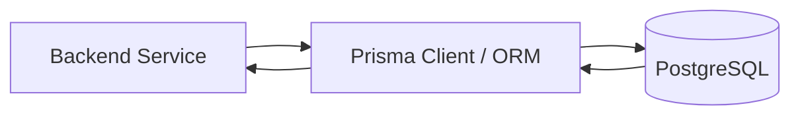
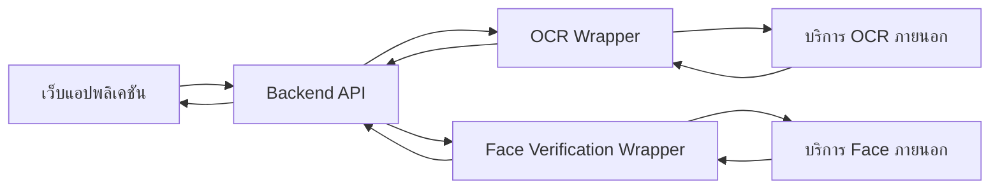
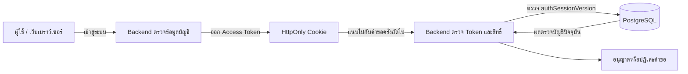
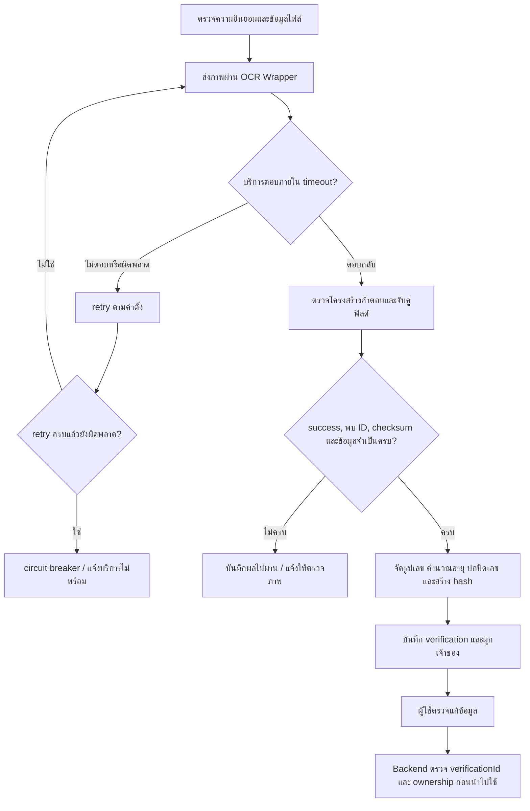
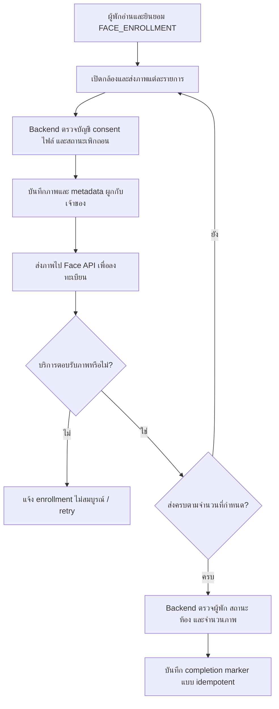
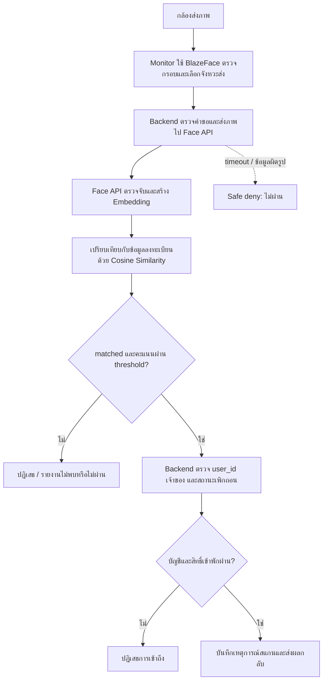
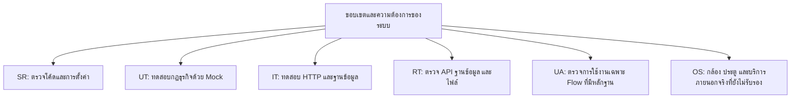

# บทที่ 2 แนวคิด ทฤษฎี และเทคโนโลยีที่เกี่ยวข้อง

บทนี้กล่าวถึงแนวคิดที่ใช้ประกอบการพัฒนาระบบต้นแบบบริหารจัดการหอพักผ่านเว็บแอปพลิเคชัน โดยเลือกเฉพาะแนวคิดที่เกี่ยวข้องกับระบบจริง ได้แก่ ระบบสารสนเทศสำหรับบริหารหอพัก สถาปัตยกรรมเว็บ การจัดการฐานข้อมูล การเชื่อมต่อ API การควบคุมสิทธิ์ การใช้ OCR และ Face Verification ตลอดจนวิธีทดสอบระบบ ทั้งนี้ การอธิบายเทคโนโลยีหรือบริการภายนอกไม่ได้หมายความว่าบริการนั้นผ่านการทดสอบในสภาพแวดล้อมใช้งานจริงแล้ว

## 2.1 ระบบสารสนเทศสำหรับบริหารจัดการหอพัก

ระบบบริหารจัดการหอพักเป็นระบบสารสนเทศที่ช่วยจัดเก็บและเชื่อมโยงข้อมูลของผู้ใช้ ห้องพัก สัญญา ค่าใช้จ่าย งานแจ้งซ่อม และผู้มาติดต่อ การออกแบบจึงต้องคำนึงถึงความสัมพันธ์ระหว่างข้อมูลและสถานะของแต่ละกระบวนการ เช่น ใบสมัครที่ได้รับอนุมัติต้องสัมพันธ์กับข้อมูลผู้พักและห้อง ส่วนงานซ่อมต้องมีสถานะตั้งแต่รับแจ้งจนถึงปิดงาน

ระบบต้นแบบนี้แบ่งงานตามบทบาทและโมดูล ดังสรุปใน **ตารางที่ 2.1** โดยคำว่า “ผู้พัก” หมายถึงบัญชีผู้ใช้ที่มีข้อมูลการเข้าพัก ซึ่งบัญชีผู้ใช้และข้อมูลการเข้าพักเป็นคนละส่วนของระบบ

**ตารางที่ 2.1 โมดูลหลักและข้อมูลที่เกี่ยวข้องในระบบต้นแบบ**

| โมดูล/แนวคิด         | ข้อมูลหรือกระบวนการที่รองรับ                                   |
| -------------------- | -------------------------------------------------------------- |
| บัญชีและสิทธิ์ผู้ใช้ | บัญชีผู้ใช้ การเข้าสู่ระบบ บทบาท และการเข้าถึงข้อมูลตามสิทธิ์  |
| ผู้พัก ห้อง และสัญญา | ใบสมัคร ข้อมูลผู้พัก ห้อง สถานะห้อง เงื่อนไขและข้อมูลสัญญา     |
| บิลและการชำระเงิน    | ค่าเช่า เงินประกัน ค่าน้ำ ค่าไฟ QR หลักฐานชำระ และสถานะตรวจสอบ |
| งานแจ้งซ่อม          | รายละเอียดคำขอ ผู้รับผิดชอบ สถานะการดำเนินงาน และการปิดงาน     |
| ผู้มาติดต่อ          | ข้อมูลผู้มาติดต่อ คำขอเข้าพบ และสถานะการดำเนินการ              |
| รายงานและประวัติ     | ข้อมูลภาพรวมและบันทึกที่ระบบจัดเก็บเพื่อใช้ตรวจสอบ             |

ขอบเขตของระบบไม่รวมการรับชำระเงินจากธนาคารโดยอัตโนมัติ การอ่านมิเตอร์น้ำหรือไฟแบบเรียลไทม์ และการเปิดประตูจริง รายละเอียดความสามารถและข้อจำกัดอยู่ใน [บทที่ 1](01-introduction.md) และ [บทที่ 3](03-system-design.md)

## 2.2 เว็บแอปพลิเคชันและการแบ่งระบบเป็นโมดูล

เว็บแอปพลิเคชันทำงานผ่านการรับส่งคำขอระหว่างเว็บเบราว์เซอร์กับบริการเว็บ ผู้ใช้ส่งข้อมูลจากหน้าจอไปยัง API ส่วนบริการเว็บตรวจสอบข้อมูลและสิทธิ์ ดำเนินการตามกฎธุรกิจ แล้วอ่านหรือบันทึกข้อมูลในฐานข้อมูล

ระบบนี้ใช้สถาปัตยกรรมแบบ Modular Monolith กล่าวคือ บริการ Backend หลักทำงานเป็นแอปพลิเคชันเดียว แต่แยกโค้ดตามหน้าที่ เช่น ผู้ใช้ ผู้พัก ห้อง บิล งานซ่อม และผู้มาติดต่อ การแบ่งโมดูลช่วยให้ติดตามกฎของแต่ละงานได้ แต่ไม่ได้หมายความว่าแต่ละโมดูลเป็น Microservice แยกกัน

ลำดับการรับคำขอโดยทั่วไปคือ Route เลือกปลายทางและ Middleware ตรวจเงื่อนไขเบื้องต้น Controller ตรวจและแปลงข้อมูลที่รับเข้ามา แล้วส่งให้ Service ประมวลผลกฎธุรกิจ ส่วนฐานข้อมูลเข้าถึงผ่าน Prisma ตามรูปแบบของโมดูล การแบ่งหน้าที่ดังกล่าวสอดคล้องกับโครงสร้างโค้ดที่ใช้จริง ไม่ได้อ้างว่าทุกส่วนเป็นสถาปัตยกรรม Clean Architecture อย่างเคร่งครัด

## 2.3 ฐานข้อมูลและความสอดคล้องของข้อมูล

PostgreSQL เป็นฐานข้อมูลหลักและเป็นแหล่งข้อมูลถาวรของระบบ ใช้จัดเก็บข้อมูลที่มีความสัมพันธ์ เช่น บัญชี ผู้พัก ห้อง บิล การชำระเงิน งานซ่อม และผู้มาติดต่อ Prisma เป็น ORM ที่ใช้เชื่อมต่อข้อมูลและจัดการ Schema กับ Migration

เมื่อการทำงานหนึ่งต้องเปลี่ยนข้อมูลหลายรายการที่ต้องสอดคล้องกัน ระบบใช้ Transaction เพื่อให้การเปลี่ยนแปลงสำเร็จหรือย้อนกลับเป็นชุดเดียวตามกรณีใช้งาน แนวคิด Transaction ของ Prisma และระดับการแยกธุรกรรมของ PostgreSQL อธิบายไว้ใน [Prisma Transactions](https://www.prisma.io/docs/orm/fundamentals/transactions) [9] และ [PostgreSQL 16: Transaction Isolation](https://www.postgresql.org/docs/16/transaction-iso.html) [8]

Redis ใช้กับข้อมูลปฏิบัติการชั่วคราว เช่น Cache, Rate Limit และ Lock ในจุดที่ระบบกำหนด ไม่ใช้แทน PostgreSQL สำหรับข้อมูลหลัก ส่วนเอกสารและภาพเก็บเป็นไฟล์โดยฐานข้อมูลเก็บข้อมูลอ้างอิง ตารางที่ 2.2 แสดงหน้าที่และข้อจำกัดของพื้นที่จัดเก็บแต่ละประเภท

**ตารางที่ 2.2 หน้าที่ของแหล่งจัดเก็บข้อมูลในระบบ**

| แหล่งจัดเก็บ       | หน้าที่                                                        | ข้อมูลที่ไม่ใช้แทน                                                        |
| ------------------ | -------------------------------------------------------------- | ------------------------------------------------------------------------- |
| PostgreSQL         | เก็บข้อมูลหลักและสถานะที่ต้องคงอยู่                            | ไม่ใช้แทนไฟล์เอกสารจริง                                                   |
| Redis              | Cache, Rate Limit, Lock และสถานะชั่วคราวตามจุดที่กำหนด         | ไม่ใช้เป็นแหล่งข้อมูลหลักของบิลหรือประวัติถาวร                            |
| พื้นที่ไฟล์ของระบบ | เก็บเอกสารและภาพที่ระบบรับผิดชอบ โดยเชื่อมโยงด้วยข้อมูลอ้างอิง | ไม่ถือว่าไฟล์มีข้อมูลเจ้าของครบถ้วนหากไม่มีการตรวจความสัมพันธ์ในฐานข้อมูล |

การอ่านและบันทึกข้อมูลจาก Backend ผ่าน Prisma ไปยัง PostgreSQL แสดงเป็นแนวคิดในภาพที่ 2.1 ภาพนี้อธิบายเฉพาะเส้นทางเข้าถึงฐานข้อมูล ไม่ได้แสดงตารางหรือความสัมพันธ์จริงของระบบ ซึ่งแสดงในบทที่ 3



**ภาพที่ 2.1 แนวคิดการเข้าถึงฐานข้อมูลผ่าน Prisma ORM**

ที่มา: ผู้จัดทำ

## 2.4 API และการเชื่อมต่อบริการภายนอก

API เป็นช่องทางให้ส่วนต่าง ๆ ของระบบรับส่งข้อมูลตามรูปแบบที่กำหนด ระบบเว็บส่งคำขอ HTTP ไปยัง Backend และ Backend ส่งต่อไปยังบริการอื่นผ่าน Wrapper เมื่อจำเป็น รูปแบบ REST ใช้ URL และ HTTP Method เพื่อระบุการอ่านหรือเปลี่ยนแปลงข้อมูล โดยระบบตรวจสอบข้อมูลนำเข้า สิทธิ์ และผลลัพธ์ก่อนตอบกลับหน้าเว็บ

OCR และ Face Verification ทำงานเป็นบริการที่เชื่อมต่อผ่าน API ไม่ใช่ Engine ที่พัฒนาภายใน Backend ระบบส่งข้อมูลที่จำเป็น รับผลลัพธ์ และจัดการกรณีข้อผิดพลาดหรือบริการไม่พร้อม การทดสอบที่ใช้ Mock หรือ Fixture ยืนยันการจัดการคำขอและผลตอบกลับตามกรณีจำลองเท่านั้น ไม่ยืนยันความพร้อมหรือความแม่นยำของผู้ให้บริการจริง

การสร้าง QR หรือแนบหลักฐานชำระเงินก็ไม่ใช่หลักฐานว่าเงินเข้าบัญชีแล้ว สถานะการชำระต้องอ้างอิงผลการตรวจสอบตามขั้นตอนของระบบและผู้ดูแล ไม่กล่าวอ้างว่า Backend เชื่อมธนาคารเพื่อรับรองการโอนหรือคืนเงินจริงโดยอัตโนมัติ

ภาพที่ 2.2 แสดงแนวคิดการเชื่อมต่อ OCR และ Face Verification ผ่าน Backend Wrapper โดยบริการภายนอกส่งผลกลับให้ Backend จัดการต่อ ระบบไม่ได้ให้หน้าเว็บเรียก Engine ภายนอกโดยตรง



**ภาพที่ 2.2 แนวคิดการเชื่อมต่อบริการ OCR และ Face Verification ผ่าน Backend**

ที่มา: ผู้จัดทำ

## 2.5 การยืนยันตัวตน สิทธิ์ และข้อมูลส่วนบุคคล

การยืนยันตัวตน (Authentication) ใช้ตรวจว่าผู้ใช้เป็นบัญชีใด ส่วนการกำหนดสิทธิ์ (Authorization) ใช้ตัดสินว่าบัญชีนั้นทำรายการใดหรืออ่านข้อมูลส่วนใดได้ ระบบตรวจทั้งบทบาทและความเป็นเจ้าของข้อมูลที่ Backend ไม่พึ่งการซ่อนปุ่มบนหน้าเว็บเพียงอย่างเดียว

ระบบส่ง Access Token ผ่าน Cookie ที่กำหนด HttpOnly และตรวจสถานะ Session กับข้อมูลบัญชีปัจจุบัน การยินยอมก่อนสมัครเข้าพักและก่อนเก็บข้อมูลใบหน้าเป็นคนละวัตถุประสงค์ และแยกจากการยอมรับสัญญา ข้อมูลชีวภาพเป็นข้อมูลส่วนบุคคลที่กฎหมายกำหนดเงื่อนไขเฉพาะในการเก็บรวบรวม [2] ระบบบันทึกหลักฐานความยินยอมตาม Flow ที่กำหนด แต่การมีฟังก์ชันดังกล่าวไม่ใช่การรับรองว่าการดำเนินงานทุกด้านสอดคล้องกับกฎหมายครบถ้วน ผู้ดูแลระบบยังต้องพิจารณาประกาศความเป็นส่วนตัว ฐานการประมวลผล ระยะเวลาเก็บ และช่องทางใช้สิทธิ์ให้ตรงกับการใช้งานจริง โดยอาจศึกษาแนวทางตัวอย่างจาก [นโยบายคุ้มครองข้อมูลส่วนบุคคลของกรมส่งเสริมการค้าระหว่างประเทศ](https://pdpa.ditp.go.th/content/policy) [1]

ภาพที่ 2.3 สรุปการเข้าสู่ระบบและการตรวจคำขอครั้งถัดไป โดย Cookie เก็บ Access Token แบบ HttpOnly ส่วน Backend ตรวจ Token และเปรียบเทียบรุ่น Session กับข้อมูลบัญชีใน PostgreSQL ทั้งนี้ Redis ไม่ได้ทำหน้าที่เป็นแหล่งเก็บ Session หลักของระบบ



**ภาพที่ 2.3 แนวคิดการยืนยันตัวตนด้วย HttpOnly Cookie และการตรวจ Session**

ที่มา: ผู้จัดทำ

## 2.6 OCR และ Face Verification

ระบบใช้ OCR และ Face Verification ผ่าน API ภายนอก โดยโครงการรับผิดชอบการตรวจข้อมูลก่อนส่ง การจัดรูปและตรวจผลที่ได้รับ การผูกผลกับเจ้าของข้อมูล และการตัดสินใจตามกฎของระบบ ขั้นตอนเหล่านี้เป็นกระบวนการที่พัฒนาเชื่อมรอบบริการ ไม่ใช่การอ้างว่าโครงการสร้างโมเดลรู้จำภาพขึ้นเอง

### 2.6.1 การอ่านและตรวจสอบข้อมูลจากบัตรด้วย OCR

OCR (Optical Character Recognition) คือการแปลงตัวอักษรในภาพเป็นข้อมูลข้อความ ในระบบใช้กับเอกสารระบุตัวตนเพื่อช่วยกรอกข้อมูลส่วนบุคคล เช่น เลขประจำตัว ชื่อ วันเกิด และที่อยู่ ระบบหอพักทำหน้าที่เป็น Wrapper ส่งภาพไปยังบริการ OCR และรับผลกลับ จึงไม่สามารถระบุชื่อ Engine หรืออัลกอริทึมภายในของผู้ให้บริการจากโค้ด Backend เพียงอย่างเดียว

ก่อนอ่านภาพ ระบบต้องตรวจสิทธิ์และความยินยอมตาม Flow ที่เรียกใช้ รวมทั้งตรวจรูปแบบไฟล์และข้อจำกัดของ Route จากนั้น Wrapper ส่งข้อมูลภาพไปยังบริการภายนอกโดยกำหนด timeout และ retry เมื่อเกิดข้อผิดพลาดชั่วคราว หากบริการขัดข้องต่อเนื่องจะใช้ circuit breaker เพื่อหยุดคำขอช่วงหนึ่งและคืนสถานะผิดพลาด แทนการสร้างผล OCR สำเร็จขึ้นเอง

เมื่อได้คำตอบ Backend ตรวจโครงสร้าง JSON และรองรับชื่อฟิลด์ที่บริการส่งกลับได้หลายรูปแบบ เช่น เลขประจำตัวและวันเกิด จากนั้นคัดค่าที่เป็นข้อความจริงออกจากค่าว่างหรือสัญลักษณ์ ตรวจเงื่อนไขข้อมูล ได้แก่ บริการระบุว่าสำเร็จ พบเอกสาร พบเลขประจำตัว สถานะ checksum ที่บริการส่งกลับเป็นจริง และมีเลขประจำตัว ชื่อ และวันเกิดครบ หากข้อใดไม่ผ่าน ผลจะไม่ถูกจัดเป็นบัตรที่ตรวจสอบผ่าน ทั้งนี้ Backend ตรวจสถานะ checksum ที่ Provider ส่งกลับ ไม่ได้อ้างว่าโครงการเป็นผู้พัฒนาอัลกอริทึม checksum ของผู้ให้บริการ

หลังผ่านเงื่อนไข ระบบจัดเลขประจำตัวให้เหลือเฉพาะตัวเลข คำนวณอายุจากวันเกิด สร้างค่าแฮชสำหรับตรวจความสอดคล้อง ปกปิดเลขบางส่วนในข้อมูลแสดงผล และบันทึกผลตรวจพร้อมรหัส `verificationId` โดยผูกกับบัญชีผู้ใช้เมื่อมีข้อมูลเจ้าของ ภาพที่ตรวจพบจะเก็บในพื้นที่ส่วนตัวตามกฎของระบบ เมื่อจะนำผลไปสมัครหรือส่งคำขอ Backend ตรวจ `verificationId` และเจ้าของอีกครั้ง จึงไม่เชื่อข้อมูลที่หน้าเว็บส่งมาเพียงอย่างเดียว ผู้ใช้ยังตรวจและแก้ข้อมูลที่ OCR อ่านได้ก่อนยืนยัน

ภาพที่ 2.4 แสดงลำดับการประมวลผล รวมกรณีที่บริการไม่พร้อมหรือข้อมูลไม่ครบด้วย



**ภาพที่ 2.4 ลำดับการอ่านและตรวจสอบข้อมูลบัตรด้วย OCR ในระบบต้นแบบ**

ที่มา: ผู้จัดทำ สรุปจากโมดูล OCR และขั้นตอนสมัคร/ผู้มาติดต่อ

### 2.6.2 การลงทะเบียนข้อมูลใบหน้า

การเปรียบเทียบใบหน้าต้องมีข้อมูลอ้างอิงที่ลงทะเบียนไว้ก่อน การลงทะเบียนของผู้พักเริ่มจากการแสดงข้อความและขอความยินยอม `FACE_ENROLLMENT` ก่อนเปิดกล้องหรือเก็บภาพ ผู้ใช้ส่งภาพตามขั้นตอนของหน้าจอผ่าน Backend โดย Backend ตรวจบัญชีเจ้าของ ความยินยอม การเพิกถอน และชนิดไฟล์ บันทึกไฟล์กับ metadata ที่ผูกกับเจ้าของ แล้วส่งภาพให้ Face API เพื่อประมวลผลและลงทะเบียน

ขั้นตอนสมัครใบหน้าสำเร็จเมื่อส่งภาพตามขั้นครบ 5 ภาพและ API บันทึก completion marker ให้ผู้พักที่ผ่านเงื่อนไขสถานะและมีห้อง การบันทึก marker ทำซ้ำได้โดยไม่สร้างรายการซ้ำ แต่จำนวนภาพและ marker ใช้ยืนยันสถานะของ Flow ในระบบเท่านั้น ไม่ได้ยืนยันว่าภาพเป็นคนละมุมอย่างถูกต้องว่าโมเดลพร้อมใช้งาน หรือว่าการเปิดประตูจริงจะสำเร็จ หากบริการล้มเหลว Backend แจ้ง enrollment ไม่สมบูรณ์และให้ retry; ภาพที่บันทึกไปแล้วอาจยังคงอยู่เพื่อทำต่อได้

ภาพที่ 2.5 แสดงการลงทะเบียนและจุดตรวจของระบบก่อนทำเครื่องหมายว่าสำเร็จ



**ภาพที่ 2.5 ลำดับการลงทะเบียนใบหน้าและการตรวจสถานะ completion**

ที่มา: ผู้จัดทำ สรุปจากโมดูล Face Verification และการจัดการผู้พัก

### 2.6.3 การตรวจจับ เปรียบเทียบ และตัดสินผลใบหน้า

การตรวจจับใบหน้า (Face Detection) หาตำแหน่งใบหน้าในภาพ ส่วนการรู้จำหรือค้นหาใบหน้า (Face Recognition/Identification) เปรียบเทียบคุณลักษณะกับข้อมูลที่ลงทะเบียนไว้ Monitor ใช้ BlazeFace ในเบราว์เซอร์เพื่อตรวจกรอบใบหน้าและเลือกจังหวะส่งภาพ ไม่ได้ใช้ BlazeFace ตัดสินสิทธิ์เข้าพัก บริการ Python มีเส้นทางใช้ InsightFace ตรวจจับและสร้าง Embedding และมีเส้นทางจำลองเมื่อโมเดลไม่พร้อม การมีเส้นทางดังกล่าวในโค้ดไม่ยืนยันว่าโมเดลจริงโหลดสำเร็จในทุก Runtime งานวิจัย [BlazeFace](https://arxiv.org/abs/1907.05047) [4] และ [ArcFace](https://arxiv.org/abs/1801.07698) [5] ใช้อธิบายแนวคิดที่เกี่ยวข้อง ไม่ใช่หลักฐานว่าโครงการคิดค้นหรือฝึกโมเดลเหล่านั้นเอง

Embedding เป็นเวกเตอร์ตัวเลขที่แทนลักษณะสำคัญของใบหน้า ระบบค้นหาในกลุ่มบุคคลที่ลงทะเบียนมีลักษณะ 1:N คือใช้ภาพหนึ่งภาพค้นหาบุคคลจากรายการอ้างอิงหลายรายการ ส่วนการเปรียบเทียบภาพสองภาพโดยตรงเป็น 1:1 จึงต้องระบุชนิดการทดลองให้ชัดเมื่อนำผลไปประเมิน

บริการค้นหาใช้ Cosine Similarity ระหว่างเวกเตอร์ภาพทดสอบ `a` และเวกเตอร์อ้างอิง `b`:

```text
s = (a · b) / (||a|| × ||b||)
```

คะแนน `s` แสดงทิศทางความใกล้เคียงของเวกเตอร์ คะแนนที่สูงกว่า threshold จึงเป็นเงื่อนไขหนึ่งในการยอมรับ ไม่ใช่ความน่าจะเป็นว่าบุคคลถูกต้องหรือร้อยละความแม่นยำ Controller มีค่า threshold เริ่มต้น 0.68 แต่รับค่าจากบางช่องทางและการตั้งค่าบริการได้ จึงต้องรายงานค่าที่ใช้จริงในแต่ละการทดลอง ค่าดังกล่าวยังไม่ได้พิสูจน์ว่าเหมาะสมที่สุดจากชุดทดลองของโครงการ

หลัง Face API คืน `matched`, `user_id` และ `similarity` Backend ตรวจว่าค่าคะแนนเป็นตัวเลขที่ใช้ได้ ผ่าน threshold และมีรหัสเจ้าของที่ถูกต้อง จากนั้นตรวจเจ้าของและการเพิกถอนในฐานข้อมูล แล้วตรวจสิทธิ์เข้าพักและเงื่อนไขของบัญชีตามบทบาท จึงบันทึกเหตุการณ์สแกนเมื่อผ่านทั้งหมด หากไม่พบใบหน้า พบหลายใบหน้า คะแนนไม่ผ่าน เจ้าของไม่มี/ถูกเพิกถอน หรือ Face API ใช้งานไม่ได้ ระบบปฏิเสธผลหรือแจ้งไม่พร้อมตามกรณี โดยเส้นทาง fallback กำหนดเป็นไม่ผ่านเพื่อไม่เปิดสิทธิ์จากข้อมูลที่ตรวจไม่ได้

ภาพที่ 2.6 สรุปการทำงานตั้งแต่กล้องถึงการตรวจสิทธิ์ โดยแยกการตรวจจับบน Monitor การเปรียบเทียบผ่าน API และการตรวจสิทธิ์ฝั่ง Backend



**ภาพที่ 2.6 ลำดับการตรวจจับ เปรียบเทียบใบหน้า และตรวจสิทธิ์**

ที่มา: ผู้จัดทำ สรุปจากโค้ด Backend และรายงาน QA ของ Face Verification

### 2.6.4 ขอบเขตการตีความผล

ผล OCR หรือ Face ที่แสดงบนหน้าจอไม่ใช่ผลประเมินความแม่นยำโดยอัตโนมัติ การประเมิน OCR ต้องมีชุดภาพเอกสารที่ได้รับอนุญาต มีคำตอบอ้างอิงรายฟิลด์ และนับความถูกต้องของแต่ละฟิลด์ตามวิธีที่กำหนด การประเมิน Face ต้องแยกภาพลงทะเบียนออกจากภาพทดสอบและระบุจำนวนบุคคล จำนวนภาพ threshold สภาพแสงและอุปกรณ์ ตลอดจนแยกการปฏิเสธของโมเดลออกจากการปฏิเสธด้านสิทธิ์

คะแนน Cosine Similarity ไม่ใช่ Accuracy; การตรวจคู่ 1:1 มักพิจารณาอัตราการยอมรับผิด (FMR) และการปฏิเสธผิด (FNMR) ส่วนการค้นหา 1:N พิจารณาอัตราการระบุตัวตนผิด (FPIR) และการไม่พบตัวตนที่ควรพบ (FNIR) โดยต้องระบุขนาดชุดบุคคลอ้างอิงให้ชัดเจน แนวทางแยกการประเมิน 1:1 และ 1:N อ้างอิงการจัดประเภทของ NIST [6][7]

สำหรับโครงการนี้ ทดลองใบหน้า 4 ภาพ: ผลตรงตามที่คาด 3 ภาพ และตรวจไม่พบใบหน้า 1 ภาพ คิดเป็นผลตรงตามคาด 3 ใน 4 ภาพ หรือร้อยละ 75 เฉพาะชุดทดลองนี้ ไม่ใช่ค่าความแม่นยำทั่วไป ส่วน OCR ยังไม่มีชุดภาพพร้อมคำตอบอ้างอิงรายฟิลด์ จึงยังคำนวณความแม่นยำเป็นเปอร์เซ็นต์ไม่ได้ การทดลองนี้ยังไม่ประเมิน liveness การป้องกันภาพถ่ายหรือวิดีโอ และการเปิดประตูจริง

## 2.7 แนวทางการทดสอบและการประเมินผล

การทดสอบระบบแบ่งตามชนิดหลักฐาน เพื่อให้ทราบว่าผลแต่ละชุดยืนยันอะไร ตารางที่ 2.3 สรุปความหมายและข้อจำกัด ส่วนจำนวนกรณีที่ผ่านรายงานในบทที่ 4 แยกตามชุดทดสอบ ไม่รวมเป็นเปอร์เซ็นต์ความครอบคลุมของระบบ

**ตารางที่ 2.3 ประเภทการตรวจสอบและสิ่งที่ผลทดสอบยืนยัน**

| ประเภท                         | วิธีตรวจสอบ                                      | ขอบเขตของข้อสรุป                                                        |
| ------------------------------ | ------------------------------------------------ | ----------------------------------------------------------------------- |
| Source Review (SR)             | ตรวจโค้ด การตั้งค่า และเส้นทางการทำงาน           | อธิบายพฤติกรรมจากโค้ด ไม่ใช่ผลการรัน                                    |
| Unit/Mock (UT)                 | ทดสอบกฎธุรกิจและกรณีจำลอง                        | ยืนยันเฉพาะ input/output และเงื่อนไขที่เขียนทดสอบ                       |
| HTTP/Database Integration (IT) | เรียก API กับฐานข้อมูลทดสอบแยก                   | ยืนยันการทำงานร่วมกันในสภาพแวดล้อมทดสอบ โดย Provider อาจเป็น Mock       |
| Runtime Test (RT)              | ตรวจ API ฐานข้อมูล และไฟล์ในระบบที่รัน           | ยืนยันเฉพาะบริการและข้อมูลที่ตรวจในเวลานั้น                             |
| User Acceptance (UA)           | ตรวจการใช้งานผ่านหน้าจอหรือข้อมูลตอบรับจากผู้ใช้ | ระบุเฉพาะหน้าหรือ Flow ที่มีหลักฐาน ไม่แทนการประเมินผู้ใช้แบบเป็นทางการ |
| Out of Scope (OS)              | ระบุรายการที่ยังไม่ทดสอบ                         | ไม่ถือว่าผ่านหรือใช้งานได้จริง                                          |

ภาพที่ 2.7 แสดงประเภทหลักฐานที่ใช้ในการประเมินระบบและขอบเขตที่ยังไม่รับรอง โดยประเภททดสอบเป็นแนวทางแยกหลักฐาน ไม่ได้หมายความว่าทุกประเภทครอบคลุมทุกโมดูล



**ภาพที่ 2.7 กรอบประเภทหลักฐานและขอบเขตการทดสอบระบบต้นแบบ**

ที่มา: ผู้จัดทำ

การทดสอบสมรรถนะอาจรายงาน RPS (Requests Per Second) เป็นจำนวนคำขอต่อวินาที และ TPS (Transactions Per Second) เป็นจำนวนธุรกรรมที่สำเร็จต่อวินาที แต่ต้องระบุจำนวนผู้ใช้พร้อมกัน ระยะเวลาทดสอบ สภาพแวดล้อม และชนิดคำขอ ผลทดสอบระยะสั้นในเครื่องพัฒนาไม่ใช่การรับรองปริมาณใช้งานจริงระยะยาว

## 2.8 เทคโนโลยีหลักที่ใช้ในระบบ

เทคโนโลยีหลักและหน้าที่สรุปไว้ใน [ตารางที่ 1.2 ของบทที่ 1](01-introduction.md) ส่วนนี้อธิบายความสัมพันธ์กับงานของระบบเพิ่มเติม

### 2.8.1 TypeScript

TypeScript ใช้ระบุชนิดข้อมูลของตัวแปรและผลลัพธ์ระหว่างพัฒนา เมื่อ Build จะถูกแปลงเป็น JavaScript สำหรับ Runtime การระบุชนิดไม่ทดแทนการตรวจข้อมูลจากคำขอ HTTP ระบบจึงยังต้องตรวจ Input ด้วย DTO และ Validation

### 2.8.2 Node.js และ Express.js

Node.js ใช้รันบริการ Backend และ Express.js ใช้จัดการ HTTP Route และ Middleware เช่น การยืนยันตัวตน การตรวจสิทธิ์ และการตรวจข้อมูล ก่อนส่งงานให้ Service ประมวลผล

### 2.8.3 React และ Vite

React ใช้ประกอบหน้าจอจาก Component และจัดการสถานะของหน้าจอ ส่วน Vite ใช้รันเว็บระหว่างพัฒนาและสร้างไฟล์เว็บสำหรับนำไปให้บริการ

### 2.8.4 PostgreSQL และ Prisma

PostgreSQL จัดเก็บข้อมูลหลักแบบสัมพันธ์กัน ส่วน Prisma ช่วยจัดการ Schema, Migration และคำสั่งเข้าถึงข้อมูล ระบบต้องรักษาความสอดคล้องระหว่างฐานข้อมูลกับไฟล์ที่ผูกกับข้อมูล โดยเฉพาะเมื่อมีการลบหรือย้ายข้อมูล

### 2.8.5 Redis

Redis ใช้เป็นพื้นที่ปฏิบัติการสำหรับ Cache, Rate Limit และ Lock ตามจุดที่กำหนด ไม่ใช้แทนฐานข้อมูลหลักหรือหลักฐานธุรกรรมถาวร

### 2.8.6 Axios, Socket.IO และ Recharts

Axios ใช้ส่งคำขอ HTTP จากหน้าเว็บ Socket.IO ใช้ส่งเหตุการณ์แบบเรียลไทม์เมื่อการเชื่อมต่อพร้อมและผู้ใช้มีสิทธิ์รับเหตุการณ์ ส่วน Recharts ใช้แสดงกราฟในหน้าภาพรวมและรายงาน การแสดงกราฟไม่ได้ยืนยันความถูกต้องของข้อมูลต้นทาง จึงต้องตรวจแหล่งข้อมูลและเงื่อนไขที่นำมาคำนวณด้วย

### 2.8.7 Nginx, Docker และ Docker Compose

Nginx ใช้ให้บริการไฟล์เว็บและส่งต่อคำขอตามการตั้งค่าระบบ Docker บรรจุโปรแกรมและสภาพแวดล้อมเป็น Container ส่วน Docker Compose กำหนดบริการ เครือข่าย และ Volume ที่ใช้ร่วมกัน รายละเอียดองค์ประกอบที่ทำงานจริงอยู่ใน [เอกสารการติดตั้งและข้อมูล](deployment-and-data.md)

ภาพในบทนี้มี 7 ภาพ ได้แก่ ภาพที่ 2.1 การเข้าถึงฐานข้อมูลผ่าน Prisma, ภาพที่ 2.2 การเชื่อมต่อบริการภายนอก, ภาพที่ 2.3 การยืนยันตัวตน, ภาพที่ 2.4 ขั้นตอน OCR, ภาพที่ 2.5 การลงทะเบียนใบหน้า, ภาพที่ 2.6 การเปรียบเทียบใบหน้าและตรวจสิทธิ์ และภาพที่ 2.7 กรอบประเภทหลักฐานการทดสอบ ส่วนภาพ System Architecture ภาพรวมระบบ วงจรผู้พัก และ ERD ซึ่งแสดงโครงสร้างจริงของโครงการอยู่ในบทที่ 3 เพื่อไม่ให้ภาพซ้ำกันระหว่างบท ตารางเรียงตามลำดับที่อ้างถึง คือ ตารางที่ 2.1–2.3
