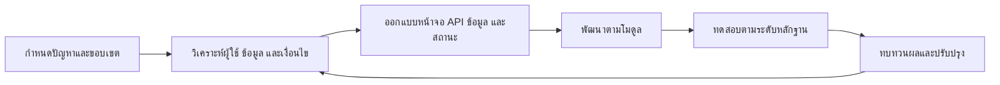
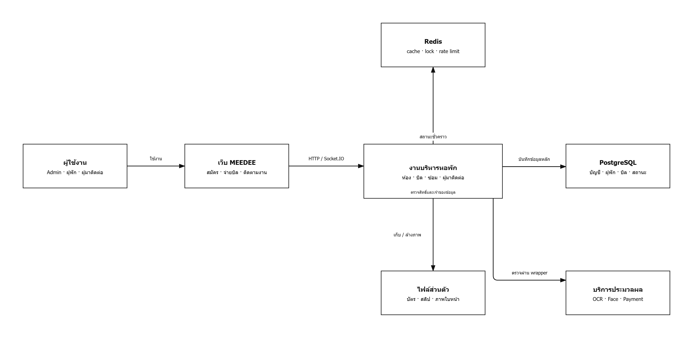
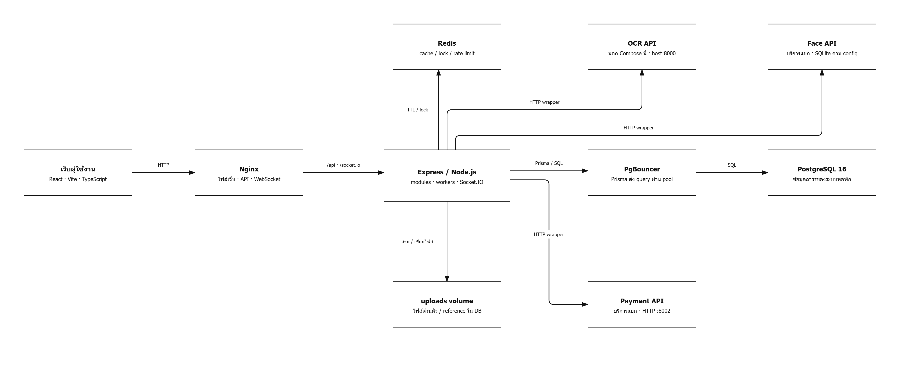
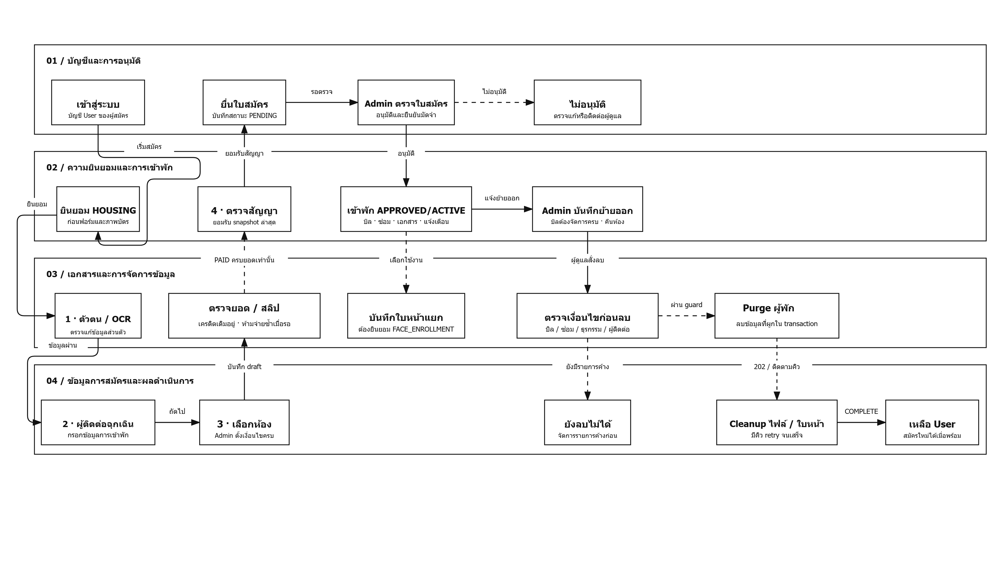
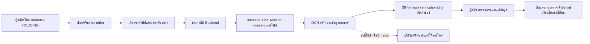
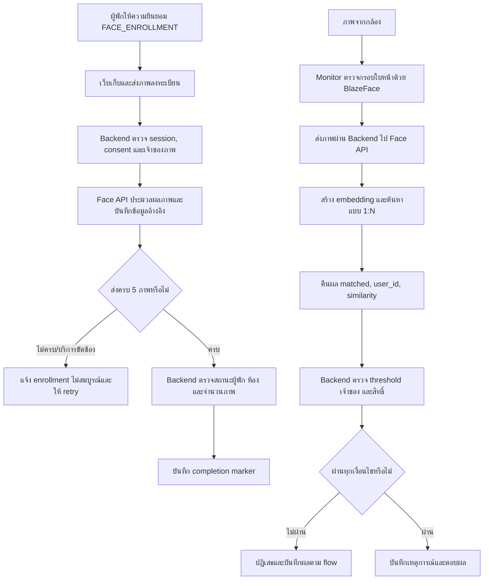
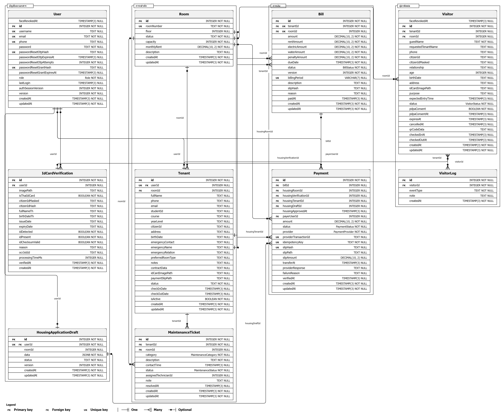

# บทที่ 3 วิธีดำเนินการและออกแบบระบบ

บทนี้อธิบายแนวทางดำเนินโครงงาน การวิเคราะห์ความต้องการ การออกแบบสถาปัตยกรรมและกระบวนการหลัก แบบจำลองข้อมูล การรักษาความปลอดภัย ส่วนติดต่อผู้ใช้ ตลอดจนเครื่องมือและสภาพแวดล้อมที่ใช้พัฒนา เนื้อหาอ้างอิงจากระบบต้นแบบบริหารจัดการหอพักที่พัฒนาจริง โดยแยกบริการภายนอกและอุปกรณ์ที่ยังไม่ได้ทดสอบจริงออกจากขอบเขตของระบบ

## 3.1 แนวทางการดำเนินงาน

โครงงานดำเนินงานเป็นรอบตามโมดูลและกระบวนการของระบบ เริ่มจากกำหนดปัญหาและขอบเขต วิเคราะห์บทบาทและข้อมูลที่เกี่ยวข้อง ออกแบบการทำงาน พัฒนาและเชื่อมต่อส่วนประกอบ จากนั้นตรวจสอบผลและปรับปรุงตามข้อผิดพลาดหรือเงื่อนไขที่พบ การทำงานลักษณะนี้ทำให้สามารถปรับรายละเอียดของแต่ละส่วนโดยยังตรวจสอบผลกระทบกับ API ฐานข้อมูล และหน้าจอที่เกี่ยวข้องได้

การดำเนินงานแบ่งเป็น 6 ระยะ ได้แก่ (1) กำหนดปัญหาและขอบเขต (2) วิเคราะห์ผู้ใช้ ข้อมูล และเงื่อนไข (3) ออกแบบหน้าจอ API และฐานข้อมูล (4) พัฒนาระบบเป็นโมดูล (5) ทดสอบตามระดับหลักฐาน และ (6) ทบทวนผลเพื่อปรับปรุง การทดสอบระหว่างพัฒนาแยกเป็นการทดสอบกฎธุรกิจและหน้าจอด้วย Mock การทดสอบ HTTP ร่วมกับฐานข้อมูลทดสอบ และการตรวจระบบที่รันจริงตามกรณีที่มีหลักฐาน บริการ OCR, Face, Payment และ Notification ภายนอกใช้ Mock ในการทดสอบบางชุด จึงไม่ถือว่าเป็นการทดสอบ Provider จริง ขั้นตอนแสดงในภาพที่ 3.1

**ภาพที่ 3.1 วงจรการดำเนินงานและปรับปรุงระบบต้นแบบ**

ที่มา: ผู้จัดทำ สรุปจากแนวทางดำเนินโครงงาน

## 3.2 การวิเคราะห์ความต้องการของระบบ

การวิเคราะห์แบ่งความต้องการตามผู้ใช้งานและงานที่ระบบรองรับ โดยพิจารณาข้อมูลที่แต่ละบทบาทเข้าถึงได้และผลลัพธ์ปลายทางของแต่ละกระบวนการ ตารางที่ 3.1 สรุปความต้องการเชิงหน้าที่หลัก ระบบต้นแบบครอบคลุมบัญชีและสิทธิ์ การสมัครเข้าพัก ห้องและสัญญา บิล งานซ่อม ผู้มาติดต่อ การแจ้งเตือน และรายงาน โดยไม่รวมการควบคุมกล้องหรือประตูจริงและการยืนยันบริการภายนอกในสภาพแวดล้อมจริง

**ตารางที่ 3.1 ความต้องการเชิงหน้าที่ของระบบต้นแบบ**

| กลุ่มงาน              | ความต้องการของระบบ                                                                          |
| --------------------- | ------------------------------------------------------------------------------------------- |
| บัญชีและสิทธิ์        | สมัครและเข้าสู่ระบบ กำหนดบทบาท ตรวจสิทธิ์และเจ้าของข้อมูลที่ Backend                        |
| สมัครเข้าพัก          | บันทึกข้อมูลผู้สมัครและเอกสารเป็นฉบับร่าง เลือกห้อง ชำระ/ใช้เครดิต ตรวจสัญญา และส่งใบสมัคร  |
| ห้องและสัญญา          | จัดการห้องและราคา บันทึกข้อมูลสัญญาตามเงื่อนไขที่ผู้ดูแลกำหนด และรักษาข้อมูลสัญญาที่ส่งแล้ว |
| บิลและการชำระเงิน     | ออกบิล แสดงรายการและยอด แสดง QR รับหลักฐาน และปรับสถานะตามขั้นตอนตรวจสอบ                    |
| งานซ่อม               | รับคำขอ มอบหมายและปรับสถานะจนผู้พักยืนยันปิดงาน                                             |
| ผู้มาติดต่อ           | รับข้อมูลและคำขอเข้าพบ ตรวจสอบเอกสาร และบันทึกสถานะการดำเนินการ                             |
| รายงานและการแจ้งเตือน | แสดงข้อมูลสรุปและประวัติตามสิทธิ์ พร้อมแจ้งเหตุการณ์เมื่อช่องทางเชื่อมต่อพร้อม              |

ความต้องการด้านคุณภาพประกอบด้วยการตรวจข้อมูลจาก API แม้มีการตรวจที่หน้าเว็บ การจำกัดข้อมูลตามบทบาทและเจ้าของ การเก็บข้อมูลสำคัญใน PostgreSQL การป้องกันคำขอหรือธุรกรรมซ้ำ การแสดงสถานะและข้อผิดพลาดที่เข้าใจได้ และการแยกผลทดสอบ Mock ออกจากผลของบริการจริง ทั้งนี้ไม่ถือเป็นการรับรองความพร้อมใช้งานระยะยาวหรือการประเมินผู้ใช้เชิงสถิติ

## 3.3 การออกแบบสถาปัตยกรรมระบบ

ระบบแบ่งเป็นส่วนติดต่อผู้ใช้ Backend ฐานข้อมูล และบริการสนับสนุน โดยหน้าเว็บ React ส่งคำขอ HTTP ไปยัง Backend ผ่าน API; Nginx ให้บริการไฟล์เว็บและส่งต่อคำขอตามการตั้งค่า Backend ใช้ Express และแยกงานเป็นโมดูล ทำงานร่วมกับ PostgreSQL ผ่าน Prisma และ PgBouncer ส่วน Redis ใช้กับ cache, rate limit, lock และสถานะชั่วคราว OCR, Face, Payment และ Notification เชื่อมผ่าน Wrapper ของ Backend ไม่เรียก Engine หรือ Provider โดยตรงจากหน้าเว็บ

ภาพที่ 3.2 แสดงองค์ประกอบระดับภาพรวม ส่วนภาพที่ 3.3 แสดงการจัดวางส่วนประกอบตามโครงสร้างระบบที่ออกแบบ ภาพทั้งสองอธิบาย topology จาก source และ config ไม่ใช่ภาพวัดการทำงานหรือสมรรถนะใน runtime

**ภาพที่ 3.2 ภาพรวมระบบต้นแบบบริหารจัดการหอพัก**

ที่มา: ผู้จัดทำ สรุปจาก source และ configuration ของระบบ

**ภาพที่ 3.3 สถาปัตยกรรมระบบต้นแบบ**

ที่มา: ผู้จัดทำ สรุปจาก source และ configuration ของระบบ

โครงสร้างใช้งาน Docker Compose สำหรับ Backend, PostgreSQL, Redis, PgBouncer และ Nginx ตาม profile ที่กำหนด เว็บสร้างไฟล์ด้วย Vite แล้วให้บริการตามการตั้งค่า Nginx ส่วนบริการ OCR และ Face ทำงานเป็นบริการแยกและเชื่อมต่อผ่าน API การมีองค์ประกอบในแบบออกแบบไม่ได้ยืนยันว่าทุกบริการเปิดใช้งานอยู่พร้อมกันในทุกสภาพแวดล้อม

ตารางที่ 3.2 แสดง API หลักที่สอดคล้องกับกระบวนการของระบบ โดยชื่อเส้นทางตรวจจากการลงทะเบียน route จริง API สำหรับ OCR และ Face เป็นจุดเชื่อมต่อกับบริการประมวลผล ไม่ใช่ algorithm ที่พัฒนาขึ้นใหม่ในระบบหอพัก

**ตารางที่ 3.2 ตัวอย่าง API หลักของระบบ**

| Method | Endpoint | หน้าที่ |
|---|---|---|
| POST | `/api/auth/login` | ตรวจสอบบัญชีและเริ่ม session โดยส่ง access token ผ่าน HttpOnly cookie |
| GET | `/api/rooms` | อ่านรายการห้องพักตามสิทธิ์ผู้ใช้ |
| PATCH | `/api/tenants/draft` | บันทึกข้อมูลใบสมัครฉบับร่างของบัญชีปัจจุบัน |
| POST | `/api/tenants/draft/upload-identity` | ส่งภาพเอกสารเพื่อยืนยันข้อมูลผู้สมัครผ่าน OCR wrapper |
| GET | `/api/tenants/draft/payment-qr/:roomNumber` | ขอ QR ตามยอดคงเหลือและตรวจสิทธิ์จองห้องชั่วคราว |
| POST | `/api/maintenance` | สร้างคำขอแจ้งซ่อมของผู้พักที่มีสิทธิ์ |
| POST | `/api/visitor/register` | ลงทะเบียนผู้มาติดต่อ พร้อมตรวจข้อมูลและป้องกันคำขอซ้ำ |
| POST | `/api/face-verification/verify` | ส่งภาพสำหรับตรวจสอบใบหน้าผ่าน Face API wrapper |
| GET | `/api/billing` | อ่านรายการบิลตามสิทธิ์ของบัญชี |

ตารางนี้ยก API หลักตามกระบวนการ ไม่ใช่รายการ endpoint ทั้งหมด ส่วน endpoint ที่ใช้กับผู้ดูแล อุปกรณ์ หรือการดูแลระบบมีการตรวจ role/token เพิ่มเติมตามหน้าที่

## 3.4 การออกแบบหน้าที่ตามผู้ใช้งาน

ระบบกำหนดงานตามบทบาทเพื่อไม่ให้ผู้ใช้เข้าถึงข้อมูลที่ไม่เกี่ยวข้อง User ที่มี role STUDENT และข้อมูล Tenant เป็นคนละส่วนกัน บัญชีผู้ใช้สามารถมีอยู่ก่อนเริ่มสมัครเข้าพัก และการลบข้อมูลผู้พักไม่ได้หมายถึงการลบบัญชี ตารางที่ 3.3 สรุปหน้าที่หลักและข้อจำกัดของแต่ละบทบาท

**ตารางที่ 3.3 บทบาทผู้ใช้งานและหน้าที่ในระบบ**

| บทบาท        | หน้าที่หลัก                                                                       | ข้อจำกัดการเข้าถึง                                                 |
| ------------ | --------------------------------------------------------------------------------- | ------------------------------------------------------------------ |
| Admin        | พิจารณาใบสมัคร จัดการผู้พัก ห้อง ราคา บิล งานซ่อม ผู้มาติดต่อ การตั้งค่าและรายงาน | เข้าถึงข้อมูลตามสิทธิ์ Admin และใช้ข้อมูลเท่าที่จำเป็นต่อการจัดการ |
| User/STUDENT | จัดการข้อมูลสมัครและสัญญาของตนเอง ดูบิล ชำระเงิน แจ้งซ่อม และติดตามสถานะ          | อ่านหรือเปลี่ยนข้อมูลที่ผูกกับบัญชีตนเองเท่านั้น                   |
| ผู้มาติดต่อ  | ส่งข้อมูลและคำขอเข้าพบตามแบบฟอร์มที่เปิดให้บริการ                                 | ไม่มีสิทธิ์ดูรายการหรือเอกสารของผู้มาติดต่อรายอื่น                 |
| บริการภายนอก | ประมวลผลคำขอที่ Backend ส่งผ่าน API เช่น OCR หรือ Face                            | ไม่ใช่ผู้ใช้งานเว็บและไม่เป็นแหล่งตัดสินสิทธิ์ของหอพัก             |

## 3.5 การออกแบบกระบวนการทำงานหลัก

### 3.5.1 การสมัครเข้าพักและจัดการห้อง

ผู้สมัครอ่านและให้ความยินยอมตามวัตถุประสงค์ HOUSING ก่อนเริ่มกรอกข้อมูลและส่งเอกสาร จากนั้นดำเนินการ 4 ขั้น ได้แก่ (1) ยืนยันตัวตนและข้อมูลส่วนตัว (2) ระบุผู้ติดต่อฉุกเฉิน (3) เลือกห้องและจัดการยอดชำระ (4) ตรวจสัญญาและยืนยันส่งใบสมัคร ระบบบันทึกฉบับร่างไว้กับบัญชีเพื่อให้กลับมาทำต่อได้ และตรวจข้อมูลสำคัญซ้ำที่ Backend ก่อนบันทึก

ก่อนออก QR ระบบกันสิทธิ์ห้องชั่วคราว 10 นาที โดยบันทึกเวลาหมดอายุไว้กับฉบับร่างและตรวจความจุซ้ำเมื่อส่งใบสมัคร เมื่อหมดเวลา ระบบคืนสิทธิ์ห้องให้ผู้สมัครรายอื่นได้ ยอดที่ชำระและตรวจผ่านแล้วคงเป็นเครดิตของเจ้าของฉบับร่าง ไม่ผูกกับห้องที่หมดเวลาจอง ผู้สมัครเลือกใช้เครดิตกับห้องใหม่หรือส่งคำขอคืนได้ หากยอดเครดิตเกินยอดที่ต้องชำระ ระบบแจ้งยอดส่วนเกินและให้ผู้สมัครเลือกดำเนินการต่อโดยไม่ขอคืน ซึ่งจะไม่มีการคืนส่วนเกินให้โดยอัตโนมัติ หรือกลับไปส่งคำขอคืนก่อนยืนยันสมัคร การคืนเงินจริงต้องให้ Admin บันทึกผลและหลักฐานหลังดำเนินการภายนอกแล้ว ระบบไม่ได้โอนเงินคืนอัตโนมัติ ใบสมัครที่ส่งแล้วรอ Admin พิจารณา การชำระเงินเพียงอย่างเดียวไม่ทำให้ได้รับสิทธิ์เข้าพัก

ภาพที่ 3.4 แสดงวงจรการสมัคร การพิจารณา การเข้าพัก การย้ายออก และการล้างข้อมูลที่ผูกกับผู้พัก โดยยังเก็บบัญชี User ไว้สำหรับสมัครใหม่ตามเงื่อนไข

**ภาพที่ 3.4 วงจรการสมัครเข้าพัก ย้ายออก และล้างข้อมูลผู้พัก**

ที่มา: ผู้จัดทำ สรุปจากกระบวนการและเงื่อนไขในระบบ

### 3.5.2 กระบวนการบิล งานซ่อม และผู้มาติดต่อ

กระบวนการอื่นออกแบบให้สถานะเปลี่ยนตามเงื่อนไข ไม่ใช่จากการเปลี่ยนข้อความบนหน้าจอเพียงอย่างเดียว สถานะหลักแสดงในตารางที่ 3.4

**ตารางที่ 3.4 กระบวนการและสถานะปลายทางหลัก**

| กระบวนการ        | ลำดับ/เงื่อนไขหลัก                                                                                                       |
| ---------------- | ------------------------------------------------------------------------------------------------------------------------ |
| งานซ่อม          | PENDING → APPROVED → IN_PROGRESS → RESOLVED → CLOSED โดยผู้พักยืนยันปิดงานของตนเอง                                       |
| ผู้มาติดต่อ      | คำขอเข้าพบแยกจากขั้นการเข้าพื้นที่ WAITING → ADMITTED → COMPLETED; การบันทึกด้วยเจ้าหน้าที่ไม่ใช่หลักฐานว่าประตูจริงเปิด |
| บิล              | UNPAID/OVERDUE → VERIFYING → PAID หรือ FAILED ตามผลตรวจและขั้นตอนที่ระบบรองรับ                                           |
| ย้ายออก          | ตรวจบิลและงานค้างก่อนเปลี่ยนสถานะผู้พักและคืนห้อง                                                                        |
| ล้างข้อมูลผู้พัก | ตรวจเงื่อนไขก่อนลบข้อมูลและไฟล์ที่ผูก จากนั้นติดตามงาน cleanup จนเสร็จ โดยเก็บบัญชี User                                 |

## 3.6 การออกแบบการทำงานของ OCR และ Face Verification

โครงงานเชื่อม OCR และ Face Verification ผ่าน API wrapper โดยไม่ได้พัฒนาโมเดลประมวลผลขึ้นเอง ขั้นตอนของทั้งสองส่วนแสดงในภาพที่ 3.5–3.7 และตารางที่ 3.6 สรุปข้อมูลที่รับ การประมวลผล และผลที่ระบบนำไปใช้ การออกแบบเน้นตรวจสอบเจ้าของข้อมูลและสิทธิ์ที่ Backend ไม่ถือว่าผลจาก AI เพียงอย่างเดียวเป็นการอนุมัติใบสมัครหรืออนุญาตเข้าพัก

### 3.6.1 การอ่านและตรวจสอบเอกสารด้วย OCR

ผู้สมัครให้ความยินยอม HOUSING ก่อนส่งภาพบัตร ระบบตรวจชนิดและขนาดไฟล์ แล้วส่งภาพผ่าน OCR API เพื่ออ่านข้อความ เช่น ชื่อ วันเกิด เลขบัตร และที่อยู่ ผลการอ่านผูกกับรายการตรวจเอกสารและบัญชีผู้ใช้ ผู้สมัครตรวจทานและแก้ข้อมูลที่กรอกได้ก่อนดำเนินการต่อ เมื่อใช้ผลยืนยันในใบสมัคร Backend ตรวจว่า verification และภาพเป็นของบัญชีเดียวกัน รวมทั้งตรวจความถูกต้องตามกฎข้อมูลของระบบ หาก OCR อ่านไม่สำเร็จหรือบริการภายนอกขัดข้อง ระบบแสดงข้อผิดพลาด/ให้ลองใหม่ และไม่สร้างผลยืนยันขึ้นเอง

**ภาพที่ 3.5 ขั้นตอนอ่านเอกสารและตรวจเจ้าของผล OCR**

ที่มา: ผู้จัดทำ สรุปจากขั้นตอนสมัครและโมดูล OCR

### 3.6.2 การลงทะเบียนและตรวจสอบใบหน้า

ก่อนเปิดกล้องหรือส่งภาพ ผู้พักต้องให้ความยินยอม FACE_ENROLLMENT ซึ่งแยกจากความยินยอมสมัครเข้าพัก จากนั้นเว็บส่งภาพลงทะเบียนเป็นรายการ โดยระบบเก็บข้อมูลภาพและผลจาก Face service ผ่าน wrapper เมื่อส่งภาพครบ 5 ภาพจึงเรียก API เพื่อบันทึกสถานะ enrollment สำเร็จ Backend ตรวจบัญชีผู้ใช้ consent สถานะผู้พัก ห้อง และจำนวนภาพก่อนบันทึก completion marker แบบป้องกันการบันทึกซ้ำ หากบางภาพส่งไม่สำเร็จ ระบบแจ้ง enrollment ไม่สมบูรณ์และให้ทำต่อได้ ภาพที่บันทึกสำเร็จแล้วอาจคงอยู่ระหว่าง retry

เมื่อตรวจใบหน้า Monitor ใช้ BlazeFace ตรวจกรอบใบหน้าเพื่อเลือกภาพส่ง ส่วนการสร้าง embedding และค้นหาเทียบกับข้อมูลที่ลงทะเบียนทำผ่านบริการ Face API ตาม integration ที่ระบบเชื่อมไว้ ผลค้นหามีลักษณะ 1:N และใช้คะแนน cosine similarity กับ threshold ที่กำหนด บริการส่งผลกลับ เช่น matched, user_id และ similarity; Backend ตรวจรูปแบบผล เจ้าของบัญชี สถานะการเพิกถอน และสิทธิ์เข้าพักก่อนบันทึกเหตุการณ์หรืออนุญาตตาม flow ระบบ หากบริการไม่พร้อม ผลผิดรูป คะแนนไม่ผ่าน หรือบัญชีไม่มีสิทธิ์ จะไม่อนุญาตให้ผ่าน การมี endpoint หรือโค้ดรองรับไม่ได้ยืนยันว่าทดสอบกล้อง ประตูจริง liveness หรือบริการ Face ภายนอกในสภาพแวดล้อมใช้งานจริงแล้ว

**ภาพที่ 3.6 ขั้นตอนลงทะเบียนและตรวจสอบใบหน้า**

ที่มา: ผู้จัดทำ สรุปจากการเชื่อมต่อ Face API และ flow ยืนยันสิทธิ์

| ส่วนงาน | ข้อมูลเข้า | การประมวลผล | ผลลัพธ์และการตรวจสอบ |
|---|---|---|---|
| OCR บัตร | ภาพบัตรที่ผู้สมัครส่ง | Backend ส่งภาพให้ OCR API และบันทึกผลตรวจที่ผูกกับบัญชี | ข้อมูลที่อ่านได้และ verificationId; ผู้สมัครตรวจทาน และ Backend ตรวจเจ้าของก่อนใช้ |
| ลงทะเบียนใบหน้า | ภาพใบหน้าตามขั้นตอนลงทะเบียน | Face API ประมวลผลภาพ; Backend ตรวจความยินยอม สถานะผู้พัก ห้อง และจำนวนภาพ | ข้อมูลลงทะเบียนและ completion marker เมื่อครบ 5 ภาพและผ่านเงื่อนไข |
| ตรวจใบหน้า | ภาพจาก Monitor และข้อมูลใบหน้าที่ลงทะเบียน | ตรวจกรอบบน Monitor, ส่งไป Face API, เปรียบเทียบ embedding แบบ 1:N แล้วตรวจคะแนนและสิทธิ์ที่ Backend | ผล matched/ไม่ผ่าน; คะแนน similarity ไม่ใช่ร้อยละความแม่นยำ และผล AI ไม่แทนการตรวจสิทธิ์ |

**ตารางที่ 3.6 สรุปข้อมูลเข้าและผลลัพธ์ของ OCR และ Face Verification**

## 3.7 การออกแบบฐานข้อมูล

ระบบใช้ PostgreSQL เป็นแหล่งข้อมูลหลักและ Prisma ในการเข้าถึงข้อมูล ตารางในฐานข้อมูลเชื่อมโยงบัญชี ผู้พัก ห้อง บิล การชำระเงิน งานซ่อม ผู้มาติดต่อ และข้อมูลตรวจเอกสาร ระบบแยก User ซึ่งเป็นบัญชีเข้าสู่ระบบออกจาก Tenant ซึ่งเป็นข้อมูลสมัครและเข้าพัก รวมถึงแยกข้อมูลภาพจริงในพื้นที่ไฟล์ออกจากข้อมูลอ้างอิงในฐานข้อมูล

ภาพที่ 3.7 เป็น ERD เฉพาะตารางหลักที่เลือกแสดง ไม่ใช่ฐานข้อมูลทั้งหมด โดยฉบับที่ใช้สร้างภาพครอบคลุม 10 ตาราง 161 คอลัมน์ และความสัมพันธ์ Foreign Key 17 จุด ตารางหลักมีหน้าที่ดังนี้: User เก็บบัญชีและสิทธิ์; IdCardVerification เก็บผลตรวจเอกสาร; HousingApplicationDraft เก็บข้อมูลสมัครชั่วคราวและเวลาสิทธิ์ห้อง; Room เก็บห้องและราคา; Tenant เก็บข้อมูลผู้พักและสัญญา; MaintenanceTicket เก็บคำขอซ่อม; Bill เก็บยอดเรียกเก็บ; Payment เก็บรายการชำระและเครดิต; Visitor เก็บคำขอผู้มาติดต่อ; VisitorLog เก็บประวัติการดำเนินการกับผู้มาติดต่อ

**ภาพที่ 3.7 ERD ตารางหลักของระบบต้นแบบ**

ที่มา: ผู้จัดทำ สรุปจาก Prisma schema และ source; ภาพฉบับนี้จัดทำเมื่อ 16 ตุลาคม 2569

ตารางที่ 3.5 สรุปกลุ่มข้อมูลสำคัญและหน้าที่ การทำงานที่ต้องปรับหลายรายการให้สอดคล้องกันใช้ Transaction ตามกรณี ส่วน Redis ใช้ Cache, Rate Limit, Lock และสถานะชั่วคราว ไม่ใช้แทนข้อมูลหลักหรือประวัติธุรกรรมถาวร

**ตารางที่ 3.5 กลุ่มข้อมูลหลักในฐานข้อมูล**

| กลุ่มข้อมูล         | ตัวอย่างข้อมูลและหน้าที่                                                                               |
| ------------------- | ------------------------------------------------------------------------------------------------------ |
| บัญชีและความยินยอม  | User, role, session version และหลักฐานยินยอมตามวัตถุประสงค์                                            |
| ผู้พักและห้อง       | Tenant, Room, ใบสมัครฉบับร่าง และ snapshot ของสัญญา                                                    |
| การเงิน             | Bill, Payment, ชุดชำระ เครดิต และคำขอคืนเงิน                                                           |
| งานปฏิบัติการ       | MaintenanceTicket, Visitor และบันทึกการดำเนินงาน                                                       |
| เอกสารและชีวมิติ    | IdCardVerification, OcrJob, FaceEnrollmentPhoto และ FaceEmbedding โดยเชื่อมข้อมูลอ้างอิงกับไฟล์ตามระบบ |
| การตั้งค่าและบันทึก | SystemSetting, Notification และ AccessLog สำหรับค่าระบบ เหตุการณ์ และการตรวจสอบ                        |

Data Dictionary ในตารางที่ 3.7 อธิบายฟิลด์สำคัญของข้อมูลที่สัมพันธ์กับ ERD ในภาพที่ 3.7 ชนิดข้อมูลสรุปตามการใช้งานของแต่ละฟิลด์ ไม่รวมฟิลด์เชิงระบบ เช่น `createdAt`, `updatedAt` และฟิลด์ความสัมพันธ์ย้อนกลับ

**ตารางที่ 3.7 Data Dictionary ของข้อมูลหลัก**

| ตาราง | ฟิลด์ | ชนิดข้อมูล | ความหมาย |
|---|---|---|---|
| User | `id` | จำนวนเต็ม | รหัสบัญชีผู้ใช้ |
| User | `email`, `username`, `phone` | ข้อความ | อีเมล ชื่อผู้ใช้ และเบอร์ติดต่อ; username/phone อาจว่างได้ |
| User | `password` | ข้อความเข้ารหัส | ค่า password hash สำหรับตรวจสอบการเข้าสู่ระบบ ไม่ใช่รหัสผ่านดิบ |
| User | `role` | enum | บทบาทผู้ใช้ เช่น ADMIN หรือ STUDENT ใช้กำหนดสิทธิ์ |
| User | `authSessionVersion`, `version` | จำนวนเต็ม | รุ่น session สำหรับเพิกถอนการเข้าสู่ระบบ และรุ่นข้อมูลสำหรับ OCC |
| Room | `id`, `roomNumber` | จำนวนเต็ม, ข้อความ | รหัสห้องและหมายเลขห้อง |
| Room | `floor`, `capacity`, `status` | จำนวนเต็ม, จำนวนเต็ม, ข้อความ | ชั้น จำนวนผู้พักสูงสุด และสถานะห้อง |
| Room | `monthlyRent` | จำนวนเงิน | ค่าเช่ารายเดือน |
| Tenant | `id`, `userId`, `roomId` | จำนวนเต็ม | รหัสผู้พักและรหัสอ้างอิงบัญชี/ห้อง; ความสัมพันธ์อาจยังไม่มี |
| Tenant | `fullName`, `phone`, `email`, `studentId` | ข้อความ | ชื่อ ข้อมูลติดต่อ และรหัสนักศึกษาของผู้พัก |
| Tenant | `citizenId`, `address`, `birthDate` | ข้อความ | เลขประจำตัวประชาชน ที่อยู่ และวันเกิดตามข้อมูลสมัคร |
| Tenant | `emergencyContact`, `emergencyName`, `emergencyRelation` | ข้อความ | เบอร์ติดต่อ ชื่อ และความสัมพันธ์ของผู้ติดต่อฉุกเฉิน |
| Tenant | `contractData` | ข้อความ JSON | รายละเอียดและ snapshot ข้อมูลสัญญาของผู้พัก |
| Tenant | `status`, `checkInDate`, `checkOutDate`, `isActive` | ข้อความ, วันเวลา, วันเวลา, ค่าจริง/เท็จ | สถานะและช่วงเวลาการเข้าพัก รวมถึงตัวบ่งชี้การใช้งาน |
| HousingApplicationDraft | `id`, `userId`, `roomId` | จำนวนเต็ม | รหัสฉบับร่าง เจ้าของฉบับร่าง และห้องที่เลือก |
| HousingApplicationDraft | `roomHoldExpiresAt` | วันเวลา | เวลาสิ้นสุดการกันสิทธิ์ห้องชั่วคราว |
| HousingApplicationDraft | `data` | JSON | ข้อมูลแบบฟอร์มสมัครหลายขั้นที่บันทึกเป็นฉบับร่าง |
| HousingApplicationDraft | `status`, `version` | ข้อความ, จำนวนเต็ม | สถานะ draft และรุ่นข้อมูลสำหรับตรวจการแก้ไขขัดแย้ง |
| Bill | `id`, `tenantId`, `roomId` | จำนวนเต็ม | รหัสบิลและข้อมูลผู้พัก/ห้องที่เกี่ยวข้อง |
| Bill | `amount`, `rentAmount`, `electricAmount`, `waterAmount`, `penaltyAmount` | จำนวนเงิน | ยอดรวม ค่าเช่า ค่าไฟ ค่าน้ำ และค่าปรับ |
| Bill | `dueDate`, `billingPeriod` | วันเวลา, ข้อความ | วันครบกำหนดและรอบบิลรูปแบบปี-เดือน |
| Bill | `status`, `version`, `paidAt` | enum, จำนวนเต็ม, วันเวลา | สถานะบิล รุ่นข้อมูล และเวลาชำระสำเร็จ |
| Payment | `id`, `billId`, `housingDraftId`, `payerUserId` | จำนวนเต็ม | รหัสรายการชำระและการอ้างอิงบิล/ใบสมัคร/ผู้ชำระ |
| Payment | `amount`, `status`, `provider` | จำนวนเงิน, enum, enum | ยอดชำระ สถานะตรวจสอบ และผู้ให้บริการชำระเงิน |
| Payment | `idempotencyKey`, `providerTransactionId`, `slipHash` | ข้อความ | คีย์ป้องกันรายการซ้ำ รหัสธุรกรรม และค่า hash ของสลิป |
| Payment | `slipPath`, `transferAt`, `verifiedAt` | ข้อความ, วันเวลา, วันเวลา | ตำแหน่งหลักฐานและเวลาที่โอน/ตรวจสอบ |
| MaintenanceTicket | `id`, `tenantId`, `roomId` | จำนวนเต็ม | รหัสงานซ่อมและข้อมูลผู้พัก/ห้องที่เกี่ยวข้อง |
| MaintenanceTicket | `category`, `description`, `contactTime` | enum, ข้อความ, วันเวลา | ประเภท รายละเอียด และเวลาที่สะดวกติดต่อ |
| MaintenanceTicket | `status`, `assignedTechnicianId`, `note`, `resolvedAt` | enum, จำนวนเต็ม, ข้อความ, วันเวลา | สถานะ ผู้รับผิดชอบ หมายเหตุ และเวลาแก้ไขเสร็จ |
| Visitor | `id`, `tenantId`, `roomId` | จำนวนเต็ม | รหัสผู้มาติดต่อและผู้พัก/ห้องที่เกี่ยวข้อง |
| Visitor | `guestName`, `requestedTenantName`, `phone`, `relationship` | ข้อความ | ชื่อผู้มาติดต่อ ชื่อผู้พักที่ระบุ เบอร์ติดต่อ และความสัมพันธ์ |
| Visitor | `citizenIdMasked`, `address`, `idCardImagePath` | ข้อความ | เลขบัตรที่ปกปิด ที่อยู่ และตำแหน่งไฟล์เอกสาร |
| Visitor | `expectedEntryTime`, `status`, `expiresAt` | วันเวลา, enum, วันเวลา | เวลาคาดว่าจะเข้าพบ สถานะคำขอ และเวลาหมดอายุ |
| Visitor | `pdpaConsent`, `pdpaConsentAt`, `checkedInAt`, `checkedOutAt` | ค่าจริง/เท็จ, วันเวลา | หลักฐานความยินยอมและเวลาเข้า/ออกที่บันทึกในระบบ |
| VisitorLog | `id`, `visitorId` | จำนวนเต็ม | รหัสบันทึกเหตุการณ์และรหัสผู้มาติดต่อ |
| VisitorLog | `eventType`, `note`, `createdAt` | ข้อความ, ข้อความ, วันเวลา | ประเภทเหตุการณ์ หมายเหตุ และเวลาบันทึก |
| IdCardVerification | `id`, `userId` | จำนวนเต็ม | รหัสผลตรวจเอกสารและบัญชีที่เกี่ยวข้อง |
| IdCardVerification | `citizenIdMasked`, `citizenIdHash`, `fullNameTh`, `birthDateTh` | ข้อความ | เลขบัตรที่ปกปิด/ค่า hash ชื่อภาษาไทย และวันเกิดที่อ่านได้ |
| IdCardVerification | `isThaiIdCard`, `idDetected`, `idPresent`, `idChecksumValid` | ค่าจริง/เท็จ | ผลตรวจชนิดบัตร การตรวจพบ และความถูกต้องของเลขตรวจสอบ |
| IdCardVerification | `imagePath`, `reason`, `processingTimeMs`, `verifiedAt` | ข้อความ, ข้อความ, จำนวนเต็ม, วันเวลา | ตำแหน่งภาพ เหตุผลการตรวจ เวลาประมวลผล และเวลาตรวจ |

ข้อมูลส่วนบุคคล เช่น เลขบัตร ที่อยู่ ภาพเอกสาร และหลักฐานชำระ เป็นข้อมูลจำกัดสิทธิ์ จึงต้องปกปิดก่อนนำไปใช้ในภาพประกอบหรือเผยแพร่

## 3.8 การออกแบบด้านความปลอดภัยและข้อมูลส่วนบุคคล

การยืนยันตัวตนใช้ Access Token ใน Cookie ที่กำหนด HttpOnly และตรวจรุ่น Session กับบัญชีปัจจุบันใน PostgreSQL ทุกคำขอที่ต้องใช้สิทธิ์ การกำหนดสิทธิ์ตรวจทั้ง role และ ownership ที่ Backend; ข้อมูลจากหน้าจอ เช่น userId หรือ roomId ที่ผู้ใช้ส่งมาไม่ใช้เป็นหลักฐานสิทธิ์โดยลำพัง

ข้อมูลนำเข้าตรวจด้วย Validation ก่อนประมวลผล ไฟล์ส่วนตัวอ่านได้ตามเจ้าของและสิทธิ์ที่กำหนด การสมัครและการเก็บภาพใบหน้าใช้ความยินยอมคนละวัตถุประสงค์และต้องตรวจที่ API ก่อนเริ่มงาน ข้อมูลหลักและประวัติธุรกรรมเก็บใน PostgreSQL; Redis ใช้เฉพาะกลไกชั่วคราวที่กำหนด

การป้องกันรายการซ้ำใช้การตรวจสถานะและ idempotency ในกระบวนการที่เกี่ยวกับการชำระหรือเปลี่ยนสิทธิ์ ส่วนการจองห้องและเปลี่ยนสถานะตรวจเงื่อนไขล่าสุดในฐานข้อมูลก่อนบันทึก การเชื่อมต่อ OCR มี timeout, retry และ circuit breaker ตามการตั้งค่า ส่วนการทดสอบ provider จริง กล้องจริง และประตู/Edge จริงยังอยู่นอกขอบเขตการยืนยันผลในรอบนี้

## 3.9 การออกแบบส่วนติดต่อผู้ใช้

หน้าจอจัดแยกตามงาน Admin, User และผู้มาติดต่อ โดยใช้แบบฟอร์ม รายการสถานะ และรายละเอียดที่สัมพันธ์กับข้อมูลเดียวกัน เมื่อโหลดหน้าเริ่มต้นแสดง Skeleton ตามชนิดข้อมูล ส่วนการกดทำรายการใช้สถานะกำลังทำงานและข้อความสำเร็จหรือผิดพลาดในตำแหน่งที่เกี่ยวข้อง การตรวจความถูกต้องที่หน้าจอช่วยแนะนำผู้ใช้ แต่ Backend ยังคงตรวจซ้ำ

หน้าสมัครแสดงความคืบหน้า 4 ขั้นและเก็บ draft เพื่อกลับมาทำต่อ หน้าบิลแสดงยอด รายการ และหลักฐานชำระตามสิทธิ์ หน้างานซ่อมแสดงลำดับสถานะจนผู้พักยืนยันปิดงาน ส่วนหน้าผู้ดูแลแสดงงานที่ต้องตรวจและการดำเนินการที่ได้รับอนุญาต

สำหรับฉบับจัดเล่มควรเพิ่มภาพหน้าจอจากระบบที่รันจริงอย่างน้อย 3 ภาพ ได้แก่ หน้าสมัครและเลือกห้อง หน้ารายการบิล/หลักฐาน และหน้าจัดการงานซ่อมหรือผู้มาติดต่อ โดยปกปิดชื่อ เลขบัตร เบอร์โทร อีเมล QR และหลักฐานการเงินจริง ภาพหน้าจอเหล่านี้ยังไม่ได้แนบใน repository จึงไม่สร้างภาพจำลองแทนหน้าจอจริง

## 3.10 เครื่องมือและสภาพแวดล้อมในการพัฒนาและทดสอบ

ตารางที่ 3.8 แสดงเครื่องมือหลักและหน้าที่ในการพัฒนา โดยไม่แจกแจง package ย่อยหรือระบุรุ่น เนื่องจากรุ่นอาจเปลี่ยนตามสภาพแวดล้อมติดตั้ง

**ตารางที่ 3.8 เครื่องมือและเทคโนโลยีหลักในการดำเนินโครงงาน**

| ประเภท         | เครื่องมือ/เทคโนโลยี                                 | หน้าที่                                                             |
| -------------- | ---------------------------------------------------- | ------------------------------------------------------------------- |
| Frontend       | React, TypeScript, Vite, Axios                       | สร้างหน้าจอและสื่อสารกับ API                                        |
| Backend        | Node.js, TypeScript, Express                         | ให้บริการ HTTP API และกฎธุรกิจตามโมดูล                              |
| ฐานข้อมูล      | PostgreSQL, Prisma                                   | จัดเก็บข้อมูลหลักและจัดการ Schema/Migration                         |
| ข้อมูลชั่วคราว | Redis                                                | Cache, Rate Limit, Lock และสถานะชั่วคราวตามจุดที่กำหนด              |
| การติดตั้ง     | Docker Compose, Nginx                                | จัดบริการ Container ให้เครือข่ายและส่งต่อคำขอตามการตั้งค่า          |
| การทดสอบ       | ชุดทดสอบอัตโนมัติ, Mock และฐานข้อมูลทดสอบแยก         | ตรวจ logic, API/DB และกรณีผิดพลาดตามชุดทดสอบ                        |
| บริการภายนอก   | OCR, Face, Payment และ Notification API ผ่าน Wrapper | ส่งคำขอประมวลผลหรือแจ้งเหตุการณ์; ไม่ใช่ Engine ที่พัฒนาในระบบหอพัก |

การทดสอบที่ใช้ในโครงงานแบ่งตามหลักฐาน 5 ระดับ ได้แก่ (1) Source Review ตรวจโค้ดและ configuration โดยไม่รันระบบ (2) Unit/Mock ตรวจฟังก์ชัน กฎธุรกิจ และการตอบสนองจำลอง (3) Integration ตรวจการทำงานร่วมกันของ HTTP, ฐานข้อมูลทดสอบ และโมดูลที่เกี่ยวข้อง (4) Runtime ตรวจบริการที่เริ่มทำงานในสภาพแวดล้อมที่กำหนด และ (5) User Acceptance ให้ผู้ใช้ทดลองทำงานตามสถานการณ์จริง การใช้ Mock ไม่ยืนยันบริการภายนอก และการทดสอบบางระดับที่ยังไม่มีหลักฐานต้องระบุเป็นข้อจำกัด ไม่อนุมานจากจำนวน test หรือ build ผ่าน
