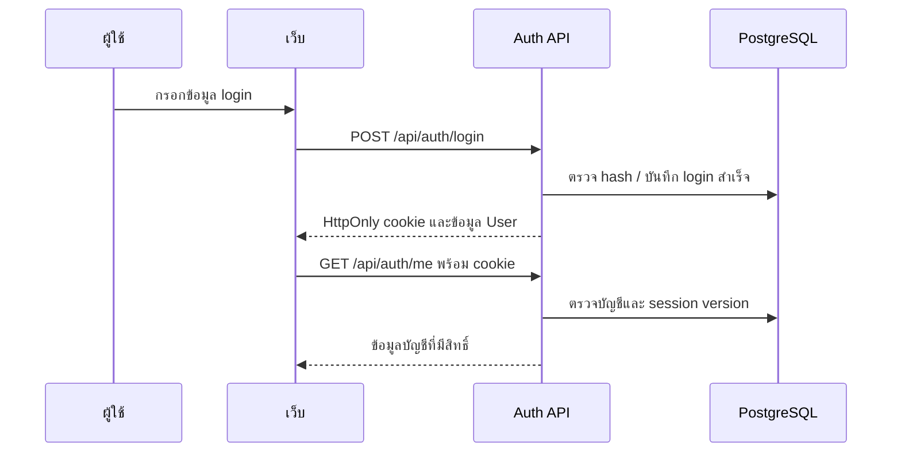

# 4.2 การพัฒนาระบบบัญชีและการยืนยันตัวตน

## 1. หน้าที่และผู้ใช้งาน

โมดูล auth แยกการมีบัญชีออกจากการสมัครห้อง ผู้สมัครสร้าง User ก่อน โดยการสมัครสาธารณะใช้ STUDENT ผู้ดูแลจัดการบัญชีผ่านส่วน Admin การเข้าถึงข้อมูลต้องผ่าน session และตรวจ role/เจ้าของที่ API ไม่ใช้เพียงการซ่อนปุ่ม

## 2. หน้าจอและ flow

1. สมัครบัญชีด้วยข้อมูลที่แบบฟอร์มกำหนด ระบบตรวจรูปแบบและข้อมูลซ้ำ แล้วเก็บ password hash
2. Login ตรวจบัญชีและรหัสผ่าน เมื่อสำเร็จบันทึก lastLogin และออก HttpOnly cookie `access_token` โดย body ไม่ส่ง JWT
3. เว็บส่งคำขอพร้อม credentials และอ่าน `/auth/me` เพื่อทราบบัญชีปัจจุบัน
4. REST และ Socket ตรวจบัญชีปัจจุบันกับ `authSessionVersion` ใน PostgreSQL; session เก่าที่ถูกยกเลิกใช้ไม่ได้
5. Logout และเปลี่ยนรหัสผ่านยกเลิก session ทุกเครื่อง การเชื่อม Socket ของบัญชีนั้นถูกยกเลิกด้วย

## 3. ลืมรหัสผ่านและ OTP

flow เป็นกรอกเบอร์ที่ผูกบัญชี → ขอ OTP → ตรวจ OTP → รับ reset grant → ตั้งรหัสผ่านใหม่ OTP เป็นเลข 6 หลักสุ่มด้วย CSPRNG มีอายุ 5 นาที เก็บ HMAC digest และตรวจแบบ constant-time จำกัดการตรวจผิด 5 ครั้ง Reset grant เป็นค่าสุ่ม เก็บ digest และใช้ครั้งเดียว

การส่ง OTP ปัจจุบันเป็น mock สำหรับพัฒนา `PASSWORD_RESET_SMS_MODE=mock` ถูกปฏิเสธใน staging/production เมื่อปิดหรือยังไม่พร้อม route จะปฏิเสธตาม policy ไม่ถือว่ามี SMS gateway จริง Grant อยู่ใน memory ของหน้าเว็บ ไม่ควรใส่ใน URL หรือเอกสารตัวอย่าง

## 4. ข้อมูลและ API

User เก็บบัญชี phone role password hash lastLogin ข้อมูล OTP/grant และ session version `User.version` ใช้กับ OCC และไม่ใช่ตัวเดียวกับ `authSessionVersion`

| Method / endpoint | หน้าที่ |
|---|---|
| POST `/api/auth/register` | สมัครบัญชีสาธารณะ |
| POST `/api/auth/login` | ตรวจรหัสผ่านและออก cookie |
| GET `/api/auth/me` | อ่านบัญชีปัจจุบัน |
| POST `/api/auth/logout` | ยกเลิก session |
| POST `/api/auth/forgot-password` | ขอ OTP ตาม policy |
| POST `/api/auth/verify-reset-otp` | ตรวจ OTP และออก grant |
| POST `/api/auth/reset-password` | ใช้ grant ตั้งรหัสใหม่ |
| POST `/api/auth/heartbeat` | presence; ไม่ใช้ยืด lastLogin |

Login จำกัดความพยายามที่ล้มเหลวต่อบัญชี โดยค่าเริ่มต้น 5 ครั้ง/5 นาทีและปรับได้จาก environment การขอ OTP จำกัด 3 ครั้ง/ชั่วโมงต่อเบอร์ การสมัครมี rate limit ต่อ IP จึงต้องระบุค่าที่ใช้จริงเมื่อทำรายงานสมรรถนะ

## 5. ผลทดสอบและความหมาย

| กรณี | ผลที่ต้องได้ | หลักฐาน/ผล |
|---|---|---|
| Login สำเร็จ | cookie และไม่ส่ง JWT ใน body | RT/IT ผ่านตาม QA |
| ไม่มี session เรียกข้อมูลป้องกัน | 401 | RT ผ่าน; ไม่แทน authorized CRUD ทุก route |
| User เรียกงาน Admin | 403 | IT/RT ตามกรณีใน QA |
| Logout แล้วใช้ session เดิม | ปฏิเสธ และ Socket ถูกยกเลิก | UT/IT มีกรณี session invalidation |
| Heartbeat | ไม่เปลี่ยน lastLogin | IT ผ่าน |
| OTP ผิด/หมดอายุ/grant ซ้ำ | ไม่เปลี่ยนรหัสผ่าน | UT และ source review; ดูรายงาน OTP |
| ส่ง SMS ถึงโทรศัพท์ | ต้องมี provider จริง | OS; ไม่รับรองในเล่มนี้ |

## 6. ข้อผิดพลาดและข้อจำกัด

เบอร์บัญชีที่หายอาจทำให้การสมัครเข้าพักไม่ผ่านแม้ OCR/สลิปอ่านได้ ผู้ดูแลต้องแก้ข้อมูล User ไม่ใช่เปลี่ยนผล OCR เพื่อให้ผ่าน API การตั้งรหัสใหม่ไม่ใช่ช่องทางข้ามสิทธิ์ และเอกสารนี้ไม่อ้างว่าทดสอบเปลี่ยนรหัสผ่านทุกบัญชีจริงแล้ว

รูปประกอบที่ควรใช้: หน้าสมัคร/Login, หน้า OTP สามขั้น และข้อความปฏิเสธ session หมดอายุ ปิดข้อมูลเบอร์ รหัส OTP และ cookie ก่อนนำไปใช้

## 7. แหล่งอ้างอิงในโครงการ

- [Routes](../../src/modules/auth/auth.routes.ts), [Service](../../src/modules/auth/auth.service.ts), [OTP service](../../src/modules/auth/password-reset-otp.service.ts)
- [Auth contract tests](../../tests/unit/auth-contract.test.ts), [Auth middleware tests](../../tests/unit/auth-jwt.test.ts)
- [รายงาน OTP](../qa/password-reset-otp-report.md), [QA หลัก](../qa/system-flow-report.md)
