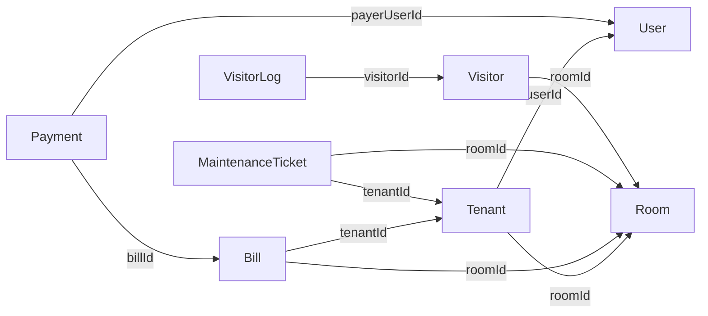

# ตารางฐานข้อมูลและพจนานุกรมข้อมูล MEEDEE Dormitory

ตรวจ schema และ source code วันที่ **18 ตุลาคม 2569** เอกสารนี้อธิบายระบบรวม ไม่แยกตามหน้าจอ และไม่เพิ่ม/เปลี่ยนตารางจริง

## 1. ขอบเขตและวิธีอ่าน

- Schema มี **25 model/table** พบ **24 ตาราง** ที่มีการอ่าน/เขียนในงานหรือบริการสนับสนุน ส่วน `Transaction` พบเพียง cleanup จึงแยกไว้ท้ายเอกสาร ไม่ถือเป็นตารางการเงินหลักปัจจุบัน
- “ใช้งาน” หมายถึงมีเส้นทางใน source รวม nested create/include ไม่ได้แปลว่าทุกตารางมีข้อมูลอยู่ หรือ provider/อุปกรณ์จริงผ่านการทดสอบแล้ว
- พจนานุกรมยึด schema กับโค้ด ไม่อ้างจำนวนข้อมูลส่วนบุคคลจริง; migration ห้องจองและคืนส่วนเกินตรวจใช้กับ Compose และฐานข้อมูลทดสอบแยกเมื่อ 18 ต.ค. 2569
- ชื่อตารางตรง Prisma model เพราะไม่มี @@map เปลี่ยนชื่อ ตารางฟิลด์แสดงชื่อคอลัมน์จริงหากมี @map เช่น photo_path/model_version
- PK = Primary key, FK = Foreign key ที่ประกาศจริง, UQ = Unique; “ว่างได้” อิงเครื่องหมาย ? ใน schema ไม่ใช่การรับรองว่า API ยอมให้ข้าม validation
- ฟิลด์ relation เช่น user, tenant, items, bills ไม่ใช่คอลัมน์เพิ่ม จึงไม่นับซ้ำ; enum เป็นชนิดข้อมูล ไม่ใช่ตาราง
- ชนิดข้อมูลใช้ชื่อ Prisma และ native type ที่ระบุใน schema เพื่อไม่เดาชนิด/ความยาวคอลัมน์ PostgreSQL ที่ schema ไม่ได้กำหนด

หลักฐาน: [prisma/schema.prisma](../../prisma/schema.prisma) และไฟล์บริการที่อ้างใต้แต่ละตาราง

## 2. สรุปตารางทั้งหมด

| ลำดับ | ตาราง | กลุ่มงาน | หน้าที่ | การใช้ที่ตรวจพบ |
|---|---|---|---|---|
| 1 | [User](#table-user) | บัญชีและสิทธิ์ | บัญชีเข้าสู่ระบบ รหัสผ่าน OTP สิทธิ์และ session | ใช้ในงานปัจจุบัน |
| 2 | [Tenant](#table-tenant) | ห้องและการเข้าพัก | ใบสมัคร/การเข้าพัก ข้อมูลส่วนตัว สัญญาและเอกสาร | ใช้ในงานปัจจุบัน |
| 3 | [Room](#table-room) | ห้องและการเข้าพัก | ห้อง ราคา ความจุและสถานะ | ใช้ในงานปัจจุบัน |
| 4 | [HousingApplicationDraft](#table-housingapplicationdraft) | ห้องและการเข้าพัก | ฉบับร่างสมัคร ห้องและเครดิตที่กลับมาทำต่อได้ | ใช้ในงานปัจจุบัน |
| 5 | [Bill](#table-bill) | บิลและชำระเงิน | ยอดเรียกเก็บแยกประเภทและรอบบิล | ใช้ในงานปัจจุบัน |
| 6 | [Payment](#table-payment) | บิลและชำระเงิน | ชำระบิลเดียวหรือชำระสมัครเข้าพัก พร้อมผลตรวจธุรกรรม | ใช้ในงานปัจจุบัน |
| 7 | [PaymentBatch](#table-paymentbatch) | บิลและชำระเงิน | ชุดรวมหลายบิลเป็นการชำระครั้งเดียว | ใช้ในงานปัจจุบัน |
| 8 | [PaymentBatchItem](#table-paymentbatchitem) | บิลและชำระเงิน | เชื่อมชุดชำระกับแต่ละบิลและยอดที่จัดสรร | ใช้ผ่าน nested items.create/include; ไม่ได้มีแค่ cleanup |
| 9 | [MaintenanceTicket](#table-maintenanceticket) | งานซ่อม | งานแจ้งซ่อมและสถานะจนผู้พักยืนยันปิดงาน | ใช้ในงานปัจจุบัน |
| 10 | [Visitor](#table-visitor) | ผู้มาติดต่อ | คำขอเข้าพบ ข้อมูลตรวจบัตรและความยินยอม | ใช้ในงานปัจจุบัน |
| 11 | [VisitorLog](#table-visitorlog) | ผู้มาติดต่อ | เหตุการณ์คำขอและหลักฐานขั้นเข้าพบ | ใช้ในงานปัจจุบัน |
| 12 | [IdCardVerification](#table-idcardverification) | เอกสารและ OCR | ผลตรวจบัตร หลักฐานเจ้าของเอกสารและ path ภาพ | ใช้ในงานปัจจุบัน |
| 13 | [OcrJob](#table-ocrjob) | เอกสารและ OCR | ติดตามงาน OCR และผลที่กู้คืนได้ | ใช้ในงานปัจจุบัน |
| 14 | [SystemSetting](#table-systemsetting) | ตั้งค่าระบบ | ค่าระบบ เงื่อนไขสัญญา คณะ และ metadata/คิว cleanup | ใช้ในงานปัจจุบัน |
| 15 | [AccessLog](#table-accesslog) | บัญชีและประวัติ | บันทึกคำขอ หลักฐาน consent โควตางานซ่อมและ completion marker | ใช้ในงานปัจจุบัน |
| 16 | [Notification](#table-notification) | แจ้งเตือน | ข้อความ ผู้รับ สถานะส่งและกำหนดเวลา | ใช้ในงานปัจจุบัน |
| 17 | [NotificationPreference](#table-notificationpreference) | แจ้งเตือน | ความประสงค์รับ/ไม่รับข้อความตามช่องทาง | ใช้ในบริการแจ้งเตือน; ไม่ใช่สถานะอ่านกระดิ่ง |
| 18 | [NotificationProvider](#table-notificationprovider) | แจ้งเตือน | ค่าผู้ให้บริการส่งข้อความที่ service เลือกตามช่องทาง | มีโค้ดอ่านใช้งาน; provider จริงอยู่นอกขอบเขต QA |
| 19 | [NotificationTemplate](#table-notificationtemplate) | แจ้งเตือน | แม่แบบข้อความที่ service อ่านเมื่อต้องเติมตัวแปร | ใช้เมื่อรายการระบุ templateId |
| 20 | [NotificationAuditLog](#table-notificationauditlog) | แจ้งเตือน | ประวัติเหตุการณ์ส่ง/เปลี่ยนสถานะแจ้งเตือน | ใช้ในบริการและ API audit logs |
| 21 | [NotificationDeadLetter](#table-notificationdeadletter) | แจ้งเตือน | รายการส่งที่ต้องจัดการ retry/ตรวจปัญหา | ใช้ในบริการและ API dead letters |
| 22 | [FaceEnrollmentPhoto](#table-faceenrollmentphoto) | ข้อมูลใบหน้า | path ภาพลงทะเบียนสำหรับประมวลผลและ cleanup | ใช้ใน wrapper/integration; ไม่รับรองกล้องจริง |
| 23 | [FaceEmbedding](#table-faceembedding) | ข้อมูลใบหน้า | เวกเตอร์และรุ่นโมเดลที่ integration รับมาจัดเก็บ | ใช้ใน wrapper/integration; ไม่รับรอง provider จริง |
| 24 | [Transaction](#table-transaction) | โครงสร้างเดิม | โครงรายการรายรับ/รายจ่ายเดิม; พบการล้าง แต่ไม่พบ flow สร้าง/อ่านเพื่อการเงินปัจจุบัน | พบเฉพาะ cleanup; ไม่จัดเป็นตารางการเงินหลัก |

| 25 | [HousingRefund](#table-housingrefund) | คืนเงินใบสมัคร | บันทึกคืนส่วนเกินจริง หลักฐานและผู้บันทึก โดยคง Payment เดิม | ใช้ในงานปัจจุบัน |
| 26 | [HousingRefundRequest](#table-housingrefundrequest) | คำขอคืนเครดิต | บันทึกคำขอของผู้สมัครและสถานะการพิจารณาของ Admin | ใช้ในงานปัจจุบัน |

## 3. รายละเอียดทุกคอลัมน์

### 1. User

บัญชีเข้าสู่ระบบ รหัสผ่าน OTP สิทธิ์และ session **สถานะ:** ใช้ในงานปัจจุบัน

หลักฐานใช้งาน: [src/modules/auth/auth.repository.ts](../../src/modules/auth/auth.repository.ts)

| ฟิลด์ Prisma | คอลัมน์จริง | ชนิดข้อมูล | ว่างได้ | คีย์/อ้างอิง | ความหมาย |
|---|---|---|---|---|---|
| `faceRevokedAt` | `faceRevokedAt` | DateTime | ได้ | — | เวลายกเลิกสิทธิ์ใช้งานใบหน้า |
| `id` | `id` | Int | ไม่ | PK | รหัสรายการ |
| `username` | `username` | String | ได้ | UQ | ชื่อบัญชี |
| `email` | `email` | String | ไม่ | UQ | อีเมล |
| `phone` | `phone` | String | ได้ | UQ | เบอร์โทรศัพท์ |
| `password` | `password` | String | ไม่ | — | รหัสผ่านที่ผ่านการ hash ไม่ใช่รหัสผ่านอ่านได้ |
| `passwordResetOtpHash` | `passwordResetOtpHash` | String | ได้ | UQ | ค่า hash OTP สำหรับกู้รหัสผ่าน |
| `passwordResetOtpExpiresAt` | `passwordResetOtpExpiresAt` | DateTime | ได้ | — | เวลาหมดอายุ OTP |
| `passwordResetOtpAttempts` | `passwordResetOtpAttempts` | Int | ไม่ | — | จำนวนครั้งที่ตรวจ OTP ไม่ผ่าน |
| `passwordResetGrantHash` | `passwordResetGrantHash` | String | ได้ | UQ | ค่า hash สิทธิ์เปลี่ยนรหัสผ่านครั้งเดียว |
| `passwordResetGrantExpiresAt` | `passwordResetGrantExpiresAt` | DateTime | ได้ | — | เวลาหมดอายุสิทธิ์เปลี่ยนรหัสผ่าน |
| `role` | `role` | Role | ไม่ | — | บทบาทบัญชี |
| `lastLogin` | `lastLogin` | DateTime | ได้ | — | เวลาเข้าสู่ระบบสำเร็จล่าสุด |
| `authSessionVersion` | `authSessionVersion` | Int | ไม่ | — | รุ่น session สำหรับยกเลิกสิทธิ์ token เดิม แยกจาก OCC |
| `version` | `version` | Int | ไม่ | — | รุ่นข้อมูลสำหรับตรวจการแก้ไขพร้อมกัน |
| `createdAt` | `createdAt` | DateTime | ไม่ | — | เวลาสร้างรายการ |
| `updatedAt` | `updatedAt` | DateTime | ไม่ | — | เวลาแก้ไขล่าสุดที่ Prisma จัดการ |

**ค่าเริ่มต้น/อัปเดตเวลา:** `id`: `@default(autoincrement())`; `passwordResetOtpAttempts`: `@default(0)`; `role`: `@default(STUDENT)`; `authSessionVersion`: `@default(1)`; `version`: `@default(1)`; `createdAt`: `@default(now())`; `updatedAt`: `@updatedAt`

### 2. Tenant

ใบสมัคร/การเข้าพัก ข้อมูลส่วนตัว สัญญาและเอกสาร **สถานะ:** ใช้ในงานปัจจุบัน

หลักฐานใช้งาน: [src/modules/tenants/tenants.service.ts](../../src/modules/tenants/tenants.service.ts)

| ฟิลด์ Prisma | คอลัมน์จริง | ชนิดข้อมูล | ว่างได้ | คีย์/อ้างอิง | ความหมาย |
|---|---|---|---|---|---|
| `id` | `id` | Int | ไม่ | PK | รหัสรายการ |
| `userId` | `userId` | Int | ได้ | UQ; FK → User.id | รหัสบัญชีเจ้าของข้อมูล |
| `roomId` | `roomId` | Int | ได้ | FK → Room.id | รหัสห้อง |
| `fullName` | `fullName` | String | ได้ | — | ชื่อ–นามสกุลผู้พัก |
| `phone` | `phone` | String | ได้ | — | เบอร์โทรศัพท์ |
| `email` | `email` | String | ได้ | — | อีเมล |
| `studentId` | `studentId` | String | ได้ | — | รหัสนักศึกษา |
| `course` | `course` | String | ได้ | — | ข้อความคณะที่เลือก; ชื่อฟิลด์เดิม ไม่ได้หมายถึงตารางหลักสูตร |
| `yearLevel` | `yearLevel` | String | ได้ | — | ชั้นปี |
| `citizenId` | `citizenId` | String | ได้ | — | เลขบัตรประชาชนซึ่งเป็นข้อมูลส่วนบุคคล |
| `address` | `address` | String | ได้ | — | ที่อยู่ |
| `birthDate` | `birthDate` | String | ได้ | — | วันเกิดที่เก็บเป็นข้อความ ไม่ใช่ชนิด DateTime |
| `emergencyContact` | `emergencyContact` | String | ได้ | — | เบอร์ผู้ติดต่อฉุกเฉินตาม mapping ที่ใช้อยู่ |
| `emergencyName` | `emergencyName` | String | ได้ | — | ชื่อผู้ติดต่อฉุกเฉิน |
| `emergencyRelation` | `emergencyRelation` | String | ได้ | — | ความสัมพันธ์ผู้ติดต่อฉุกเฉิน |
| `preferredRoomType` | `preferredRoomType` | String | ได้ | — | ความต้องการห้อง/ชั้น |
| `notes` | `notes` | String | ได้ | — | ข้อมูลเพิ่มเติม |
| `contractData` | `contractData` | String | ได้ | — | snapshot สัญญาในรูปข้อความ JSON ไม่ใช่ SQL JSON column |
| `idCardImagePath` | `idCardImagePath` | String | ได้ | — | path ภาพบัตรส่วนตัว |
| `paymentSlipPath` | `paymentSlipPath` | String | ได้ | — | path สลิปชำระตอนสมัคร |
| `status` | `status` | String | ไม่ | — | สถานะเข้าพักชนิด String เช่น PENDING/APPROVED/INACTIVE ไม่ใช่ enum ในฐานข้อมูล |
| `checkInDate` | `checkInDate` | DateTime | ได้ | — | เวลาเริ่มเข้าพักที่บันทึก |
| `checkOutDate` | `checkOutDate` | DateTime | ได้ | — | เวลาย้ายออกที่บันทึก |
| `isActive` | `isActive` | Boolean | ไม่ | — | ธงข้อมูลผู้พัก ต้องพิจารณาร่วม status/room ไม่ใช้แทนทุกเงื่อนไขสิทธิ์ |
| `createdAt` | `createdAt` | DateTime | ไม่ | — | เวลาสร้างรายการ |
| `updatedAt` | `updatedAt` | DateTime | ไม่ | — | เวลาแก้ไขล่าสุดที่ Prisma จัดการ |

**ค่าเริ่มต้น/อัปเดตเวลา:** `id`: `@default(autoincrement())`; `status`: `@default("PENDING")`; `isActive`: `@default(true)`; `createdAt`: `@default(now())`; `updatedAt`: `@updatedAt`

**คีย์และดัชนีระดับตาราง:** `@@index([userId])`, `@@index([roomId])`, `@@index([isActive])`

### 3. Room

ห้อง ราคา ความจุและสถานะ **สถานะ:** ใช้ในงานปัจจุบัน

หลักฐานใช้งาน: [src/modules/rooms/rooms.repository.ts](../../src/modules/rooms/rooms.repository.ts)

| ฟิลด์ Prisma | คอลัมน์จริง | ชนิดข้อมูล | ว่างได้ | คีย์/อ้างอิง | ความหมาย |
|---|---|---|---|---|---|
| `id` | `id` | Int | ไม่ | PK | รหัสรายการ |
| `roomNumber` | `roomNumber` | String | ไม่ | UQ | หมายเลขห้องแบบไม่ซ้ำ |
| `floor` | `floor` | Int | ได้ | — | ชั้น |
| `status` | `status` | String | ไม่ | — | สถานะห้องชนิด String เช่น AVAILABLE/OCCUPIED; กลุ่มห้องเต็มใน UI ไม่ใช่ enum ใหม่ |
| `capacity` | `capacity` | Int | ไม่ | — | จำนวนผู้พักสูงสุดของห้อง |
| `monthlyRent` | `monthlyRent` | Decimal / Decimal(10, 2) | ไม่ | — | ราคาค่าเช่าที่กำหนดกับห้อง |
| `description` | `description` | String | ได้ | — | รายละเอียด |
| `createdAt` | `createdAt` | DateTime | ไม่ | — | เวลาสร้างรายการ |
| `updatedAt` | `updatedAt` | DateTime | ไม่ | — | เวลาแก้ไขล่าสุดที่ Prisma จัดการ |

**ค่าเริ่มต้น/อัปเดตเวลา:** `id`: `@default(autoincrement())`; `status`: `@default("AVAILABLE")`; `capacity`: `@default(4)`; `createdAt`: `@default(now())`; `updatedAt`: `@updatedAt`

**คีย์และดัชนีระดับตาราง:** `@@index([roomNumber])`, `@@index([status])`

### 4. HousingApplicationDraft

ฉบับร่างสมัคร ห้องและเครดิตที่กลับมาทำต่อได้ **สถานะ:** ใช้ในงานปัจจุบัน

หลักฐานใช้งาน: [src/modules/tenants/housing-draft.service.ts](../../src/modules/tenants/housing-draft.service.ts)

| ฟิลด์ Prisma | คอลัมน์จริง | ชนิดข้อมูล | ว่างได้ | คีย์/อ้างอิง | ความหมาย |
|---|---|---|---|---|---|
| `id` | `id` | Int | ไม่ | PK | รหัสรายการ |
| `userId` | `userId` | Int | ไม่ | UQ; FK → User.id | รหัสบัญชีเจ้าของข้อมูล |
| `roomId` | `roomId` | Int | ได้ | — | รหัสห้องที่ service ตรวจและล็อก; ไม่มี FK ไป Room ใน schema |
| `roomHoldExpiresAt` | `roomHoldExpiresAt` | DateTime | ได้ | index ร่วม roomId/status | เวลาหมดอายุสิทธิ์กันที่พักก่อนชำระเงิน เพิ่ม 18 ต.ค. 2569; ใช้ร่วมสถานะ Payment เพื่อตรวจสิทธิ์ที่กำลังตรวจเงิน |
| `data` | `data` | Json | ไม่ | — | ข้อมูลฟอร์มฉบับร่างชนิด JSON |
| `status` | `status` | String | ไม่ | — | สถานะฉบับร่างชนิด String เริ่มต้น OPEN |
| `version` | `version` | Int | ไม่ | — | รุ่นข้อมูลสำหรับตรวจการแก้ไขพร้อมกัน |
| `createdAt` | `createdAt` | DateTime | ไม่ | — | เวลาสร้างรายการ |
| `updatedAt` | `updatedAt` | DateTime | ไม่ | — | เวลาแก้ไขล่าสุดที่ Prisma จัดการ |

**ค่าเริ่มต้น/อัปเดตเวลา:** `id`: `@default(autoincrement())`; `data`: `@default("{}")`; `status`: `@default("OPEN")`; `version`: `@default(1)`; `createdAt`: `@default(now())`; `updatedAt`: `@updatedAt`

**onDelete ที่ประกาศชัด:** `userId` → User.id: Cascade

### 5. Bill

ยอดเรียกเก็บแยกประเภทและรอบบิล **สถานะ:** ใช้ในงานปัจจุบัน

หลักฐานใช้งาน: [src/modules/billing/billing.service.ts](../../src/modules/billing/billing.service.ts)

| ฟิลด์ Prisma | คอลัมน์จริง | ชนิดข้อมูล | ว่างได้ | คีย์/อ้างอิง | ความหมาย |
|---|---|---|---|---|---|
| `id` | `id` | Int | ไม่ | PK | รหัสรายการ |
| `tenantId` | `tenantId` | Int | ไม่ | FK → Tenant.id | รหัสข้อมูลการเข้าพัก |
| `roomId` | `roomId` | Int | ได้ | FK → Room.id | รหัสห้อง |
| `amount` | `amount` | Decimal / Decimal(10, 2) | ไม่ | — | ยอดเงินของรายการ |
| `rentAmount` | `rentAmount` | Decimal / Decimal(10, 2) | ไม่ | — | ส่วนยอดค่าเช่า |
| `electricAmount` | `electricAmount` | Decimal / Decimal(10, 2) | ไม่ | — | ส่วนยอดค่าไฟ |
| `waterAmount` | `waterAmount` | Decimal / Decimal(10, 2) | ไม่ | — | ส่วนยอดค่าน้ำ |
| `penaltyAmount` | `penaltyAmount` | Decimal / Decimal(10, 2) | ไม่ | — | ส่วนยอดค่าปรับ |
| `dueDate` | `dueDate` | DateTime | ไม่ | — | กำหนดชำระ |
| `status` | `status` | BillStatus | ไม่ | — | สถานะรายการ |
| `version` | `version` | Int | ไม่ | — | รุ่นข้อมูลสำหรับตรวจการแก้ไขพร้อมกัน |
| `billingPeriod` | `billingPeriod` | String / VarChar(7) | ได้ | — | รอบบิล YYYY-MM แบบ ค.ศ.; เก่าอาจว่าง |
| `description` | `description` | String | ได้ | — | รายละเอียด |
| `slipHash` | `slipHash` | String | ได้ | — | hash สลิปเพื่อป้องกันใช้ซ้ำ |
| `reason` | `reason` | String | ได้ | — | เหตุผลหรือข้อสังเกต |
| `paidAt` | `paidAt` | DateTime | ได้ | — | เวลาที่บันทึกชำระสำเร็จ |
| `createdAt` | `createdAt` | DateTime | ไม่ | — | เวลาสร้างรายการ |
| `updatedAt` | `updatedAt` | DateTime | ไม่ | — | เวลาแก้ไขล่าสุดที่ Prisma จัดการ |

**ค่าเริ่มต้น/อัปเดตเวลา:** `id`: `@default(autoincrement())`; `rentAmount`: `@default(0)`; `electricAmount`: `@default(0)`; `waterAmount`: `@default(0)`; `penaltyAmount`: `@default(0)`; `status`: `@default(UNPAID)`; `version`: `@default(1)`; `createdAt`: `@default(now())`; `updatedAt`: `@updatedAt`

**คีย์และดัชนีระดับตาราง:** `@@index([tenantId])`, `@@index([roomId])`, `@@index([status])`, `@@index([dueDate])`, `@@unique([tenantId, roomId, billingPeriod])`

### 6. Payment

ชำระบิลเดียวหรือชำระสมัครเข้าพัก พร้อมผลตรวจธุรกรรม **สถานะ:** ใช้ในงานปัจจุบัน

หลักฐานใช้งาน: [src/modules/tenants/housing-payment.service.ts](../../src/modules/tenants/housing-payment.service.ts)

| ฟิลด์ Prisma | คอลัมน์จริง | ชนิดข้อมูล | ว่างได้ | คีย์/อ้างอิง | ความหมาย |
|---|---|---|---|---|---|
| `id` | `id` | Int | ไม่ | PK | รหัสรายการ |
| `billId` | `billId` | Int | ได้ | FK → Bill.id | รหัสบิล |
| `housingRoomId` | `housingRoomId` | Int | ได้ | FK → Room.id | ห้องที่ผูกการชำระสมัคร |
| `housingVerificationId` | `housingVerificationId` | Int | ได้ | FK → IdCardVerification.id | ผลตรวจบัตรของผู้สมัครที่ผูกยอดชำระ |
| `housingTenantId` | `housingTenantId` | Int | ได้ | FK → Tenant.id | ผู้พักที่รับยอดชำระสมัครแล้ว |
| `housingDraftId` | `housingDraftId` | Int | ได้ | FK → HousingApplicationDraft.id | ฉบับร่างที่ถือยอดชำระสมัคร |
| `housingApprovedAt` | `housingApprovedAt` | DateTime | ได้ | — | เวลาผู้ดูแลยืนยันยอดสมัครเพื่อการนับมัดจำ |
| `payerUserId` | `payerUserId` | Int | ได้ | FK → User.id | บัญชีผู้ชำระ |
| `amount` | `amount` | Decimal / Decimal(10, 2) | ไม่ | — | ยอดเงินของรายการ |
| `status` | `status` | PaymentStatus | ไม่ | — | สถานะรายการ |
| `provider` | `provider` | PaymentProvider | ไม่ | — | ผู้ให้บริการตรวจชำระ |
| `providerTransactionId` | `providerTransactionId` | String | ได้ | UQ | รหัสธุรกรรมจากผู้ให้บริการ |
| `idempotencyKey` | `idempotencyKey` | String | ไม่ | UQ | key ป้องกันสร้าง/ประมวลผลรายการเดิมซ้ำ |
| `slipHash` | `slipHash` | String | ได้ | UQ | hash สลิปเพื่อป้องกันใช้ซ้ำ |
| `slipPath` | `slipPath` | String | ได้ | — | path ไฟล์สลิปส่วนตัว |
| `slipAmount` | `slipAmount` | Decimal / Decimal(10, 2) | ได้ | — | ยอดที่อ่านหรือรับจากผลตรวจสลิป |
| `transferAt` | `transferAt` | DateTime | ได้ | — | เวลาโอนจากผลตรวจ |
| `providerResponse` | `providerResponse` | String | ได้ | — | ผลตอบกลับผู้ให้บริการที่เก็บเป็นข้อความ |
| `failureReason` | `failureReason` | String | ได้ | — | เหตุผลรายการไม่สำเร็จ/รอตรวจตาม flow |
| `verifiedAt` | `verifiedAt` | DateTime | ได้ | — | เวลาบันทึกผลตรวจสอบ |
| `createdAt` | `createdAt` | DateTime | ไม่ | — | เวลาสร้างรายการ |
| `updatedAt` | `updatedAt` | DateTime | ไม่ | — | เวลาแก้ไขล่าสุดที่ Prisma จัดการ |

**ค่าเริ่มต้น/อัปเดตเวลา:** `id`: `@default(autoincrement())`; `status`: `@default(PENDING)`; `provider`: `@default(THUNDER)`; `createdAt`: `@default(now())`; `updatedAt`: `@updatedAt`

**คีย์และดัชนีระดับตาราง:** `@@index([billId])`, `@@index([housingRoomId])`, `@@index([housingVerificationId])`, `@@index([housingTenantId])`, `@@index([housingDraftId])`, `@@index([payerUserId])`, `@@index([status])`, `@@index([createdAt])`

**onDelete ที่ประกาศชัด:** `billId` → Bill.id: Restrict; `housingRoomId` → Room.id: Restrict; `housingVerificationId` → IdCardVerification.id: Restrict; `housingDraftId` → HousingApplicationDraft.id: SetNull; `housingTenantId` → Tenant.id: Restrict

### 7. PaymentBatch

ชุดรวมหลายบิลเป็นการชำระครั้งเดียว **สถานะ:** ใช้ในงานปัจจุบัน

หลักฐานใช้งาน: [src/modules/billing/payment-batch.service.ts](../../src/modules/billing/payment-batch.service.ts)

| ฟิลด์ Prisma | คอลัมน์จริง | ชนิดข้อมูล | ว่างได้ | คีย์/อ้างอิง | ความหมาย |
|---|---|---|---|---|---|
| `id` | `id` | Int | ไม่ | PK | รหัสรายการ |
| `payerUserId` | `payerUserId` | Int | ได้ | FK → User.id | บัญชีผู้ชำระ |
| `amount` | `amount` | Decimal / Decimal(10, 2) | ไม่ | — | ยอดเงินของรายการ |
| `status` | `status` | PaymentBatchStatus | ไม่ | — | สถานะรายการ |
| `provider` | `provider` | PaymentProvider | ไม่ | — | ผู้ให้บริการตรวจชำระ |
| `idempotencyKey` | `idempotencyKey` | String | ไม่ | UQ | key ป้องกันสร้าง/ประมวลผลรายการเดิมซ้ำ |
| `slipHash` | `slipHash` | String | ได้ | UQ | hash สลิปเพื่อป้องกันใช้ซ้ำ |
| `slipPath` | `slipPath` | String | ได้ | — | path ไฟล์สลิปส่วนตัว |
| `slipAmount` | `slipAmount` | Decimal / Decimal(10, 2) | ได้ | — | ยอดที่อ่านหรือรับจากผลตรวจสลิป |
| `transferAt` | `transferAt` | DateTime | ได้ | — | เวลาโอนจากผลตรวจ |
| `providerTransactionId` | `providerTransactionId` | String | ได้ | UQ | รหัสธุรกรรมจากผู้ให้บริการ |
| `providerResponse` | `providerResponse` | String | ได้ | — | ผลตอบกลับผู้ให้บริการที่เก็บเป็นข้อความ |
| `failureReason` | `failureReason` | String | ได้ | — | เหตุผลรายการไม่สำเร็จ/รอตรวจตาม flow |
| `verifiedAt` | `verifiedAt` | DateTime | ได้ | — | เวลาบันทึกผลตรวจสอบ |
| `createdAt` | `createdAt` | DateTime | ไม่ | — | เวลาสร้างรายการ |
| `updatedAt` | `updatedAt` | DateTime | ไม่ | — | เวลาแก้ไขล่าสุดที่ Prisma จัดการ |

**ค่าเริ่มต้น/อัปเดตเวลา:** `id`: `@default(autoincrement())`; `status`: `@default(PENDING)`; `provider`: `@default(THUNDER)`; `createdAt`: `@default(now())`; `updatedAt`: `@updatedAt`

**คีย์และดัชนีระดับตาราง:** `@@index([payerUserId])`, `@@index([status])`, `@@index([createdAt])`

### 8. PaymentBatchItem

เชื่อมชุดชำระกับแต่ละบิลและยอดที่จัดสรร **สถานะ:** ใช้ผ่าน nested items.create/include; ไม่ได้มีแค่ cleanup

หลักฐานใช้งาน: [src/modules/billing/payment-batch.service.ts](../../src/modules/billing/payment-batch.service.ts)

| ฟิลด์ Prisma | คอลัมน์จริง | ชนิดข้อมูล | ว่างได้ | คีย์/อ้างอิง | ความหมาย |
|---|---|---|---|---|---|
| `batchId` | `batchId` | Int | ไม่ | PK; FK → PaymentBatch.id | รหัสชุดชำระ |
| `billId` | `billId` | Int | ไม่ | PK; FK → Bill.id | รหัสบิล |
| `amount` | `amount` | Decimal / Decimal(10, 2) | ไม่ | — | ยอดที่จัดสรรให้บิลในชุดชำระ ณ ตอนสร้างรายการ |
| `createdAt` | `createdAt` | DateTime | ไม่ | — | เวลาสร้างรายการ |

**ค่าเริ่มต้น/อัปเดตเวลา:** `createdAt`: `@default(now())`

**คีย์และดัชนีระดับตาราง:** `@@id([batchId, billId])`, `@@index([billId])`

**onDelete ที่ประกาศชัด:** `batchId` → PaymentBatch.id: Cascade

### 9. MaintenanceTicket

งานแจ้งซ่อมและสถานะจนผู้พักยืนยันปิดงาน **สถานะ:** ใช้ในงานปัจจุบัน

หลักฐานใช้งาน: [src/modules/maintenance/maintenance.repository.ts](../../src/modules/maintenance/maintenance.repository.ts)

| ฟิลด์ Prisma | คอลัมน์จริง | ชนิดข้อมูล | ว่างได้ | คีย์/อ้างอิง | ความหมาย |
|---|---|---|---|---|---|
| `id` | `id` | Int | ไม่ | PK | รหัสรายการ |
| `tenantId` | `tenantId` | Int | ไม่ | FK → Tenant.id | รหัสข้อมูลการเข้าพัก |
| `roomId` | `roomId` | Int | ได้ | FK → Room.id | รหัสห้อง |
| `category` | `category` | MaintenanceCategory | ไม่ | — | หมวดข้อมูล |
| `description` | `description` | String | ไม่ | — | รายละเอียด |
| `contactTime` | `contactTime` | DateTime | ได้ | — | ช่วงเวลาติดต่อที่บันทึกเป็น DateTime |
| `status` | `status` | MaintenanceStatus | ไม่ | — | สถานะรายการ |
| `assignedTechnicianId` | `assignedTechnicianId` | Int | ได้ | — | รหัสผู้รับงานที่เก็บเป็น scalar; ไม่มี FK ไป User/ตารางช่างใน schema |
| `note` | `note` | String | ได้ | — | หมายเหตุ |
| `resolvedAt` | `resolvedAt` | DateTime | ได้ | — | เวลาบันทึกซ่อมเสร็จ |
| `createdAt` | `createdAt` | DateTime | ไม่ | — | เวลาสร้างรายการ |
| `updatedAt` | `updatedAt` | DateTime | ไม่ | — | เวลาแก้ไขล่าสุดที่ Prisma จัดการ |

**ค่าเริ่มต้น/อัปเดตเวลา:** `id`: `@default(autoincrement())`; `category`: `@default(OTHER)`; `status`: `@default(PENDING)`; `createdAt`: `@default(now())`; `updatedAt`: `@updatedAt`

**คีย์และดัชนีระดับตาราง:** `@@index([tenantId])`, `@@index([roomId])`, `@@index([status])`, `@@index([createdAt])`

### 10. Visitor

คำขอเข้าพบ ข้อมูลตรวจบัตรและความยินยอม **สถานะ:** ใช้ในงานปัจจุบัน

หลักฐานใช้งาน: [src/modules/visitor/visitor.service.ts](../../src/modules/visitor/visitor.service.ts)

| ฟิลด์ Prisma | คอลัมน์จริง | ชนิดข้อมูล | ว่างได้ | คีย์/อ้างอิง | ความหมาย |
|---|---|---|---|---|---|
| `faceRevokedAt` | `faceRevokedAt` | DateTime | ได้ | — | เวลายกเลิกสิทธิ์ใช้งานใบหน้า |
| `id` | `id` | Int | ไม่ | PK | รหัสรายการ |
| `tenantId` | `tenantId` | Int | ได้ | FK → Tenant.id | รหัสข้อมูลการเข้าพัก |
| `roomId` | `roomId` | Int | ได้ | FK → Room.id | รหัสห้อง |
| `guestName` | `guestName` | String | ไม่ | — | ชื่อผู้มาติดต่อ |
| `requestedTenantName` | `requestedTenantName` | String | ได้ | — | ชื่อผู้พักที่ต้องการพบที่กรอกเอง ไม่ใช่ FK |
| `phone` | `phone` | String | ได้ | — | เบอร์โทรศัพท์ |
| `citizenId` | `citizenId` | String | ได้ | — | เลขบัตรประชาชนซึ่งเป็นข้อมูลส่วนบุคคล |
| `citizenIdMasked` | `citizenIdMasked` | String | ได้ | — | เลขบัตรแบบปกปิด |
| `relationship` | `relationship` | String | ได้ | — | ความสัมพันธ์กับผู้ที่ติดต่อ |
| `age` | `age` | Int | ได้ | — | อายุที่บันทึก; กฎบริการใช้วันเกิดคำนวณก่อนเมื่อมีข้อมูล |
| `birthDate` | `birthDate` | String | ได้ | — | วันเกิดที่เก็บเป็นข้อความ ไม่ใช่ชนิด DateTime |
| `address` | `address` | String | ได้ | — | ที่อยู่ |
| `idCardImagePath` | `idCardImagePath` | String | ได้ | — | path ภาพบัตรส่วนตัว |
| `purpose` | `purpose` | String | ได้ | — | วัตถุประสงค์การเข้าพบ |
| `expectedEntryTime` | `expectedEntryTime` | DateTime | ได้ | — | กำหนดเวลาที่คาดว่าจะเข้าพบ |
| `status` | `status` | VisitorStatus | ไม่ | — | สถานะคำขอตาม VisitorStatus แยกจาก visitStage ที่บริการคำนวณจาก log |
| `pdpaConsent` | `pdpaConsent` | Boolean | ไม่ | — | การยินยอมข้อมูลของผู้มาติดต่อ |
| `pdpaConsentAt` | `pdpaConsentAt` | DateTime | ได้ | — | เวลายินยอมของผู้มาติดต่อ |
| `expiresAt` | `expiresAt` | DateTime | ได้ | — | เวลาคำขอหมดอายุ |
| `cancelledAt` | `cancelledAt` | DateTime | ได้ | — | เวลายกเลิกคำขอ |
| `qrCodeData` | `qrCodeData` | String | ได้ | — | ข้อมูล QR ตามโครงเดิม; flow สาธารณะปัจจุบันไม่ใช้แทนสิทธิ์เปิดประตู |
| `checkedInAt` | `checkedInAt` | DateTime | ได้ | — | เวลาเช็กอินในโครงเดิม; visitStage ปัจจุบันอ้าง log |
| `checkedOutAt` | `checkedOutAt` | DateTime | ได้ | — | เวลาเช็กเอาต์ในโครงเดิม; visitStage ปัจจุบันอ้าง log |
| `createdAt` | `createdAt` | DateTime | ไม่ | — | เวลาสร้างรายการ |
| `updatedAt` | `updatedAt` | DateTime | ไม่ | — | เวลาแก้ไขล่าสุดที่ Prisma จัดการ |

**ค่าเริ่มต้น/อัปเดตเวลา:** `id`: `@default(autoincrement())`; `status`: `@default(REGISTERED)`; `pdpaConsent`: `@default(false)`; `createdAt`: `@default(now())`; `updatedAt`: `@updatedAt`

**คีย์และดัชนีระดับตาราง:** `@@index([tenantId])`, `@@index([roomId])`, `@@index([status])`, `@@index([expectedEntryTime])`, `@@index([expiresAt])`

### 11. VisitorLog

เหตุการณ์คำขอและหลักฐานขั้นเข้าพบ **สถานะ:** ใช้ในงานปัจจุบัน

หลักฐานใช้งาน: [src/modules/visitor/visitor.service.ts](../../src/modules/visitor/visitor.service.ts)

| ฟิลด์ Prisma | คอลัมน์จริง | ชนิดข้อมูล | ว่างได้ | คีย์/อ้างอิง | ความหมาย |
|---|---|---|---|---|---|
| `id` | `id` | Int | ไม่ | PK | รหัสรายการ |
| `visitorId` | `visitorId` | Int | ไม่ | FK → Visitor.id | รหัสผู้มาติดต่อ |
| `eventType` | `eventType` | String | ไม่ | — | ชื่อเหตุการณ์ที่บันทึก |
| `note` | `note` | String | ได้ | — | หมายเหตุ |
| `createdAt` | `createdAt` | DateTime | ไม่ | — | เวลาสร้างรายการ |

**ค่าเริ่มต้น/อัปเดตเวลา:** `id`: `@default(autoincrement())`; `createdAt`: `@default(now())`

**คีย์และดัชนีระดับตาราง:** `@@index([visitorId])`, `@@index([createdAt])`

### 12. IdCardVerification

ผลตรวจบัตร หลักฐานเจ้าของเอกสารและ path ภาพ **สถานะ:** ใช้ในงานปัจจุบัน

หลักฐานใช้งาน: [src/modules/ocr/ocr.repository.ts](../../src/modules/ocr/ocr.repository.ts)

| ฟิลด์ Prisma | คอลัมน์จริง | ชนิดข้อมูล | ว่างได้ | คีย์/อ้างอิง | ความหมาย |
|---|---|---|---|---|---|
| `id` | `id` | Int | ไม่ | PK | รหัสรายการ |
| `userId` | `userId` | Int | ได้ | FK → User.id | รหัสบัญชีเจ้าของข้อมูล |
| `imagePath` | `imagePath` | String | ได้ | — | path ภาพเอกสาร ไม่ใช่ binary ภาพ |
| `isThaiIdCard` | `isThaiIdCard` | Boolean | ไม่ | — | ผลจำแนกว่าเป็นบัตรประชาชนไทย |
| `citizenIdMasked` | `citizenIdMasked` | String | ได้ | — | เลขบัตรแบบปกปิด |
| `citizenIdHash` | `citizenIdHash` | String | ได้ | — | hash เลขบัตรสำหรับเทียบหลักฐาน |
| `fullNameTh` | `fullNameTh` | String | ได้ | — | ชื่อภาษาไทยที่อ่านจากบัตร |
| `birthDateTh` | `birthDateTh` | String | ได้ | — | วันเกิดข้อความภาษาไทยที่อ่านจากบัตร |
| `issueDate` | `issueDate` | String | ได้ | — | วันที่ออกบัตรตามผลอ่าน |
| `expiryDate` | `expiryDate` | String | ได้ | — | วันหมดอายุบัตรตามผลอ่าน |
| `idDetected` | `idDetected` | Boolean | ไม่ | — | ตรวจพบบัตร |
| `idPresent` | `idPresent` | Boolean | ไม่ | — | ตรวจพบข้อมูลเลขบัตร |
| `idChecksumValid` | `idChecksumValid` | Boolean | ไม่ | — | ผลตรวจเลขตรวจสอบของบัตร |
| `reason` | `reason` | String | ได้ | — | เหตุผลหรือข้อสังเกต |
| `ocrJobId` | `ocrJobId` | String | ได้ | — | รหัสงาน OCR ที่บันทึกประกอบผลตรวจ ไม่ใช่ FK ใน schema |
| `processingTimeMs` | `processingTimeMs` | Int | ได้ | — | เวลาประมวลผล OCR (มิลลิวินาที) |
| `verifiedAt` | `verifiedAt` | DateTime | ไม่ | — | เวลาบันทึกผลตรวจสอบ |
| `createdAt` | `createdAt` | DateTime | ไม่ | — | เวลาสร้างรายการ |

**ค่าเริ่มต้น/อัปเดตเวลา:** `id`: `@default(autoincrement())`; `idDetected`: `@default(false)`; `idPresent`: `@default(false)`; `idChecksumValid`: `@default(false)`; `verifiedAt`: `@default(now())`; `createdAt`: `@default(now())`

**คีย์และดัชนีระดับตาราง:** `@@index([userId])`, `@@index([citizenIdHash])`, `@@index([verifiedAt])`

### 13. OcrJob

ติดตามงาน OCR และผลที่กู้คืนได้ **สถานะ:** ใช้ในงานปัจจุบัน

หลักฐานใช้งาน: [src/modules/ocr/ocr.repository.ts](../../src/modules/ocr/ocr.repository.ts)

| ฟิลด์ Prisma | คอลัมน์จริง | ชนิดข้อมูล | ว่างได้ | คีย์/อ้างอิง | ความหมาย |
|---|---|---|---|---|---|
| `id` | `id` | String | ไม่ | PK | รหัสรายการ |
| `userId` | `userId` | Int | ได้ | FK → User.id | รหัสบัญชีเจ้าของข้อมูล |
| `status` | `status` | OcrJobStatus | ไม่ | — | สถานะรายการ |
| `imagePath` | `imagePath` | String | ไม่ | — | path ภาพเอกสาร ไม่ใช่ binary ภาพ |
| `resultVerificationId` | `resultVerificationId` | Int | ได้ | FK → IdCardVerification.id | รหัสผลตรวจบัตรที่งาน OCR ส่งคืน |
| `errorMessage` | `errorMessage` | String | ได้ | — | ข้อความผิดพลาดของงาน |
| `createdAt` | `createdAt` | DateTime | ไม่ | — | เวลาสร้างรายการ |
| `updatedAt` | `updatedAt` | DateTime | ไม่ | — | เวลาแก้ไขล่าสุดที่ Prisma จัดการ |
| `completedAt` | `completedAt` | DateTime | ได้ | — | เวลางานเสร็จ |

**ค่าเริ่มต้น/อัปเดตเวลา:** `id`: `@default(uuid())`; `status`: `@default(PENDING)`; `createdAt`: `@default(now())`; `updatedAt`: `@updatedAt`

**คีย์และดัชนีระดับตาราง:** `@@index([userId])`, `@@index([status])`, `@@index([createdAt])`, `@@index([resultVerificationId])`

### 14. SystemSetting

ค่าระบบ เงื่อนไขสัญญา คณะ และ metadata/คิว cleanup **สถานะ:** ใช้ในงานปัจจุบัน

หลักฐานใช้งาน: [src/modules/settings/settings.service.ts](../../src/modules/settings/settings.service.ts)

| ฟิลด์ Prisma | คอลัมน์จริง | ชนิดข้อมูล | ว่างได้ | คีย์/อ้างอิง | ความหมาย |
|---|---|---|---|---|---|
| `id` | `id` | Int | ไม่ | PK | รหัสรายการ |
| `key` | `key` | String | ไม่ | UQ | ชื่อค่าตั้งค่าแบบไม่ซ้ำ |
| `value` | `value` | String | ไม่ | — | ค่าตั้งค่า; บางหมวดเป็นข้อความ JSON |
| `category` | `category` | String | ไม่ | — | หมวดข้อมูล |
| `updatedById` | `updatedById` | Int | ได้ | FK → User.id | บัญชีผู้แก้ไขค่าตั้งค่า |
| `createdAt` | `createdAt` | DateTime | ไม่ | — | เวลาสร้างรายการ |
| `updatedAt` | `updatedAt` | DateTime | ไม่ | — | เวลาแก้ไขล่าสุดที่ Prisma จัดการ |

**ค่าเริ่มต้น/อัปเดตเวลา:** `id`: `@default(autoincrement())`; `category`: `@default("GENERAL")`; `createdAt`: `@default(now())`; `updatedAt`: `@updatedAt`

**คีย์และดัชนีระดับตาราง:** `@@index([category])`, `@@index([updatedById])`

### 15. AccessLog

บันทึกคำขอ หลักฐาน consent โควตางานซ่อมและ completion marker **สถานะ:** ใช้ในงานปัจจุบัน

หลักฐานใช้งาน: [src/modules/users/privacy-consent.service.ts](../../src/modules/users/privacy-consent.service.ts)

| ฟิลด์ Prisma | คอลัมน์จริง | ชนิดข้อมูล | ว่างได้ | คีย์/อ้างอิง | ความหมาย |
|---|---|---|---|---|---|
| `id` | `id` | Int | ไม่ | PK | รหัสรายการ |
| `userId` | `userId` | Int | ได้ | FK → User.id | รหัสบัญชีเจ้าของข้อมูล |
| `method` | `method` | String | ไม่ | — | ชนิดคำขอหรือเหตุการณ์ เช่น CONSENT และ MAINTENANCE_CREATED |
| `path` | `path` | String | ไม่ | — | เส้นทาง API หรือ key หลักฐานเหตุการณ์ |
| `ip` | `ip` | String | ได้ | — | IP ที่บันทึกได้ |
| `duration` | `duration` | Int | ได้ | — | เวลาประมวลผลคำขอ (มิลลิวินาที) |
| `createdAt` | `createdAt` | DateTime | ไม่ | — | เวลาสร้างรายการ |

**ค่าเริ่มต้น/อัปเดตเวลา:** `id`: `@default(autoincrement())`; `createdAt`: `@default(now())`

**คีย์และดัชนีระดับตาราง:** `@@index([userId])`, `@@index([createdAt])`, `@@index([path])`

### 16. Notification

ข้อความ ผู้รับ สถานะส่งและกำหนดเวลา **สถานะ:** ใช้ในงานปัจจุบัน

หลักฐานใช้งาน: [src/modules/notifications/notification.service.ts](../../src/modules/notifications/notification.service.ts)

| ฟิลด์ Prisma | คอลัมน์จริง | ชนิดข้อมูล | ว่างได้ | คีย์/อ้างอิง | ความหมาย |
|---|---|---|---|---|---|
| `id` | `id` | Int | ไม่ | PK | รหัสรายการ |
| `providerId` | `providerId` | Int | ได้ | FK → NotificationProvider.id | รหัสค่าผู้ให้บริการแจ้งเตือน |
| `templateId` | `templateId` | Int | ได้ | FK → NotificationTemplate.id | รหัสแม่แบบแจ้งเตือน |
| `tenantId` | `tenantId` | Int | ได้ | — | รหัสผู้พักผู้รับที่ service ตรวจ; ไม่มี FK ไป Tenant ใน schema |
| `userId` | `userId` | Int | ได้ | — | รหัสผู้รับที่ service ตรวจ; ไม่มี FK ไป User ใน schema |
| `channel` | `channel` | NotificationChannel | ไม่ | — | ช่องทาง SMS หรือ EMAIL |
| `type` | `type` | NotificationType | ไม่ | — | ชนิดรายการตาม enum |
| `recipientPhone` | `recipientPhone` | String | ได้ | — | เบอร์ปลายทางสำหรับส่งข้อความ |
| `recipientEmail` | `recipientEmail` | String | ได้ | — | อีเมลปลายทาง |
| `payload` | `payload` | String | ได้ | — | ข้อมูลข้อความ/ตัวแปร/metadata ที่เก็บเป็นข้อความ |
| `status` | `status` | NotificationStatus | ไม่ | — | สถานะรายการ |
| `providerMessageId` | `providerMessageId` | String | ได้ | — | รหัสข้อความจากผู้ให้บริการ |
| `attempts` | `attempts` | Int | ไม่ | — | จำนวนครั้งที่พยายามส่ง |
| `lastError` | `lastError` | String | ได้ | — | ข้อผิดพลาดล่าสุด |
| `scheduledAt` | `scheduledAt` | DateTime | ได้ | — | กำหนดเวลาส่ง |
| `sentAt` | `sentAt` | DateTime | ได้ | — | เวลาที่บันทึกส่งสำเร็จ |
| `createdAt` | `createdAt` | DateTime | ไม่ | — | เวลาสร้างรายการ |
| `updatedAt` | `updatedAt` | DateTime | ไม่ | — | เวลาแก้ไขล่าสุดที่ Prisma จัดการ |

**ค่าเริ่มต้น/อัปเดตเวลา:** `id`: `@default(autoincrement())`; `status`: `@default(PENDING)`; `attempts`: `@default(0)`; `createdAt`: `@default(now())`; `updatedAt`: `@updatedAt`

**คีย์และดัชนีระดับตาราง:** `@@index([tenantId])`, `@@index([userId])`, `@@index([status])`, `@@index([scheduledAt])`

### 17. NotificationPreference

ความประสงค์รับ/ไม่รับข้อความตามช่องทาง **สถานะ:** ใช้ในบริการแจ้งเตือน; ไม่ใช่สถานะอ่านกระดิ่ง

หลักฐานใช้งาน: [src/modules/notifications/notification.repository.ts](../../src/modules/notifications/notification.repository.ts)

| ฟิลด์ Prisma | คอลัมน์จริง | ชนิดข้อมูล | ว่างได้ | คีย์/อ้างอิง | ความหมาย |
|---|---|---|---|---|---|
| `id` | `id` | Int | ไม่ | PK | รหัสรายการ |
| `tenantId` | `tenantId` | Int | ได้ | — | รหัสผู้พักที่ service ตรวจ; ไม่มี FK ไป Tenant ใน schema |
| `userId` | `userId` | Int | ได้ | — | รหัสบัญชีที่ service ตรวจ; ไม่มี FK ไป User ใน schema |
| `channel` | `channel` | NotificationChannel | ไม่ | — | ช่องทาง SMS หรือ EMAIL |
| `optedOut` | `optedOut` | Boolean | ไม่ | — | ไม่ประสงค์รับข้อความตามช่องทางนี้ |
| `createdAt` | `createdAt` | DateTime | ไม่ | — | เวลาสร้างรายการ |
| `updatedAt` | `updatedAt` | DateTime | ไม่ | — | เวลาแก้ไขล่าสุดที่ Prisma จัดการ |

**ค่าเริ่มต้น/อัปเดตเวลา:** `id`: `@default(autoincrement())`; `optedOut`: `@default(false)`; `createdAt`: `@default(now())`; `updatedAt`: `@updatedAt`

**คีย์และดัชนีระดับตาราง:** `@@index([tenantId])`, `@@index([userId])`, `@@index([channel])`

### 18. NotificationProvider

ค่าผู้ให้บริการส่งข้อความที่ service เลือกตามช่องทาง **สถานะ:** มีโค้ดอ่านใช้งาน; provider จริงอยู่นอกขอบเขต QA

หลักฐานใช้งาน: [src/modules/notifications/notification.repository.ts](../../src/modules/notifications/notification.repository.ts)

| ฟิลด์ Prisma | คอลัมน์จริง | ชนิดข้อมูล | ว่างได้ | คีย์/อ้างอิง | ความหมาย |
|---|---|---|---|---|---|
| `id` | `id` | Int | ไม่ | PK | รหัสรายการ |
| `name` | `name` | String | ไม่ | UQ | ชื่อแบบไม่ซ้ำตามข้อกำหนดของตาราง |
| `channel` | `channel` | NotificationChannel | ไม่ | — | ช่องทาง SMS หรือ EMAIL |
| `config` | `config` | String | ไม่ | — | ค่าผู้ให้บริการในข้อความ JSON อาจมี secret ไม่ใส่ค่าจริงในเอกสาร |
| `isActive` | `isActive` | Boolean | ไม่ | — | สถานะเปิดใช้งาน |
| `createdAt` | `createdAt` | DateTime | ไม่ | — | เวลาสร้างรายการ |
| `updatedAt` | `updatedAt` | DateTime | ไม่ | — | เวลาแก้ไขล่าสุดที่ Prisma จัดการ |

**ค่าเริ่มต้น/อัปเดตเวลา:** `id`: `@default(autoincrement())`; `isActive`: `@default(true)`; `createdAt`: `@default(now())`; `updatedAt`: `@updatedAt`

**คีย์และดัชนีระดับตาราง:** `@@index([name])`, `@@index([channel])`

### 19. NotificationTemplate

แม่แบบข้อความที่ service อ่านเมื่อต้องเติมตัวแปร **สถานะ:** ใช้เมื่อรายการระบุ templateId

หลักฐานใช้งาน: [src/modules/notifications/notification.service.ts](../../src/modules/notifications/notification.service.ts)

| ฟิลด์ Prisma | คอลัมน์จริง | ชนิดข้อมูล | ว่างได้ | คีย์/อ้างอิง | ความหมาย |
|---|---|---|---|---|---|
| `id` | `id` | Int | ไม่ | PK | รหัสรายการ |
| `name` | `name` | String | ไม่ | UQ | ชื่อแม่แบบแบบไม่ซ้ำ |
| `channel` | `channel` | NotificationChannel | ไม่ | — | ช่องทาง SMS หรือ EMAIL |
| `type` | `type` | NotificationType | ไม่ | — | ชนิดรายการตาม enum |
| `subject` | `subject` | String | ได้ | — | หัวเรื่องข้อความ |
| `body` | `body` | String | ไม่ | — | เนื้อหาแม่แบบข้อความ |
| `variables` | `variables` | String | ได้ | — | รายการตัวแปรในรูปข้อความ JSON |
| `createdAt` | `createdAt` | DateTime | ไม่ | — | เวลาสร้างรายการ |
| `updatedAt` | `updatedAt` | DateTime | ไม่ | — | เวลาแก้ไขล่าสุดที่ Prisma จัดการ |

**ค่าเริ่มต้น/อัปเดตเวลา:** `id`: `@default(autoincrement())`; `createdAt`: `@default(now())`; `updatedAt`: `@updatedAt`

**คีย์และดัชนีระดับตาราง:** `@@index([channel])`, `@@index([type])`

### 20. NotificationAuditLog

ประวัติเหตุการณ์ส่ง/เปลี่ยนสถานะแจ้งเตือน **สถานะ:** ใช้ในบริการและ API audit logs

หลักฐานใช้งาน: [src/modules/notifications/notification.repository.ts](../../src/modules/notifications/notification.repository.ts)

| ฟิลด์ Prisma | คอลัมน์จริง | ชนิดข้อมูล | ว่างได้ | คีย์/อ้างอิง | ความหมาย |
|---|---|---|---|---|---|
| `id` | `id` | Int | ไม่ | PK | รหัสรายการ |
| `notificationId` | `notificationId` | Int | ไม่ | FK → Notification.id | รหัสแจ้งเตือน |
| `eventType` | `eventType` | String | ไม่ | — | ชื่อเหตุการณ์ที่บันทึก |
| `payload` | `payload` | String | ได้ | — | ข้อมูลข้อความ/ตัวแปร/metadata ที่เก็บเป็นข้อความ |
| `createdAt` | `createdAt` | DateTime | ไม่ | — | เวลาสร้างรายการ |

**ค่าเริ่มต้น/อัปเดตเวลา:** `id`: `@default(autoincrement())`; `createdAt`: `@default(now())`

**คีย์และดัชนีระดับตาราง:** `@@index([notificationId])`, `@@index([eventType])`

**onDelete ที่ประกาศชัด:** `notificationId` → Notification.id: Cascade

### 21. NotificationDeadLetter

รายการส่งที่ต้องจัดการ retry/ตรวจปัญหา **สถานะ:** ใช้ในบริการและ API dead letters

หลักฐานใช้งาน: [src/modules/notifications/notification.repository.ts](../../src/modules/notifications/notification.repository.ts)

| ฟิลด์ Prisma | คอลัมน์จริง | ชนิดข้อมูล | ว่างได้ | คีย์/อ้างอิง | ความหมาย |
|---|---|---|---|---|---|
| `id` | `id` | Int | ไม่ | PK | รหัสรายการ |
| `notificationId` | `notificationId` | Int | ไม่ | UQ; FK → Notification.id | รหัสแจ้งเตือน |
| `reason` | `reason` | String | ไม่ | — | เหตุผลที่ส่งต่อไปจัดการใน dead letter |
| `details` | `details` | String | ได้ | — | รายละเอียดข้อผิดพลาด |
| `createdAt` | `createdAt` | DateTime | ไม่ | — | เวลาสร้างรายการ |

**ค่าเริ่มต้น/อัปเดตเวลา:** `id`: `@default(autoincrement())`; `createdAt`: `@default(now())`

**คีย์และดัชนีระดับตาราง:** `@@index([reason])`

**onDelete ที่ประกาศชัด:** `notificationId` → Notification.id: Cascade

### 22. FaceEnrollmentPhoto

path ภาพลงทะเบียนสำหรับประมวลผลและ cleanup **สถานะ:** ใช้ใน wrapper/integration; ไม่รับรองกล้องจริง

หลักฐานใช้งาน: [src/modules/face-verification/face-verification.service.ts](../../src/modules/face-verification/face-verification.service.ts)

| ฟิลด์ Prisma | คอลัมน์จริง | ชนิดข้อมูล | ว่างได้ | คีย์/อ้างอิง | ความหมาย |
|---|---|---|---|---|---|
| `id` | `id` | Int | ไม่ | PK | รหัสรายการ |
| `userId` | `userId` | Int | ได้ | FK → User.id | รหัสบัญชีเจ้าของข้อมูล |
| `visitorId` | `visitorId` | Int | ได้ | FK → Visitor.id | รหัสผู้มาติดต่อ |
| `photoPath` | `photo_path` | String | ไม่ | — | path ภาพลงทะเบียนใบหน้า ไม่ใช่ไฟล์โมเดล ONNX |
| `createdAt` | `created_at` | DateTime | ไม่ | — | เวลาสร้างรายการ |

**ค่าเริ่มต้น/อัปเดตเวลา:** `id`: `@default(autoincrement())`; `createdAt`: `@default(now())`

**คีย์และดัชนีระดับตาราง:** `@@index([userId])`, `@@index([visitorId])`

**onDelete ที่ประกาศชัด:** `userId` → User.id: Cascade; `visitorId` → Visitor.id: Cascade

### 23. FaceEmbedding

เวกเตอร์และรุ่นโมเดลที่ integration รับมาจัดเก็บ **สถานะ:** ใช้ใน wrapper/integration; ไม่รับรอง provider จริง

หลักฐานใช้งาน: [src/modules/face-verification/face-verification.service.ts](../../src/modules/face-verification/face-verification.service.ts)

| ฟิลด์ Prisma | คอลัมน์จริง | ชนิดข้อมูล | ว่างได้ | คีย์/อ้างอิง | ความหมาย |
|---|---|---|---|---|---|
| `id` | `id` | Int | ไม่ | PK | รหัสรายการ |
| `userId` | `userId` | Int | ได้ | FK → User.id | รหัสบัญชีเจ้าของข้อมูล |
| `visitorId` | `visitorId` | Int | ได้ | FK → Visitor.id | รหัสผู้มาติดต่อ |
| `vector` | `vector` | Float[] | ไม่ | — | เวกเตอร์ลักษณะใบหน้าชนิด Float array ซึ่งเป็นข้อมูลชีวภาพ |
| `modelVersion` | `model_version` | String | ไม่ | — | รุ่นโมเดลที่สร้างเวกเตอร์ |
| `qualityScore` | `quality_score` | Float | ได้ | — | คะแนนคุณภาพที่รับจาก integration ไม่ใช่ accuracy ของระบบ |
| `createdAt` | `created_at` | DateTime | ไม่ | — | เวลาสร้างรายการ |
| `updatedAt` | `updated_at` | DateTime | ไม่ | — | เวลาแก้ไขล่าสุดที่ Prisma จัดการ |

**ค่าเริ่มต้น/อัปเดตเวลา:** `id`: `@default(autoincrement())`; `createdAt`: `@default(now())`; `updatedAt`: `@updatedAt`

**คีย์และดัชนีระดับตาราง:** `@@index([userId])`, `@@index([visitorId])`

**onDelete ที่ประกาศชัด:** `userId` → User.id: Cascade; `visitorId` → Visitor.id: Cascade

### 24. Transaction

โครงรายการรายรับ/รายจ่ายเดิม; พบการล้าง แต่ไม่พบ flow สร้าง/อ่านเพื่อการเงินปัจจุบัน **สถานะ:** พบเฉพาะ cleanup; ไม่จัดเป็นตารางการเงินหลัก

หลักฐานใช้งาน: [src/modules/users/account-retention.service.ts](../../src/modules/users/account-retention.service.ts)

| ฟิลด์ Prisma | คอลัมน์จริง | ชนิดข้อมูล | ว่างได้ | คีย์/อ้างอิง | ความหมาย |
|---|---|---|---|---|---|
| `id` | `id` | Int | ไม่ | PK | รหัสรายการ |
| `userId` | `userId` | Int | ได้ | FK → User.id | รหัสบัญชีเจ้าของข้อมูล |
| `amount` | `amount` | Decimal / Decimal(10, 2) | ไม่ | — | ยอดเงินของรายการ |
| `type` | `type` | TransactionType | ไม่ | — | INCOME/EXPENSE ตามโครงรายการเดิม ไม่ใช่แหล่งตัวเลขรายรับ Dashboard ปัจจุบัน |
| `description` | `description` | String | ได้ | — | รายละเอียด |
| `createdAt` | `createdAt` | DateTime | ไม่ | — | เวลาสร้างรายการ |

**ค่าเริ่มต้น/อัปเดตเวลา:** `id`: `@default(autoincrement())`; `createdAt`: `@default(now())`

**คีย์และดัชนีระดับตาราง:** `@@index([userId])`, `@@index([type])`, `@@index([createdAt])`

**ข้อสำคัญ:** ค้น source พบเพียง `tx.transaction.deleteMany` ใน retention/purge และ seed ล้างตาราง ไม่พบ flow สร้างรายรับ/รายจ่ายลงตารางนี้ การลบหมายเหตุในเอกสารไม่ใช่คำสั่งลบตาราง ให้คง schema เดิมจนกว่าจะมีงานเปลี่ยนฐานข้อมูลที่อนุมัติ

## 4. ความสัมพันธ์ที่เป็น FK จริงทั้งหมด

| ตารางลูก | ฟิลด์ FK | ตารางแม่/คีย์ | กฎลบที่ระบุใน schema |
|---|---|---|---|
| SystemSetting | updatedById | User.id | ไม่ได้ระบุ explicit |
| AccessLog | userId | User.id | ไม่ได้ระบุ explicit |
| Transaction | userId | User.id | ไม่ได้ระบุ explicit |
| IdCardVerification | userId | User.id | ไม่ได้ระบุ explicit |
| OcrJob | userId | User.id | ไม่ได้ระบุ explicit |
| OcrJob | resultVerificationId | IdCardVerification.id | ไม่ได้ระบุ explicit |
| Tenant | userId | User.id | ไม่ได้ระบุ explicit |
| Tenant | roomId | Room.id | ไม่ได้ระบุ explicit |
| Bill | tenantId | Tenant.id | ไม่ได้ระบุ explicit |
| Bill | roomId | Room.id | ไม่ได้ระบุ explicit |
| Payment | billId | Bill.id | Restrict |
| Payment | housingRoomId | Room.id | Restrict |
| Payment | housingVerificationId | IdCardVerification.id | Restrict |
| Payment | housingDraftId | HousingApplicationDraft.id | SetNull |
| Payment | housingTenantId | Tenant.id | Restrict |
| Payment | payerUserId | User.id | ไม่ได้ระบุ explicit |
| HousingApplicationDraft | userId | User.id | Cascade |
| PaymentBatch | payerUserId | User.id | ไม่ได้ระบุ explicit |
| PaymentBatchItem | batchId | PaymentBatch.id | Cascade |
| PaymentBatchItem | billId | Bill.id | ไม่ได้ระบุ explicit |
| MaintenanceTicket | tenantId | Tenant.id | ไม่ได้ระบุ explicit |
| MaintenanceTicket | roomId | Room.id | ไม่ได้ระบุ explicit |
| Visitor | tenantId | Tenant.id | ไม่ได้ระบุ explicit |
| Visitor | roomId | Room.id | ไม่ได้ระบุ explicit |
| VisitorLog | visitorId | Visitor.id | ไม่ได้ระบุ explicit |
| Notification | providerId | NotificationProvider.id | ไม่ได้ระบุ explicit |
| Notification | templateId | NotificationTemplate.id | ไม่ได้ระบุ explicit |
| NotificationAuditLog | notificationId | Notification.id | Cascade |
| NotificationDeadLetter | notificationId | Notification.id | Cascade |
| FaceEmbedding | userId | User.id | Cascade |
| FaceEmbedding | visitorId | Visitor.id | Cascade |
| FaceEnrollmentPhoto | userId | User.id | Cascade |
| FaceEnrollmentPhoto | visitorId | Visitor.id | Cascade |

### ความสัมพันธ์ที่ service ดูแล แต่ไม่ใช่ FK ใน schema

| จุดอ้างอิง | สิ่งที่ต้องเข้าใจ |
|---|---|
| HousingApplicationDraft.roomId | Service ตรวจห้องด้วย query/lock แต่ไม่มี relation ไป Room ใน schema |
| Notification.userId / tenantId | ใช้แยกผู้รับและสิทธิ์ที่ service ไม่มี DB foreign key ที่ประกาศไว้ |
| NotificationPreference.userId / tenantId | Service จัดการบัญชี/ผู้พัก ไม่มี DB foreign key ที่ประกาศไว้ |
| MaintenanceTicket.assignedTechnicianId | ไม่มี relation ไป User หรือตาราง Technician อย่าวาดเป็น FK โดยเดา |
| IdCardVerification.ocrJobId | เป็นข้อความ metadata; FK ที่เชื่อมผลตรวจจริงอยู่ที่ OcrJob.resultVerificationId |
| Visitor.requestedTenantName | ข้อความชื่อที่กรอกเอง ไม่เชื่อม Tenant จากการเดาชื่อ |

## 5. Enum ตาม schema

| ชนิดข้อมูล | ค่าที่ประกาศ |
|---|---|

ค่า enum ที่มีใน schema ไม่ยืนยันว่าทุกสถานะถูกใช้ใน flow ปัจจุบัน เช่น Visitor มีสถานะเก่าอยู่ แต่ visitStage WAITING/ADMITTED/COMPLETED เป็นค่าที่ service สร้างจาก log ไม่ใช่ enum/คอลัมน์ใหม่ และ Room.status/Tenant.status เป็น String

## 6. สิ่งที่ไม่ควรนับเป็นตารางเพิ่ม

- คณะและรายการทางวิชาการเก็บใน SystemSetting หมวด ACADEMIC_CATALOG ไม่มีตาราง Faculty/Course แยกใน schema ปัจจุบัน
- อาคารที่แสดงใน UI ไม่ใช่ตาราง Building ใน schema นี้
- หลักฐาน consent HOUSING/FACE_ENROLLMENT เก็บ AccessLog method=CONSENT พร้อม path ระบุ purpose/version และ createdAt ไม่มีตาราง Consent แยก
- สัญญาอยู่ใน Tenant.contractData และฟอร์ม draft อยู่ใน HousingApplicationDraft.data ไม่มีตาราง Contract แยก
- metadata/คิว cleanup อยู่ใน SystemSetting ส่วนภาพบัตร สลิป รูปซ่อม และภาพใบหน้าอยู่ในพื้นที่ไฟล์ ไม่ใช่ตารางแยกทุกชนิดภาพ
- Redis เป็น cache/lock/rate limit/presence ชั่วคราว ไม่ใช่ตาราง PostgreSQL
- ไฟล์โมเดล ONNX ไม่ใช่ข้อมูลผู้พักหรือ table ส่วน schema ภายในบริการ OCR/Face/Payment ภายนอกไม่ได้รวมในจำนวน 24 นี้
- ตารางระบบ PostgreSQL และ _prisma_migrations ไม่ใช่ตารางธุรกิจที่ต้องแจกแจงใน ER ของโครงงาน

## 7. ใช้ประกอบเล่มและภาพสรุปอย่างไร

ภาพนี้เลือกเฉพาะ FK ของข้อมูลหลัก ลูกศรชี้จากตารางที่เก็บ FK ไปยังตารางที่ถูกอ้างอิง ไม่ใช่ flow การทำรายการและไม่ได้แสดงทุกตาราง:

บทที่ 3 ใช้สรุปตารางและความสัมพันธ์หลัก ส่วนรายละเอียดทุกคอลัมน์เก็บในหัวข้อออกแบบฐานข้อมูลหรือภาคผนวก บทที่ 4 อ้าง flow และหลักฐานการอ่าน/เขียน ไม่ต้องยกทุกคอลัมน์ซ้ำในแต่ละโมดูล

สไลด์สอบใช้เพียง User → Tenant → Room พร้อม Bill/Payment และ MaintenanceTicket อีกภาพแสดง Visitor → VisitorLog ส่วนตารางสนับสนุนเปิดเมื่อตอบคำถาม ไม่รวมทุกตารางในภาพเดียวจนอ่านไม่ได้

### แนวทาง Archify

หากหมายถึง [Archify ของ tt-a1i](https://github.com/tt-a1i/archify) เครื่องมือนี้ทำภาพ interactive HTML จากคำอธิบายหรือ codebase ได้ตามเอกสารโครงการ (ตรวจอ่าน 16 ต.ค. 2569) จึงเหมาะกับภาพสรุปประกอบการนำเสนอ แต่ให้ schema/โค้ดเป็นหลักตรวจความถูกต้องของตารางและลูกศร

สร้างภาพแล้ว 4 แบบ: ภาพรวมผู้ใช้งาน/โมดูล/ข้อมูล, flow สมัครจนจบการเข้าพัก, ERD ข้อมูลหลัก และ System Architecture เปิดได้ที่ [หน้ารวมแผนภาพ](diagrams/index.html) พร้อม PNG/SVG เก็บตารางครบไว้ในไฟล์นี้ ใช้เครื่องมือ Archify จากพื้นที่ชั่วคราวโดยไม่เพิ่ม dependency ให้แอป และไม่ส่งโค้ดหรือข้อมูลผู้พักให้บริการสร้างภาพภายนอก

ตัวอย่าง brief สำหรับทำภาพภายหลัง:

> สรุประบบ MEEDEE Dormitory เป็นระบบเดียว แสดง Admin ผู้พัก และผู้มาติดต่อ เชื่อมงานสมัคร/สัญญา ห้อง บิล/ชำระเงิน ซ่อม ผู้มาติดต่อ และแจ้งเตือนกับ PostgreSQL/ไฟล์ ใช้ Redis เฉพาะ cache/lock แยก OCR/Face/Payment เป็นบริการเชื่อมต่อ อย่าสมมติตาราง Faculty/Building/Contract และอย่าวาดความสัมพันธ์ logical เป็น FK ใส่หมายเหตุว่าอุปกรณ์/ผู้ให้บริการจริงยังไม่ใช่ผลทดสอบที่รับรอง

อ่านต่อ: [บทที่ 3](03-system-design.md), [สารบัญระบบ](README.md), [กฎการล้างข้อมูล](users-and-tenants.md), [ขอบเขตบริการภายนอก](deployment-and-data.md)

### 25. HousingRefund

หลักฐาน: prisma/schema.prisma และ src/modules/tenants/housing-refund.service.ts

| คอลัมน์ | ชนิด | หน้าที่ |
|---|---|---|
| id | Int PK autoincrement | รหัสรายการคืนเงิน |
| draftId | Int FK | ผูกฉบับร่าง; cascade เมื่อ purge ฉบับร่าง |
| amount | Decimal(10,2) | ยอดคืนจริง ต้องมากกว่า 0 และไม่เกินส่วนเกินปัจจุบัน |
| reference | String varchar(100) unique | เลขอ้างอิงคืนเงินจริง |
| idempotencyKey | String unique | ป้องกัน retry สร้างรายการซ้ำ |
| proofHash | String unique | SHA-256 ป้องกันใช้หลักฐานเดิมซ้ำ |
| proofPath | String | path ภาพหลักฐานส่วนตัว ไม่เปิด public |
| recordedById | Int? FK User | Admin ผู้บันทึก; SetNull หากบัญชีถูกลบ |
| createdAt | DateTime default now | เวลา server บันทึก |

ดัชนี draftId; relation draft และ recordedBy ใช้เชื่อมข้อมูล ไม่ใช่คอลัมน์เพิ่ม ยอดรับเดิมยังอยู่ใน Payment ส่วนเครดิตสุทธิคำนวณหัก HousingRefund ไม่อ้างว่าระบบส่งเงินคืนผ่านธนาคารเอง ไฟล์หลักฐานเข้าคิว cleanup เมื่อ guarded purge ลบผู้พัก/ฉบับร่าง

### 26. HousingRefundRequest

| ฟิลด์ | ชนิด | คำอธิบาย |
|---|---|---|
| `id` | Int | รหัสคำขอ |
| `draftId` | Int | ฉบับสมัครที่เป็นเจ้าของเครดิต; ลบตาม draft |
| `amount` | Decimal(10,2) | เครดิตสุทธิทั้งหมดที่ขอคืน ณ เวลาส่งคำขอ |
| `reason` | String? | เหตุผลจากผู้สมัคร ไม่เกิน 500 ตัวอักษร |
| `status` | String | `PENDING`, `COMPLETED` หรือ `REJECTED` |
| `adminNote` | String? | เหตุผลประกอบการปฏิเสธ |
| `resolvedById` | Int? | Admin ผู้ปิดคำขอ; ลบผู้ดูแลแล้วคงคำขอ |
| `requestedAt` / `resolvedAt` | DateTime | เวลาส่งและเวลาปิดคำขอ |

Index `draftId/status/requestedAt`; request อ้าง `HousingApplicationDraft` จึงแสดงในคิว Admin ได้ก่อนมี Tenant หรือเอกสาร เมื่อ PENDING จะกันใช้เครดิตซ้ำ; `COMPLETED` ต้องมี HousingRefund บันทึกการคืนเงินจริง ส่วน `REJECTED` คงเครดิตให้ผู้สมัครใช้ต่อ
