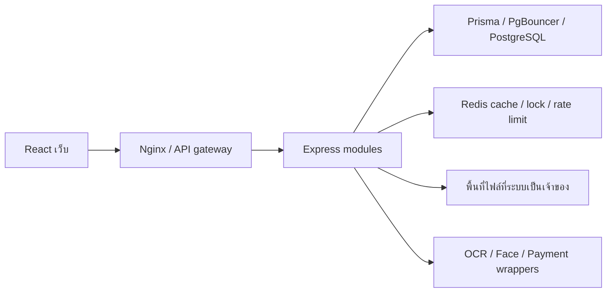

# 4.12 การติดตั้ง ข้อมูล ความปลอดภัย และสมรรถนะ

## 1. โครงสร้างที่ใช้จริง

### เทคโนโลยีหลัก แยกตามประเภท

ตารางนี้เลือกเฉพาะส่วนหลักที่มีหน้าที่ในระบบจริง ไม่ใช่รายการ dependency ทั้งหมด คำว่า Technology stack หมายถึงภาพรวมของเทคโนโลยีหลายประเภทที่ใช้ร่วมกัน ไม่ใช่ประเภทเดียวกับ Framework หรือเครื่องมือ

| ประเภท | ส่วนหลักที่ใช้ | หน้าที่ในโครงการ |
|---|---|---|
| ภาษา | TypeScript | เขียนโปรแกรมของระบบพร้อมตรวจชนิดข้อมูล |
| Runtime | Node.js | รันบริการของระบบ |
| Web framework | Express.js | จัดการ HTTP API, routes และ middleware |
| UI library | React | สร้างหน้าจอ Admin, User และ Visitor |
| เครื่องมือพัฒนาและ build เว็บ | Vite | รันเว็บระหว่างพัฒนาและสร้างไฟล์เว็บสำหรับติดตั้ง |
| ฐานข้อมูลหลัก | PostgreSQL 16 | เก็บข้อมูลผู้ใช้ ผู้พัก บิล งานซ่อม และผู้มาติดต่อ |
| ORM | Prisma | เชื่อมต่อฐานข้อมูล จัดการ query และ schema/migration |
| ระบบเก็บข้อมูลชั่วคราว | Redis | Cache, rate limit และ lock; ไม่แทนฐานข้อมูลหลัก |
| Library การสื่อสาร | Axios, Socket.IO | ส่งคำขอ HTTP จากเว็บ และอัปเดตข้อมูลแบบ real-time |
| Library กราฟ | Recharts | แสดงกราฟ Dashboard และรายงาน |
| เครื่องมือติดตั้งระบบ | Docker และ Docker Compose | จัดสภาพแวดล้อมและบริการตาม Compose ของโครงการ |

React จัดเป็น UI library และ Vite เป็นเครื่องมือพัฒนา/build จึงไม่เรียกรวมทั้งหมดว่า Framework รายละเอียด package ย่อยให้ดูในโค้ดเมื่อเกี่ยวข้องกับโมดูลนั้น เช่น validation และการอัปโหลด ไม่แยกเอกสารสำหรับทุก package ส่วน OCR/Face/Payment เป็นบริการที่ระบบเชื่อมต่อผ่าน wrapper ไม่ใช่ engine ที่ระบบหอพักพัฒนาขึ้นเอง

หลักฐานการใช้งาน: [รายการ package](../../package.json), [Express app](../../src/app.ts), [Prisma client](../../src/database/db.ts), [Redis client](../../src/shared/redis.ts) และ [Compose](../../docker-compose.yml) ฝั่งเว็บตรวจจาก `../smart-dormitory-frontend/package.json`, `src/services/api.ts`, `src/services/realtime.ts` และ component กราฟของเว็บ

ระบบใช้ TypeScript ร่วมกับ React สำหรับหน้าจอ Express สำหรับ HTTP API และ Node.js สำหรับรันบริการ จัดงานเป็น modular monolith ตามโมดูล PostgreSQL เก็บข้อมูลหลัก Redis สนับสนุนงานชั่วคราว ส่วน Compose จัดบริการฐานข้อมูล cache การเชื่อมต่อและบริการที่เกี่ยวข้อง

**ขอบเขตการติดตั้งจริง:** Compose ปัจจุบันยังไม่ได้รวมเว็บเป็น service จึงระบุการรันเว็บผ่าน Vite/ไฟล์ build ตามการติดตั้งจริง แผนภาพแสดงองค์ประกอบที่ทำงานร่วมกันในระบบเดียว



## 2. ฐานข้อมูลและไฟล์

PostgreSQL เป็นแหล่งหลักของบัญชี ผู้พัก บิล งานซ่อม Visitor และผลธุรกรรม Redis ไม่แทนข้อมูลเหล่านี้ รูปบัตร/สลิป/ใบหน้าอ้าง path ในฐานข้อมูล ไม่เก็บเป็น binary ทั้งหมด การสำรองต้องครอบคลุมฐานข้อมูลและ volume ภาพ ณ ช่วงที่สอดคล้องกัน

purge ใช้ transaction ลบข้อมูลสัมพันธ์ แล้วสร้าง durable job ล้างไฟล์/ภายนอก Worker retry และตรวจ reference ก่อน unlink คืน COMPLETE เมื่อสำเร็จ คิว DONE เป็น metadata ยืนยันการล้าง ไม่ใช่ข้อมูลภาพที่เหลืออยู่

บัญชีไม่ใช้ 1 ปีนับ lastLogin ที่สำเร็จ หรือ createdAt ถ้าไม่เคย login ไม่ใช้ heartbeat ไม่มีแจ้งเตือนล่วงหน้า Worker retention ต้องเปิดโหมดตาม environment มี dry-run/delete และ guard ไม่ลบ Admin/รายการค้าง การมี implementation ไม่ยืนยันว่าเปิด annual deletion ใน runtime ปัจจุบัน

## 3. การตั้งค่าและการส่งมอบ

Admin ดูแลราคา/ห้อง คณะ และเงื่อนไข CONTRACT: สถานที่ทำสัญญา ชื่อ/ที่อยู่/เบอร์ผู้ให้เช่า อาคาร เงินประกันคีย์การ์ด วันกำหนดชำระ อัตราไฟ อัตราน้ำ และจำนวนวันแจ้งล่วงหน้า วันเริ่ม/สิ้นสุดใบสมัครใหม่คำนวณอัตโนมัติ ไม่ต้องกรอกเอง

ไฟล์ `.env` เก็บการเชื่อมต่อ/secret ไม่แนบค่าจริงในเล่มหรือ repository build ไม่เปลี่ยน Docker image อัตโนมัติ เมื่อแก้บริการต้อง build/redeploy และตรวจ runtime ซ้ำ การลง migration ต้องทำก่อนใช้ schema ใหม่ ไม่ใช้ reset DB เพื่อทำ demo

## 4. ความปลอดภัยที่ตรวจได้

ความยินยอม HOUSING/FACE_ENROLLMENT เก็บใน AccessLog พร้อม purpose/version/เวลา server ไม่ต้องเพิ่ม schema เมื่อ deploy ต้องอัปเดตทั้งหน้าจอและ API ให้ตรงกัน ผู้พักเก่าไม่มีหลักฐานจะต้องอ่านและยินยอมก่อนเก็บข้อมูลใหม่

Session ผ่าน HttpOnly cookie และตรวจ role/owner ที่ API; Socket ตรวจ session version; DTO ตรวจ input; payment มี idempotency/hash/transaction checks; upload จำกัดประเภท/ขนาด; deletion ป้องกัน path traversal/reference ที่ยังใช้; error response ใช้ wrapper ตาม flow

ผลเหล่านี้ไม่ใช่ penetration test ครบทุก attack surface ไม่มีหลักฐานว่าปลอดภัยทุกกรณี ต้องทบทวน dependency, TLS, secret, public port และ backup/restore ตาม environment ก่อน production ปัจจุบัน compose มี published ports ของบางบริการ จึงไม่สรุปว่าปิดจากภายนอกทั้งหมด

## 5. Cache และสมรรถนะ

Redis มี utility JSON cache/TTL และ invalidate รวมถึง OCR verification list; cache เป็นสำเนาอ่านได้ใหม่ การมี cache ไม่ยืนยันว่าเร็วขึ้นกี่เปอร์เซ็นต์ หากต้องเปรียบเทียบต้องวัดก่อน/หลังด้วย payload/จำนวนข้อมูลเท่ากัน

RPS = จำนวน request/เวลาทดลอง (วินาที); TPS = จำนวน transaction สำเร็จ/เวลาเดียวกัน ทั้งสองอาจไม่เท่ากันหากมีคำขอล้มเหลว อ่านอย่างเดียว หรือหลายรายการในคำขอเดียว

| ผลล่าสุดใน artifact 13 ต.ค. 2569 | ค่า |
|---|---|
| Visitor synthetic registrations | 12 คำขอ |
| Concurrency | 4 |
| PostgreSQL rows/logs ที่ commit | 12/12 |
| RPS | ประมาณ 77.67 |
| TPS | ประมาณ 77.67 |

เป็น bounded local integration ช่วงสั้น ไม่รวม gateway/OCR/payment จริง ไม่ใช่ sustained capacity หรือ SLA ตัวเลข snapshot เก่าใน QA อาจต่างกัน ให้ใช้ [artifact ล่าสุด](../../tests/load/logs/2026-10-13/final_report.md) ร่วมกับ [stats](../../tests/load/logs/2026-10-13/stats.csv) ไม่เลือกเฉพาะค่าที่สูงสุด

## 6. ผลตรวจและวิธีรัน

ผลล่าสุดที่บันทึก: การทดสอบกฎธุรกิจ/API unit/mock 185/185 และ logic/สถานะหน้าจอ 119/119 (14 ต.ค. 2569); isolated maintenance-flow 38/38 เป็นผลก่อนหน้า, Build/TypeScript/lint ผ่าน และ การ deploy บริการผ่าน Docker ผ่าน ไม่ได้นำเลขชุดอื่นมาบวกเป็นการรันพร้อมกันรอบเดียว

```powershell
# รันจาก repository ปัจจุบัน
npm.cmd run build
npm.cmd run test:typecheck
npm.cmd test
# รันจาก ../smart-dormitory-frontend
npm.cmd run build
npm.cmd run lint
npm.cmd test
```

Integration ต้องใช้ฐานแยกที่ชื่อและ host ผ่าน guard ของแต่ละ suite พร้อม migration ห้ามรัน fixture/load/write tests กับฐานใช้งานจริง คำสั่งสร้างเอกสารครั้งนี้ไม่ได้รัน load test หรือแก้ schema เพิ่ม

## 7. หลักฐานและรูป

ใช้ diagram ข้างต้น ภาพสถานะ container แบบไม่แสดง environment/secret และตารางผลทดสอบ ไม่ใช้ภาพ `.env` จริง ผล backup/restore ยังไม่มีรายงานทดลองรับรองในชุดนี้

- [Compose](../../docker-compose.yml), [Schema](../../prisma/schema.prisma), [Cache](../../src/shared/cache.ts)
- [Retention worker](../../src/workers/accountRetentionWorker.ts), [Retention service](../../src/modules/users/account-retention.service.ts)
- [QA](../qa/system-flow-report.md), [ผล bounded load](../../tests/load/logs/2026-10-13/final_report.md)
