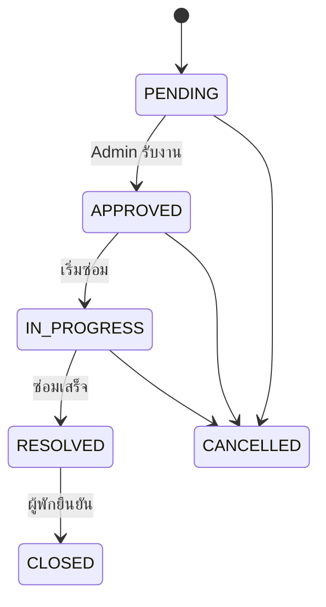

# 4.6 การพัฒนาระบบแจ้งซ่อมบำรุง

## 1. หน้าที่และสิทธิ์

ผู้พักที่มีสิทธิ์ active และมีห้องส่งงานซ่อมของห้องตนเองได้ Admin อ่านภาพรวมและเปลี่ยนสถานะงาน ผู้พักยืนยันปิดงานของตนเองได้เมื่อซ่อมเสร็จ ระบบตรวจ ownership ไม่ให้ส่ง roomId คนอื่นหรือยืนยันงานของผู้อื่น

## 2. หน้าจอและ flow

ฟอร์มรับประเภท รายละเอียด เวลาติดต่อ และภาพแนบ หลังส่งแสดงรายการ/รายละเอียดพร้อมสถานะเดียวกันทั้ง User/Admin แรกโหลดใช้ Skeleton ส่งหรือเปลี่ยนสถานะใช้ spinner และป้องกันกดซ้ำ

APPROVED/IN_PROGRESS ยังเป็นงานค้าง RESOLVED หมายถึงซ่อมเสร็จรอผู้พักยืนยัน CLOSED/CANCELLED เป็นปลายทางที่ไม่เปิดให้แก้/ลบตาม guard มีการย้อน APPROVED → PENDING และ IN_PROGRESS → APPROVED สำหรับการแก้ไขตาม state transition ที่กำหนด

## 3. โควตาและภาพแนบ

จำกัดการสร้างสำเร็จ 3 รายการต่อวันตามเวลาไทย ล็อกข้อมูลบัญชีและบันทึก AccessLog ของรายการสำเร็จ การลบงานไม่คืนโควตา และ rate limit ต่อคำขอเป็นคนละเงื่อนไขกับโควตารายวัน

ภาพอัปโหลดเป็น staged upload มีเจ้าของและอายุ ต้องผูกกับงานของบัญชีนั้น ระบบเก็บกวาดภาพที่ไม่ถูกใช้ และ purge ส่งภาพงานซ่อมเข้าสู่คิวล้าง ต้องปฏิเสธ path traversal/symlink ไม่ปลอดภัย และไม่ลบไฟล์ที่ยังมีเจ้าของอื่นอ้างอิง

## 4. API และข้อมูล

MaintenanceTicket เชื่อม Tenant/Room มีประเภท รายละเอียด เวลาติดต่อ note และสถานะ ภาพอาจอ้างผ่าน marker ใน description ตามรูปแบบปัจจุบัน ไม่ควรอธิบายว่าเป็นตารางเอกสารแยกหากไม่มีใน schema

| Method / endpoint | การทำงาน |
|---|---|
| POST `/api/maintenance` | สร้างงานเจ้าของ |
| GET `/api/maintenance` | User เฉพาะตนเอง/Admin ภาพรวม |
| POST `/api/maintenance/upload` | แนบภาพชั่วคราว |
| PATCH `/api/maintenance/:id/status` | Admin เปลี่ยนสถานะ |
| POST `/api/maintenance/:id/confirm` | STUDENT ยืนยันงานตนเอง |
| DELETE `/api/maintenance/:id` | Admin ภายใต้ guard |

## 5. แจ้งเตือนและการจบงาน

Admin รับแจ้งเตือนงานใหม่รอรับงาน ข้อความตอนสร้างงานไม่ใช้ MAINTENANCE_COMPLETED ผู้พักเห็นสถานะของตนเองและข้อความ “ซ่อมเสร็จ รอคุณยืนยัน” เมื่อ RESOLVED การกดปิดงานซ้ำไม่สร้างผลซ้ำ การที่ Admin ซ่อมเสร็จไม่เท่ากับผู้พักยอมรับแล้ว

## 6. ผลทดสอบ

| กรณี | ผล | หลักฐาน |
|---|---|---|
| ส่งงานห้องอื่น/ไม่มี active room | ปฏิเสธ | IT |
| ส่งพร้อมกัน 4 คำขอ | สำเร็จไม่เกินโควตา 3 | IT |
| รับงานถึง RESOLVED | สถานะเปลี่ยนตามกฎ | IT/RT ตาม QA |
| ผู้พักยืนยันงาน #248 | CLOSED | UA และ RT ตรวจ DB |
| แก้/ลบงานจบแล้ว | 409 ไม่เปลี่ยนข้อมูล | UT/IT/RT |
| ยืนยันงานคนอื่น | ปฏิเสธ ownership | IT |
| ลบผู้พักหลังจบงาน | Ticket 248 หายจาก DB | RT |

## 7. รูปและหลักฐาน

ภาพที่ควรใช้: ฟอร์มแจ้งซ่อม รายละเอียดภาพแนบ หน้ารับงาน Admin และ User เห็น RESOLVED/CLOSED ใช้ข้อมูลทดสอบและไม่เปิดเบอร์ติดต่อจริง

- [Service](../../src/modules/maintenance/maintenance.service.ts), [Repository](../../src/modules/maintenance/maintenance.repository.ts), [Routes](../../src/modules/maintenance/maintenance.routes.ts)
- [Unit](../../tests/unit/maintenance.test.ts), [Integration](../../tests/integration/maintenance-flow.test.ts)
- [QA](../qa/system-flow-report.md), [Notifications](notifications-and-realtime.md)
