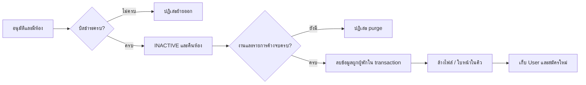

# 4.3 การพัฒนาบัญชีผู้ใช้ ผู้พัก และสัญญา

## 1. หน้าที่และข้อมูลสัมพันธ์

User คือบัญชีเข้าระบบ Tenant คือข้อมูลการสมัคร/เข้าพักซึ่งเชื่อม User กับ Room การลบผู้พักจึงไม่จำเป็นต้องลบบัญชี และบัญชีเดิมสมัครใหม่ได้ ผู้ดูแลจัดการ User และอนุมัติ Tenant ส่วน User อ่านและส่งข้อมูลของตนเอง

ข้อมูลร่วมประกอบด้วย HousingApplicationDraft, IdCardVerification, Payment, Tenant, Room และ SystemSetting หมวด CONTRACT การเก็บ draft ที่ server ช่วยให้รีเฟรชแล้วกลับมาทำต่อ ไม่อาศัยเฉพาะ state ของ React

## 2. หน้าจอและ flow สมัคร 4 ขั้น

| ขั้น | ข้อมูล/การทำงาน | จุดตรวจ |
|---|---|---|
| 1 ตัวตนและข้อมูลส่วนตัว | วางบัตรให้ OCR ทำงานอัตโนมัติ ตรวจแก้ชื่อ วันเกิด เลขบัตร ที่อยู่ คณะ รหัสนักศึกษาและชั้นปี | รูปและ verification ต้องผูกเจ้าของ; ข้อมูลจำเป็นครบ |
| 2 ผู้ติดต่อฉุกเฉิน | ชื่อ ความสัมพันธ์ เบอร์ติดต่อ | ไม่ใช้เบอร์ฉุกเฉินแทนเบอร์บัญชี |
| 3 ห้องและชำระเงิน | เลือก/สุ่มห้อง สร้าง QR วางสลิป ตรวจยอดเครดิต | ตรวจห้อง ราคา และยอดที่ server |
| 4 สัญญาและยืนยัน | ดึงข้อมูลจากขั้นก่อน ตรวจสัญญาและ consent แล้วส่ง | snapshot ต้องตรงเงื่อนไขปัจจุบัน |

ช่องหลักสูตรถูกนำออกจากฟอร์มปัจจุบัน ผู้ใช้พิมพ์ค้นหาคณะจากรายการที่ Admin ดูแล ไม่ใช่ dropdown หลักสูตร การแสดงข้อมูลชื่อ/ที่อยู่บนสัญญาเป็นการตรวจทาน ไม่ต้องกรอกชุดเดียวกันใหม่ เบอร์บัญชีไม่แสดงเป็นช่องซ้ำในส่วนข้อมูลส่วนตัว แต่ backend ยังใช้ User.phone

เมื่อส่งสำเร็จ Tenant รอผู้ดูแลพิจารณา การชำระสลิปผ่านไม่ใช่การอนุมัติสิทธิ์พัก ระบบจึงแยกการอนุมัติและการยืนยันรายได้มัดจำ

## 3. สัญญา

Admin กรอกเงื่อนไขส่วนกลางใน SystemSetting หมวด CONTRACT เหลือ 10 ช่องที่ระบบกำหนด ไม่ใช้ค่าตัวอย่างเป็นข้อมูลจริง ค่าเช่า/มัดจำอ้างราคาห้องและตรวจที่ server

วันเริ่มสัญญาใหม่คือวันปัจจุบัน Asia/Bangkok วันสิ้นสุดบวก 5 เดือนปฏิทิน หากไม่มีวันนั้นในเดือนปลายทางใช้วันสุดท้ายของเดือน ไม่ต้องกรอกสองวันนี้ใน Admin หากข้ามวันก่อนยืนยันต้องโหลด terms ล่าสุด สัญญาที่ส่งแล้วคง snapshot และไม่เปลี่ยนตาม settings รอบใหม่

## 4. ย้ายออก ลบ และสมัครใหม่

guard ห้ามลบรายการที่ยังพักอยู่ บิลไม่ PAID งานซ่อมยังไม่ CLOSED/CANCELLED ธุรกรรมค้าง ผู้มาติดต่อยังไม่จบ หรือบิลรวมกับคนอื่น กรณี QR placeholder PENDING จะลบพร้อม purge ได้เฉพาะของเจ้าของเดียว ทุกบิล PAID และไม่มีหลักฐานสลิป/การโอน/provider เลย ไม่เปลี่ยนสถานะการเงินให้สำเร็จเพื่อให้ลบผ่าน

purge ปัจจุบันลบบิล/ยอดการเงินที่ผูกจริง ไม่สร้างบิลนิรนามหรือ Tenant ARCHIVED แทนการลบ คืน 202 ขณะคิวล้างยังทำงาน และต้องตรวจ COMPLETE ก่อนกล่าวว่าไฟล์หายหมด การอนุมัติใบสมัครใหม่คืนสิทธิ์ลงทะเบียนใบหน้าเฉพาะเมื่อ cleanup เดิม DONE และไม่มีภาพ/template เก่า

## 5. API สำคัญ

| Endpoint | บทบาท |
|---|---|
| GET/PATCH `/api/tenants/draft` | อ่าน/บันทึก draft เจ้าของ |
| POST `/api/tenants/draft/upload-identity` | ผูกเอกสารกับ draft |
| POST `/api/tenants/apply` | ตรวจและส่งใบสมัคร |
| GET `/api/tenants/me` | อ่าน Tenant ของบัญชี |
| GET `/api/tenants/me/documents/:documentType` | อ่านเอกสารของตัวเอง |
| GET `/api/tenants`, PATCH/DELETE `/api/tenants/:id` | Admin จัดการผู้พัก |
| GET `/api/tenants/:id/documents/:documentType` | Admin อ่านเอกสารตามสิทธิ์ |

## 6. ผลทดสอบ

| กรณี | ผล | หลักฐาน |
|---|---|---|
| รีเฟรช draft/เครดิต และเปลี่ยนห้อง | server คืนข้อมูลและคำนวณส่วนต่าง | IT พร้อม mock provider |
| ย้ายออกขณะบิลค้าง | 409 ไม่เปลี่ยนสิทธิ์พัก | RT |
| ย้ายออกหลังชำระ | 200 INACTIVE และ roomId null | RT Tenant #67 |
| ลบชุดข้อมูล | 202 ตามด้วย COMPLETE 11/11 | RT |
| ตรวจ DB และไฟล์ | ข้อมูลผูกเจ้าของ 0, ไฟล์หาย 10/10, User 1 | RT |
| สมัครใหม่ด้วยบัญชีเดิม | ผู้ใช้ยืนยันสมัครใหม่ได้ | UA |
| อนุมัติเมื่อ cleanup ใบหน้ายังไม่เสร็จ | 409 แล้วรอจน DONE จึงอนุมัติ | IT ไม่ใช่การทดสอบกล้องจริง |

## 7. รูปประกอบและแหล่งข้อมูล

ใช้ภาพสมัครครบ 4 ขั้น หน้าสัญญา หน้ารายชื่อก่อน/หลังย้ายออก และสถานะ cleanup ปิดข้อมูลบัตร ชื่อจริง และเบอร์ส่วนตัว ภาพสัญญาตัวอย่างต้องมีคำกำกับว่าเป็นข้อมูลทดสอบ

- [Tenant service](../../src/modules/tenants/tenants.service.ts), [DTO](../../src/modules/tenants/tenants.dto.ts), [Repository](../../src/modules/tenants/tenants.repository.ts)
- [Purge/retention](../../src/modules/users/account-retention.service.ts), [Integration](../../tests/integration/maintenance-flow.test.ts)
- [QA หลัก](../qa/system-flow-report.md), [การชำระ](billing-and-payments.md), [ใบหน้า](face-verification.md)

## การยืนยันข้อมูลส่วนบุคคลก่อนเริ่มสมัคร (14 ต.ค. 2569)

ก่อนโหลดฟอร์มและส่งบัตร OCR ผู้ใช้ต้องอ่านคำชี้แจงและกดยินยอม HOUSING ช่องเลือกเริ่มต้นไม่ถูกเลือก การยินยอมนี้แยกจากการยอมรับสัญญาในขั้นสุดท้าย และไม่ครอบคลุมการบันทึกใบหน้า

คำชี้แจงระบุข้อมูลที่ใช้ วัตถุประสงค์การสมัคร/สัญญา การส่งเอกสารไปบริการที่จำเป็น ผู้มีสิทธิ์เข้าถึง แนวทางล้างข้อมูล และการติดต่อผู้ดูแล ผู้สมัครต้องแจ้งผู้ติดต่อฉุกเฉินก่อนให้ข้อมูลของเขา

หลักฐานเก็บใน AccessLog เดิม โดย method=CONSENT, path=privacy-consent/HOUSING/2026-10-14.v1 ผูก User และ createdAt จาก server ไม่ใช้เพียง localStorage การรีเฟรชอ่านหลักฐานเดิมได้ การกดซ้ำใช้ล็อกบัญชีใน transaction และไม่สร้างรายการซ้ำ เมื่อ purge ผู้พัก หลักฐานที่ผูก User ถูกล้างพร้อม AccessLog ทำให้สมัครใหม่ต้องยินยอมใหม่

API บันทึกฉบับร่าง สร้าง QR อัปโหลดบัตร/สลิป และยื่นใบสมัครตรวจหลักฐานก่อนทำงาน แม้เรียกตรงโดยไม่ผ่านหน้าจอก็ไม่ได้สิทธิ์จากการส่ง pdpaConsent=true เอง ความยินยอมที่บันทึกผูกเฉพาะบัญชีปัจจุบัน Admin ยินยอมแทนเจ้าของผ่าน endpoint นี้ไม่ได้
